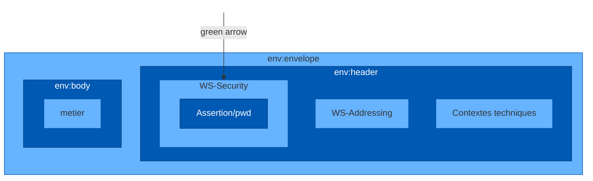

# **Exemple de contexte BAM**

```xml
<urn:ContexteBAM Version="01_02">
  <urn:Id>_24f12ad0-b6af-4cc9-a948-3d1b3ca5efaa</urn:Id>
  <urn:Temps>2014-03-18T12:00:00.00Z</urn:Temps>
  <urn:Emetteur>500000000016261/CDET0001</urn:Emetteur>
  <urn:COUVERTURE>
    <urn:GrandRegime>01</urn:GrandRegime>
    <urn:Organisme>261</urn:Organisme>
    <urn:CodeCentre>9880</urn:CodeCentre>
    <urn:ASSURE>
      <urn:Id>
        <urn:Num>1650163220102</urn:Num>
        <urn:Cle>18</urn:Cle>
      </urn:Id>
    </urn:ASSURE>
    <urn:BENEFICIAIRE>
      <urn:DateNai>1961-01-01</urn:DateNai>
      <urn:Rang>1</urn:Rang>
    </urn:BENEFICIAIRE>
  </urn:COUVERTURE>
</urn:ContexteBAM>
```




24

Présentation de cadre d'interopérabilité
15/01/2016
