# **Facturation Transporteur**

## *Spécifications Fonctionnelles Générales*

# **Facturation Transporteur**

## **Constituer et transmettre les traces de géolocalisation**

### **Taxi**

VERSION DE TRAVAIL

Référence : FACT-SFG-039 / Version : 1.08 / Date : 16/07/2026
Diffusion : RESTREINTE
État : REFERENCE

**GIE SESAM-Vitale**
5, boulevard Marie et Alexandre Oyon – 72 019 LE MANS CEDEX 2
<u>www.sesam-vitale.fr</u>

Ce document a été élaboré par le GIE SESAM-Vitale.

Conformément à l’article L.122-4 du Code de la Propriété Intellectuelle, toute représentation ou reproduction (intégrale ou partielle) du présent ouvrage, quel que soit le support utilisé, doit être soumise à l’accord préalable écrit de son auteur.

Il en est de même pour sa traduction, sa transformation, son adaptation ou son arrangement, quel que soit le procédé utilisé.

**Tout manquement à ces obligations constituerait un délit de contrefaçon, au sens des **articles L 335-2 et suivants du code de la propriété intellectuelle, susceptible d’entraîner** des sanctions pour l’auteur du délit.**

## **CONTACTS**


Pour toute demande d'évolution, comme pour toute question technique ou fonctionnelle, contactez le Centre de services :

*   portail IRIS : [https://portail-support.sesam-vitale.fr/](https://portail-support.sesam-vitale.fr/)
*   téléphone : 02 43 57 42 88

VERSION DE TRAVAIL

*FACT-SFG-039*
*SFG - Facturation Taxi*
*GE - Constituer et transmettre les traces de géolocalisation*
*Version : 1.08*

## **SOMMAIRE**

| 1 | INTRODUCTION......................................................................................................................................... | 4 |
| --- | --- | --- |
| 1.1 | OBJECTIF DU DOCUMENT ..................................................................................................................... | 4 |
| 1.2 | STATUT DU DOCUMENT........................................................................................................................ | 4 |
| 1.3 | CONTENU DU DOCUMENT..................................................................................................................... | 4 |
| 1.4 | DOCUMENTS DE RÉFÉRENCE ............................................................................................................... | 4 |
| 2 | PRÉSENTATION GÉNÉRALE................................................................................................................... | 5 |
| 2.1 | INTRODUCTION.................................................................................................................................... | 5 |
| 2.2 | ACTEURS ET OBJECTIFS MÉTIERS......................................................................................................... | 7 |
| 2.3 | DESCRIPTION GÉNÉRALE DU PROCESSUS ........................................................................................... | 10 |
| 3 | DESCRIPTION DÉTAILLÉE DU PROCESSUS ...................................................................................... | 11 |
| 3.1 | FONCTION « GE01 – CONSTITUER LES TRACES DE GÉOLOCALISATION » ............................................. | 11 |
| 3.2 | FONCTION « GE02 – COMPLÉTER LA FACTURE » ............................................................................... | 21 |
| 3.3 | FONCTION « GE03 – TRANSMETTRE LES TRACES DE GÉOLOCALISATION » .......................................... | 23 |
| 3.4 | FONCTION « GE04 – ADMINISTRER LES TRACES DE GÉOLOCALISATION » ............................................ | 26 |
| 4 | SYNTHÈSE DES ENTITÉS FONCTIONNELLES.................................................................................... | 28 |

### **TABLE DES ILLUSTRATIONS**

| FIGURE 1 : PROCESSUS SIMPLIFIÉ DE LA FACTURATION TAXI.................................................................................... | 5 |
| --- | --- |
| FIGURE 2 : PÉRIMÈTRE DES SPÉCIFICATIONS.......................................................................................................... | 6 |
| FIGURE 3 : ILLUSTRATION DES RÉPARTITIONS DES FONCTIONS D’UN LPS................................................................. | 7 |
| FIGURE 4 : ACTEURS ET OBJECTIFS MÉTIERS.......................................................................................................... | 9 |
| FIGURE 5 : PROCESSUS GLOBAL DE CONSTITUTION ET TRANSMISSION DES TRACES DE GÉOLOCALISATION............... | 10 |
| FIGURE 6 : FONCTION GE01 - CONSTITUER LES TRACES DE GÉOLOCALISATION ..................................................... | 12 |
| FIGURE 7 : FONCTION GE02 - COMPLÉTER LA FACTURE ....................................................................................... | 22 |
| FIGURE 8 : FONCTION GE03 - TRANSMETTRE LES TRACES DE GÉOLOCALISATION .................................................. | 24 |
| FIGURE 9 : ALGORITHME D’AUTORISATION DE LA TRANSMISSION DES TRACES DE GÉOLOCALISATION ....................... | 25 |
| FIGURE 10 : SYNTHÈSES DES ENTITÉS FONCTIONNELLES ...................................................................................... | 28 |

### **TABLE DES ANNEXES**

| ANNEXE 1 | GUIDE DE LECTURE .....................................................................................................31 |
| --- | --- |
| ANNEXE 2 | MISE À JOUR DE LA NORME B2 .................................................................................33 |
| ANNEXE 3 | SCHÉMA XML DU FICHIER DE TRACES.....................................................................34 |

VERSION DE TRAVAIL

*16/07/2026*
3 / 36
*Ce document à diffusion restreinte ne peut être diffusé sans l'autorisation d'une personne habilitée*


*FACT-SFG-039*
*SFG - Facturation Taxi*
*GE - Constituer et transmettre les traces de géolocalisation*
*Version : 1.08*

# **1 INTRODUCTION**

## **1.1 Objectif du document**

Ce document a pour but de spécifier le processus « Constituer et transmettre les traces de géolocalisation » associées à une facture de transport.

Ce document constitue le cahier des charges technique à destination des éditeurs de logiciels de facturation pour les sociétés de taxi conventionnées [CNV2025].

## **1.2 Statut du document**

## **1.3 Contenu du document**

Outre ce chapitre introductif, ce document de spécifications fonctionnelles générales présente les opérations :

* de constitution des traces de géolocalisation associées à une facture transport,
* de modification du processus de facturation permettant d’inclure dans la facture les informations liées à la géolocalisation,
* de transmission des traces de géolocalisation vers l’assurance maladie,
* d’administration de la constitution et la transmission des traces de géolocalisation.

## **1.4 Documents de référence**

| Appellation | Type et titre | Référence |
| --- | --- | --- |
| [B2-2007] | Norme B2 inter-régime | Juin 2007 |
| [B2-2005] | Norme B2 inter-régime | Novembre 2005 |
| [SEFI] | Documentation éditeurs pour le téléservice SEFi transport | Cf. Espace Industriels |
| [CNV2025] | Convention-cadre nationale relative à l’établissement d’une convention-type entre les entreprises de taxi et les organismes locaux d’Assurance Maladie¹ | Cf. ameli.fr |

<sup>1</sup> Arrêté du 29 juillet 2025 portant approbation de la convention-cadre nationale relative à l'établissement d'une convention-type entre les entreprises de taxi et les organismes locaux d'Assurance maladie

VERSION DE TRAVAIL

*16/07/2026*
4 / 36
*Ce document à diffusion restreinte ne peut être diffusé sans l'autorisation d'une personne habilitée*


*FACT-SFG-039* *GE - Constituer et transmettre les traces de géolocalisation* *SFG - Facturation Taxi* *Version : 1.08*

# **2 PRÉSENTATION GÉNÉRALE**

## **2.1 Introduction**

### **Contexte**

La fiabilisation de la facturation repose sur l’intégration du dispositif de géolocalisation introduit par la convention-cadre nationale de 2025.

```mermaid
graph TD
    subgraph Step1 [1]
        S1_Icons["![icon: Bénéficiaire de soins](page_5_image_2_v2.jpg) ![icon: Écran et document](page_5_image_2_v2.jpg) ![icon: Médecin Prescripteur](page_5_image_2_v2.jpg)"]
        S1_Text["Un médecin ou établissement de santé prescrit à un patient un transport. Il lui remet la prescription générateur de la prise en charge (identification du malade à transporter, lieu de prise en charge et destination, etc.)"]
    end

    subgraph Step2 [2]
        S2_Text["Le patient remet la prescription au taxi et éventuellement l'entente préalable."]
    end

    subgraph Step3 [3]
        subgraph S3_Detail [3]
            S3D_Text["Le taxi récupère les éléments relatifs au transport effectué :
            - La prescription et l'entente préalable éventuelle
            - L'identification du bénéficiaire de soins
            - L'identification du véhicule utilisé et du conducteur
            - Les caractéristiques du trajet effectué (lieu de prise en charge, destination, kilométrage parcouru...)"]
        end
        
        subgraph S3_Action [3]
            S3A_Icons["![icon: Bénéficiaire de soins](page_5_image_2_v2.jpg) ![icon: Taxi (véhicule)](page_5_image_2_v2.jpg) ![icon: taxi (personne)](page_5_image_2_v2.jpg) ![icon: Document](page_5_image_2_v2.jpg)"]
            S3A_Text["Le taxi réalise la prise en charge et le transport du malade"]
        end
    end

    subgraph Step4 [4]
        S4_Icons["![icon: Bénéficiaire de soins absent (barré)](page_5_image_2_v2.jpg) ![icon: Écran et document](page_5_image_2_v2.jpg) ![icon: taxi (personne)](page_5_image_2_v2.jpg)"]
        S4_Text["Le taxi effectue la facturation des trajets effectués (facture et annexes)"]
    end

    subgraph Step5 [5]
        S5_Text["Le taxi transmet ses factures, les pièces justificatives et les traces de géolocalisation vers l'assurance maladie."]
        S5_Icon["![icon: Bâtiment Assurance Maladie (AMO)](page_5_image_2_v2.jpg)"]
    end

    Step1 --> Step2
    Step2 --> S3_Action
    S3_Action --> S3_Detail
    S3_Detail --> Step4
    Step4 --> Step5
```



**Figure 1 : Processus simplifié de la facturation taxi**

### **Principes**

Le système de constitution et de transmission des traces de géolocalisation s’appuie sur les principes suivants :

*   L’utilisation par le taxi de la facturation B2 ou de la facturation en ligne (SEFi).
    *   La facturation B2 et la facturation en ligne (SEFi) sont exclusives l’une de l’autre. S’il s’agit d’une facture B2, seules les données relatives à cette facture doivent être renseignées dans les traces de géolocalisation. S’il s’agit d’une facture SEFi seules les données relatives à la FEL doivent être renseignées dans les traces de géolocalisation.
    *   Le taxi a la possibilité de passer d’une facture SEFI à une facture B2 comme indiqué dans la documentation SEFI.
*   Le fichier de trace de géolocalisation est une pièce complémentaire à la facture, non intégré à la facture B2 ou la facture en ligne (FEL).
*   La transmission des traces de géolocalisation se fait vers le point d’accueil des traces de géolocalisation.
*   En cas de facture B2, la version de norme de facturation pouvant être utilisée est a minima la version B2 2005-B ou version supérieure (cf. document [B2-2005]).
*   Ce cahier des charges intègre la facturation en ligne (SEFi).

*16/07/2026* *5 / 36*
*Ce document à diffusion restreinte ne peut être diffusé sans l'autorisation d'une personne habilitée*


*SFG - Facturation Taxi*
*FACT-SFG-039* *GE - Constituer et transmettre les traces de géolocalisation* *Version : 1.08*

*   En cas de facture en ligne (FEL), la version de SEFi pouvant être utilisée est a minima la prochaine version définitive de SEFi Taxi (cf. documentation [SEFI]).

## **Périmètre**

Ces spécifications portent sur les modalités de constitution et de transmission des traces de géolocalisation des trajets facturés (cf. fonctions GE01 et GE03, respectivement décrites au §3.1 et au §3.3), ainsi que sur le complément de la facturation associé à cette géolocalisation (cf. fonction GE02 décrite au §3.2).

## **Hors périmètre**

Ne sont pas spécifiées dans cette version de spécification l’identification et la transmission de l’identification de l’assuré et bénéficiaire de soins dans les traces de géolocalisation. Ces données sont actuellement renseignées uniquement dans la facture et certaines pièces justificatives. Les traces de géolocalisation ne contiennent pas ces données et font référence à la facture correspondante.

Ne sont pas spécifiées dans ce document :

*   Les modalités de mise à jour du parc des véhicules utilisés et des personnels associés dans les bases de l’assurance maladie.
*   Les modalités de mise en place du système de géolocalisation par la société de taxi ainsi que les modalités de récupération des données de géolocalisation (position GPS enregistrées) dans le LPS du taxi.

Le périmètre de ces spécifications est illustré par le schéma suivant :

**Véhicule**
(équipé d’un boitier de géolocalisation)


**Enregistrement des positions GPS de tous les trajets** (dans un bloc bleu) $\rightarrow$ (vers le cadre orange)

---

**Périmètre des spécifications** (cadre orange)

**Poste de travail**
 $\rightarrow$ **Fichier trace géoloc** (bloc bleu)

(Lien en pointillés entre les deux blocs suivants)

**Facture B2 ou FEL** (bloc violet)

---

**Système d’accueil des traces de géolocalisation**
 $\leftarrow$ (depuis **Fichier trace géoloc**)

**AMO**
 $\leftarrow$ (depuis **Facture B2 ou FEL**)

---

**Annotations externes :**

*   $\rightarrow$ **Fichier trace géoloc** : Fichier contenant des informations de la facture et les positions GPS enregistrées uniquement pour la facture correspondante
*   $\rightarrow$ **Facture B2 ou FEL** : La facture est complétée par les informations de géolocalisation (distance réelle parcourue, niveau de certification, n° autorisation du LPS)

**Figure 2 : Périmètre des spécifications**

*16/07/2026* 6 / 36
*Ce document à diffusion restreinte ne peut être diffusé sans l'autorisation d'une personne habilitée*


*SFG - Facturation Taxi*
*FACT-SFG-039* *GE - Constituer et transmettre les traces de géolocalisation* *Version : 1.08*

Un exemple de répartition des fonctionnalités dans le LPS du taxi est illustré par le schéma suivant :

```mermaid
graph LR
    subgraph SG [Système géolocalisation]
        direction TB
        SG_Text[Systèmegéolocalisation]
        SG_Icon[ ]
    end

    subgraph LPS [LPS]
        direction TB
        Interface[Interface système géoloc]
        
        subgraph LPS_Content [ ]
            direction TB
            Metier[Métier :planificationdes missions]
            Ref[Référentiel :véhicules etéquipages]
            
            Const[Constitutiondes fichiers detraces géoloc]
            Trans[Transmissiondes fichiers detraces géoloc]
            
            Fact[Facturation AM]
        end
    end

    subgraph Accueil [Système d'accueil des traces de géolocalisation]
        direction TB
        Server_Icon[ ]
        AMO_Icon[ ]
    end

    SG --> Interface
    Trans --> Server_Icon
    Fact --> AMO_Icon

    %% Data labels
    Fichier_Trace{{Fichiertracegéoloc}}
    Facture_B2{{FactureB2 ou FEL}}

    Trans -.-> Fichier_Trace
    Fact -.-> Facture_B2

    %% Styling
    style SG fill:#4F81BD,color:white
    style LPS fill:#FCD5B4,stroke:#E46C0A
    style Interface fill:#4F81BD,color:white
    style Metier fill:#4F81BD,color:white
    style Ref fill:#4F81BD,color:white
    style Const fill:#9BBB59,color:white
    style Trans fill:#9BBB59,color:white
    style Fact fill:url(#grad1),stroke:#76923C
    style Fichier_Trace fill:#DCE6F1,stroke:#4F81BD
    style Facture_B2 fill:#E4DFEC,stroke:#60497A
    style Accueil fill:none,stroke:none
```

 Périmètre des spécifications

**Figure 3 : Illustration des répartitions des fonctions d’un LPS**

## 2.2 **Acteurs et objectifs métiers**

**Acteurs**

| Nom | Définition du rôle |
| --- | --- |
| Bénéficiaire des soins | Personne bénéficiant d’une protection sociale et pour laquelle un soin est prodigué par le Partenaire de Santé. Ce soin fait l’objet d’une facturation à destination de l’Assurance Maladie. Le bénéficiaire des soins (ou son représentant légal) signe l’annexe de la facture attestant de la réalisation du soin. |
| Taxi | Le Taxi (TX) réalise la facturation de prestations relatives à une prescription et transmet ses factures, ses pièces justificatives (P.J.) et les traces de géolocalisation aux organismes d’Assurance Maladie Obligatoire. |
| LPS | Logiciel du Professionnel de Santé : il s’agit du progiciel utilisé par le taxi pour gérer son processus métier, la facturation vers l’assurance maladie et l’interface avec le système de géolocalisation. |
| Système de géolocalisation | Système permettant l’enregistrement des positions GPS des véhicules de la flotte de la société de taxi. |
| Véhicule de transport | Véhicule ayant servi au transport du bénéficiaire de soins |
| Conducteur | Conducteur du véhicule de transport |
| Boitier GPS | Boitier associé au véhicule de transport enregistrant les positions GPS de géolocalisation pendant le transport du bénéficiaire de soins. Il est installé dans le véhicule et le N° de boîtier (IMEI) est référencé dans l’entreprise par le LPS en association avec le véhicule. Il fait partie du système de géolocalisation. |

*16/07/2026* *7 / 36*
*Ce document à diffusion restreinte ne peut être diffusé sans l'autorisation d'une personne habilitée*


*SFG - Facturation Taxi*
*FACT-SFG-039* *GE - Constituer et transmettre les traces de géolocalisation* *Version : 1.08*

| Système d’accueil des traces de géolocalisation | Le système d’accueil des traces de géolocalisation reçoit et traite les traces de géolocalisation transmises par les taxis. |
| --- | --- |
| S.I. AMO | Le Système d’Information de l’Assurance Maladie Obligatoire : ● reçoit, contrôle et assure la liquidation des factures, ● transmet les RSP (Noémie), ● procède au règlement des factures conformes. |

## **Objectifs métier**

Les objectifs métiers justifiant l’utilisation du système sont les suivants :

*  constituer les traces de géolocalisation des trajets de transport effectués,
*  compléter la facturation avec les données issues de la géolocalisation,
*  transmettre les traces de géolocalisation vers l’assurance maladie,
*  administrer la constitution et la transmission des traces de géolocalisation.

VERSION DE TRAVAIL

*16/07/2026* 8 / 36
*Ce document à diffusion restreinte ne peut être diffusé sans l'autorisation d'une personne habilitée*


*FACT-SFG-039*
*SFG - Facturation Taxi*
*GE - Constituer et transmettre les traces de géolocalisation*
*Version : 1.08*

**Croisement**
**objectifs / acteurs**

Ce diagramme de cas d'utilisation illustre les interactions entre différents acteurs (humains et systèmes) et les fonctionnalités liées à la géolocalisation.

### Acteurs et Systèmes
*   **Transporteur** : Représenté par une icône de personnage.
*   **LPS** (Logiciel de Professionnel de Santé) : Représenté par une capture d'écran d'interface logicielle.
*   **Véhicule de transport** : Représenté par une icône de voiture.
*   **Boitier GPS** : Représenté par une image de matériel électronique (erco&gener GenPro 20e).
*   **Système Géolocalisation** : Représenté par une icône de smartphone affichant une carte.
*   **Conducteur** : Représenté par une icône de personnage.
*   **Bénéficiaire de soins** : Représenté par une icône de personnage.
*   **SI AMO** : Représenté par une icône de bâtiment avec le logo "iAMO".
*   **Système accueil traces géoloc** : Représenté par une icône de bâtiment avec le logo "iAMO".

### Cas d'utilisation (Objectifs)
Le diagramme présente quatre cas d'utilisation principaux (bulles bleues) et leurs relations :

*   **GE01 - Constituer les traces de géolocalisation**
    *   Relié au **LPS**.
    *   Relié au **Véhicule de transport**.
    *   Relié au **Boitier GPS**.
    *   Relié au **Système Géolocalisation**.
    *   Relié au **Conducteur**.

*   **GE02 - Compléter la facture**
    *   Relié au **LPS**.
    *   Relié au **Bénéficiaire de soins**.
    *   Relié au **SI AMO**.

*   **GE03 - Transmettre les traces de géolocalisation**
    *   Relié au **LPS**.
    *   Relié au **Système accueil traces géoloc**.

*   **GE04 - Administrer la géolocalisation**
    *   Relié au **LPS**.

### Relations transverses
*   Le **Transporteur** interagit directement avec le **LPS**.
*   Le **LPS** sert de pivot central, étant relié aux quatre cas d'utilisation (GE01, GE02, GE03, GE04).
*   Le **Véhicule de transport**, le **Boitier GPS** et le **Système Géolocalisation** sont interconnectés entre eux et liés au cas d'utilisation GE01.

**Figure 4 : Acteurs et objectifs métiers**

VERSION DE TRAVAIL

*16/07/2026*
9 / 36
*Ce document à diffusion restreinte ne peut être diffusé sans l'autorisation d'une personne habilitée*


*SFG - Facturation Taxi*
*FACT-SFG-039* *GE - Constituer et transmettre les traces de géolocalisation* *Version : 1.08*

## **2.3** **Description générale du processus**

Le processus global de constitution et de transmission des traces de géolocalisation est illustré par le schéma suivant :

```mermaid
graph TD
    Start(( )) --> Fork[ ]
    
    Fork --> GE04["GE04 - Administrer lestraces de géolocalisation"]
    Fork --> GE01["GE01 - Constituer lestraces de géolocalisation"]
    
    GE01 --> Decision1{ }
    Decision1 -- "oui" --> GE02["GE02 - Compléter lafacture"]
    Decision1 -- "non" --> Join[ ]
    
    GE02 --> Decision2{ }
    Decision2 -- "oui" --> GE03["GE03 - Transmettre lestraces de géolocalisation"]
    Decision2 -- "non" --> Join
    
    GE04 --> Join
    GE03 --> Join
    
    Join --> End((( )))

    %% Labels for decisions
    style Decision1 fill:#FFF2CC,stroke:#000
    style Decision2 fill:#FFF2CC,stroke:#000
    style GE01 fill:#F8CECC,stroke:#000
    style GE02 fill:#F8CECC,stroke:#000
    style GE03 fill:#F8CECC,stroke:#000
    style GE04 fill:#F8CECC,stroke:#000
    style Fork fill:#000,stroke:#000
    style Join fill:#000,stroke:#000

    subgraph Labels [ ]
        direction TB
        L1[Fichier de trace présent ?]
        L2[Facture transmise ?]
    end
    Labels ~~~ Decision1
    Labels ~~~ Decision2
```



**Figure 5 : Processus global de constitution et transmission des traces de** géolocalisation

VERSION DE TRAVAIL

*16/07/2026* 10 / 36
*Ce document à diffusion restreinte ne peut être diffusé sans l'autorisation d'une personne habilitée*

