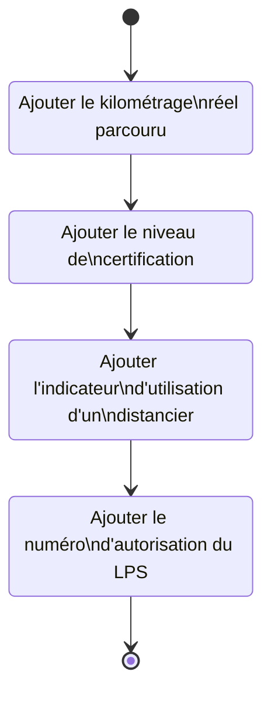
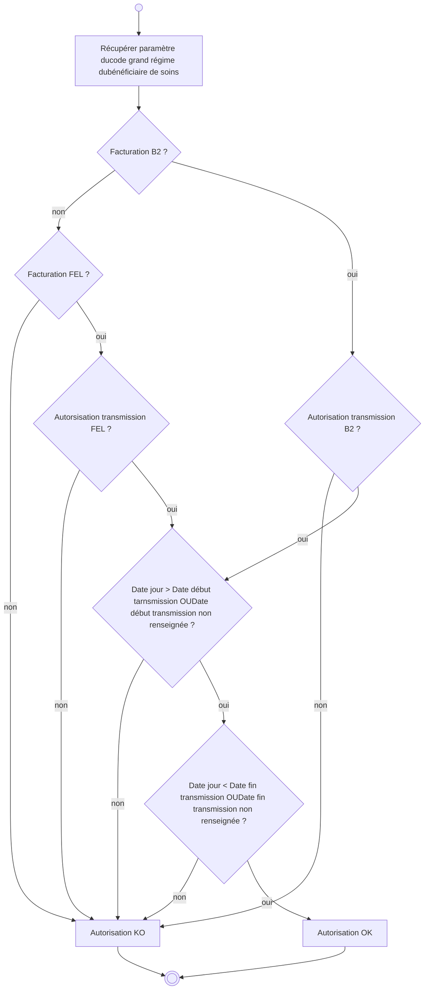

**_SFG Facturation Transporteur_**
**_FACT-SFG-039_** **_GE - Constituer et transmettre les traces de géolocalisation_** **_Version : 1.05_**

Schéma représentant les trajets de prise en charge de trois patients (A, B et C) vers une arrivée commune :

*   **Ligne de temps principale (bleue) :**
    *   **Prise en charge Patient A** (marron) : Marqué par un losange marron au début de la ligne.
    *   **Prise en charge Patient B** (vert) : Marqué par un losange vert plus loin sur la ligne.
    *   **Prise en charge Patient C** (orange) : Marqué par un losange orange encore plus loin sur la ligne.
    *   **Arrivée commune** (marron) : Marqué par un losange marron à l'extrémité droite de la ligne.

*   **Segments de trajets (flèches horizontales à double pointe) :**
    *   **Trajet Patient A** (marron) : S'étend du point de prise en charge du Patient A jusqu'à l'arrivée commune.
    *   **Trajet Patient B** (vert) : S'étend du point de prise en charge du Patient B jusqu'à l'arrivée commune.
    *   **Trajet Patient C** (orange) : S'étend du point de prise en charge du Patient C jusqu'à l'arrivée commune.

**<u>*Exemple 3*</u> : Point de dépose commun pour l’ensemble des bénéficiaires**

Dans ces exemples, trois factures seront émises, une pour chaque patient (A, B et C) et trois fichiers de traces de géolocalisation seront produits associés à chacune des factures.

Le fichier de traces de géolocalisation associé à la facture du patient A contiendra les traces GPS enregistrées entre le point de prise en charge du patient A et le point de dépose du patient A (trajet A).

Le fichier de traces de géolocalisation associé à la facture du patient B contiendra les traces GPS enregistrées entre le point de prise en charge du patient B et le point de dépose du patient B (trajet B).

Le fichier de traces de géolocalisation associé à la facture du patient C contiendra les traces GPS enregistrées entre le point de prise en charge du patient C et le point de dépose du patient C (trajet C).

Les positions GPS communes aux différents trajets sont donc dupliquées dans chacun des fichiers de traces A, B et C.

**_14/02/2024_** **_GIE SESAM-Vitale_** **_21 / 38_**
**_Ce document ne peut être diffusé sans l'autorisation d'une personne habilitée au GIE SESAM-Vitale_**

**SFG *Facturation Transporteur***
***FACT-SFG-039*** **GE - *Constituer et transmettre les traces de géolocalisation*** **Version : 1.05**

# **3.2** **Fonction « GE02 – Compléter la facture »**

**Pré-requis**
Un fichier de traces de géolocalisation a été généré avec succès pour la facture à compléter.

**Evénement déclencheur**
Enregistrement d’un fichier de traces de géolocalisation pour la facture à compléter.

**Description**
Pour chaque facture (B2 ou FEL), la facture est complétée avec :

*   le kilométrage réel parcouru calculé à partir des positions GPS de géolocalisation de ce trajet,
*   le niveau de certification des traces enregistrées,
*   un indicateur d’utilisation d’un distancier local négocié avec la profession ou non pour déterminer le kilométrage facturé,
*   ~~<u>Pour chaque facture B2, la facture est complétée avec</u>~~ le numéro d’autorisation du LPS obtenu pour la géolocalisation.

La norme B2 transporteur est enrichie par l’ajout de nouvelles zones dans le type 4U (cf. Annexe 2) et le type 2S pour enregistrer ces données.

Ces données doivent être renseignées dans la facture, même si le fichier de trace n’est pas transmis par la suite (cf. §3.3).

**Données en entrée**
Facture en cours
Fichier de traces de géolocalisation pour chaque facture (EF_GE01 à EF_GE05)

**Données en sortie**
Facture en cours complétée

***14/02/2024*** ***GIE SESAM-Vitale*** ***22 / 38***
***Ce document ne peut être diffusé sans l'autorisation d'une personne habilitée au GIE SESAM-Vitale***

*SFG Facturation Transporteur*
*FACT-SFG-039* *GE - Constituer et transmettre les traces de géolocalisation* *Version : 1.05*

# Illustration

Figure 7 : Fonction GE02 - Compléter la facture

**Règles de gestion**

## *[RG_GE201] Enregistrement de la distance réelle parcourue*

La facture est enrichie avec la distance réelle parcourue issue des traces de géolocalisation (cf. RG_GE107).

Dans le cas d’une facture B2 :

| Référence Facture | Nom | Origine | O/F |
| --- | --- | --- | --- |
| B2 Type 4U pos 113-116 | Distance réelle parcourue | EF_GE02_05 | O |

Dans le cas d’une facture en ligne (FEL) :

| Référence Facture | Nom | Origine | O/F |
| --- | --- | --- | --- |
| EF_FTE63_22 | Distance GPS | EF_GE02_05 | O |

*14/02/2024* *GIE SESAM-Vitale* 23 / 38
*Ce document ne peut être diffusé sans l'autorisation d'une personne habilitée au GIE SESAM-Vitale*

*SFG Facturation Transporteur*
**FACT-SFG-039** *GE - Constituer et transmettre les traces de géolocalisation* **Version : 1.05**

### *[RG_GE202] Enregistrement du niveau de certification*

La facture est enrichie avec le niveau de certification issue des traces de géolocalisation (cf. RG_GE108).

Dans le cas d’une facture B2 :

| Référence Facture | Nom | Origine | O/F |
| --- | --- | --- | --- |
| B2 Type 4U pos 118 | Niveau de certification | EF_GE02_06 | O |

Dans le cas d’une facture en ligne (FEL) :

| Référence Facture | Nom | Origine | O/F |
| --- | --- | --- | --- |
| EF_FTE63_24 | Niveau de certification GPS | EF_GE02_06 | O |

### *[RG_GE203] Enregistrement de l’indicateur d’utilisation d’un distancier local par le LPS*

L’indicateur d’utilisation d’un distancier permet de déterminer si le distancier a servi de référence pour la détermination de la distance à facturer, ou pas si le trajet effectué n’y figure pas.

Dans le cas d’une facture B2 :

| Référence Facture | Nom | Origine | O/F |
| --- | --- | --- | --- |
| B2 Type 4U pos 117 | Indicateur d’utilisation d’un distancier | Valeur « D » si utilisation, « N » sinon | O |

Dans le cas d’une facture en ligne (FEL) :

| Référence Facture | Nom | Origine | O/F |
| --- | --- | --- | --- |
| EF_FTE63_23 | Indicateur utilisation du distancier | Valeur « D » si utilisation, « N » sinon | O |

### *[RG_GE204] Enregistrement du numéro d’autorisation du LPS*

Le numéro d’autorisation est obtenu lors de la certification du LPS vis-à-vis de la géolocalisation.

Dans le cas d’une facture B2 :

| Référence Facture | Nom | Origine | O/F |
| --- | --- | --- | --- |
| B2 Type 2S pos 45-49 | Numéro d’autorisation du LPS sur 5 caractères alphanumériques | LPS | O |

<mark>~~Dans le cas d’une facture en ligne (FEL), le numéro d’autorisation n’est pas transmis via le téléservice SEFi transport.~~</mark>

**14/02/2024** **GIE SESAM-Vitale** **24 / 38**
***Ce document ne peut être diffusé sans l'autorisation d'une personne habilitée au GIE SESAM-Vitale***

***SFG Facturation Transporteur***
***FACT-SFG-039*** ***GE - Constituer et transmettre les traces de géolocalisation*** ***Version : 1.05***

**Dans le cas d’une facture en ligne (FEL) :**

| Référence Facture | Nom | Origine | O/F |
| --- | --- | --- | --- |
| EF_FTE63_25 | Numéro d’autorisation du LPS sur 5 caractères alphanumériques | LPS | O |

# **3.3** **Fonction « GE03 – Transmettre les traces de géolocalisation »**

**Pré-requis**
Un ou plusieurs fichiers de traces de géolocalisation ont été générés avec succès pour une ou plusieurs factures.
Les factures associées ont été transmises vers l’assurance maladie.

**Evénement déclencheur**
La facture associée au fichier de traces de géolocalisation a été transmise vers l’assurance maladie.

**Description**
Si le paramétrage de la transmission des fichiers de traces de géolocalisation autorise cette transmission pour la facture associée, le fichier de traces est transmis vers le système d’accueil des traces de géolocalisation2 par messagerie électronique. Un seul fichier de trace est transmis par message.

Il n’y a pas de regroupement des différents fichiers de traces générés.

La transmission du fichier de traces peut se faire dès que la facture associée a été transmise.

**Données en entrée**
Fichier de traces de géolocalisation pour chaque trajet facturé (EF_GE01 à EF_GE05)
Paramétrage de la transmission (EF_GE06 à EF_GE07)

**Données en sortie**
aucune

2 La solution de transmission mise en place lors de l’expérimentation associée au cahier des charges de l’avenant n°5 (cf. document [CDC]) reste compatible avec le système d’accueil des traces de géolocalisation décrit dans ce cahier des charges.

***14/02/2024*** ***GIE SESAM-Vitale*** ***25 / 38***
***Ce document ne peut être diffusé sans l'autorisation d'une personne habilitée au GIE SESAM-Vitale***

***SFG Facturation Transporteur***
***FACT-SFG-039*** ***GE - Constituer et transmettre les traces de géolocalisation*** ***Version : 1.05***

## **Illustration**

```mermaid
graph TD
    Start(( )) --> Decision1{ }
    
    Decision1 -- "oui" --> Task1(Constituer le message SMTP)
    Decision1 -- "non" --> End(( ))
    
    Task1 --> Task2(Transmettre le message SMTP)
    Task2 --> Decision2{ }
    
    Decision2 -- "oui" --> Decision1
    Decision2 -- "non" --> End
    
    %% Labels and positioning
    subgraph Labels
        direction TB
        L1[Autorisation transmission ?]
        L2[Autre fichiers trace à transmettre ?]
    end
    
    %% Styling
    style Start fill:#000
    style End fill:#000,stroke:#000,stroke-width:4px
    style Task1 fill:#f5e6d3,stroke:#000
    style Task2 fill:#f5e6d3,stroke:#000
    style Decision1 fill:#fdf5e6,stroke:#000
    style Decision2 fill:#fdf5e6,stroke:#000
    
    %% Positioning labels near nodes
    Decision1 -.->|Autorisation transmission ?| Decision1
    Decision2 -.->|Autre fichiers trace à transmettre ?| Decision2
```

**Figure 8 : Fonction GE03 - Transmettre les traces de géolocalisation**

## **Règles de gestion**

### ***[RG_GE301] Autorisation transmission du fichier de traces géolocalisation***

L’autorisation de transmettre le fichier de traces de géolocalisation se fait à partir des paramètres de géolocalisation (EF_GE07) pour le code régime et le code caisse destinataire du bénéficiaire de soins transporté et du type de facture effectuée (B2 ou FEL).

**14/02/2024** **GIE SESAM-Vitale** **26 / 38**
***Ce document ne peut être diffusé sans l'autorisation d'une personne habilitée au GIE SESAM-Vitale***

**_SFG Facturation Transporteur_**
**_FACT-SFG-039_** **_GE - Constituer et transmettre les traces de géolocalisation_** **_Version : 1.05_**

L’autorisation de transmission se détermine comme suit :

**Figure 9 : Algorithme d’autorisation de la transmission des traces de géolocalisation**

La détermination de l’autorisation en fonction des dates de début de transmission ou de fin de transmission se font en référence aux dates paramétrées dans l’entité EF_GE07 (EF_GE07_05 et EF_GE07_06) décrite ci-après (cf. §3.4).

 *⮱ **Cas d’erreur***

***CE_GE03 : autorisation KO***

Dans ce cas, la transmission n’est pas possible.

**_14/02/2024_** **_GIE SESAM-Vitale_** **_27 / 38_**
**_Ce document ne peut être diffusé sans l'autorisation d'une personne habilitée au GIE SESAM-Vitale_**

***SFG Facturation Transporteur***
**FACT-SFG-039** ***GE - Constituer et transmettre les traces de géolocalisation*** **Version : 1.05**

### **[RG_GE302] *Constitution du message SMTP d’envoi des traces***

Le fichier de trace XML est mis en pièce jointe, **non compressé**, d’un message SMTP **non sécurisé**, à destination de l’adresse mail paramétrée dans l’entité EF_GE07_07 pour le code régime et le code caisse destinataire du bénéficiaire de soins transporté.

Il n’y a qu’un seul fichier de trace par message SMTP (une seule pièce jointe possible).

## **3.4** **Fonction « GE04 – Administrer les traces de géolocalisation »**

**Evénement déclencheur**
Action de l’administrateur du LPS pour modifier le paramétrage lié aux traces de géolocalisation.

**Description**
Les éléments suivants doivent faire l’objet d’un paramétrage dans le LPS :

*   Au niveau de l’enregistrement des données de géolocalisation
    *   La fréquence d’enregistrement des traces de géolocalisation par le boitier GPS d’un véhicule. La valeur par défaut est de 1 minute.
*   Au niveau de la transmission des fichiers de traces de géolocalisation, l’autorisation de transmission est définie par
    *   Code régime AMO et code caisse destinataire
    *   Mode de facturation (B2 ou en ligne (FEL) ou les deux)
    *   Date de début d’autorisation de transmission
    *   Date de fin d’autorisation de transmission
    *   Adresse mail où envoyer les traces de géolocalisation

**Données en entrée**
Paramétrage de la géolocalisation (EF_GE06 à EF_GE07)

**Données en sortie**
Paramétrage de la géolocalisation (EF_GE06 à EF_GE07) mis à jour

**14/02/2024** **GIE SESAM-Vitale** **28 / 38**
***Ce document ne peut être diffusé sans l'autorisation d'une personne habilitée au GIE SESAM-Vitale***

**SFG Facturation Transporteur**
**FACT-SFG-039** **GE - Constituer et transmettre les traces de géolocalisation** **Version : 1.05**

## **Règles de gestion**

### ***[RG_GE401] Paramétrage de la fréquence d’enregistrement des traces***

| Référence | Nom | Valeur |
| --- | --- | --- |
| EF_GE06_01 | Fréquence d’enregistrement des traces exprimées en secondes | Valeur par défaut : 60 secondes |

### ***[RG_GE402] Paramétrage des autorisations de transmission des traces***

Ce paramétrage permet de définir pour chaque régime ses capacités à recevoir ou non les traces de géolocalisation.

Pour le régime général et les régimes hébergés par le régime général (ENIM, CAVIMAC, MGP, CAMIEG, INTERIALE, CANSSM, CNMSS, CRPCEN), les valeurs par défaut doivent être valorisées.

| Référence | Nom | Valeur |
| --- | --- | --- |
| EF_GE07_01 | Code régime | De 01 à 99 |
| EF_GE07_02 | Code caisse destinataire | De 000 à 999 |
| EF_GE07_03 | Autorisation B2 | « O » : transmission autorisée pour une facture B2 pour le régime « N » : transmission non autorisée Valeur par défaut : « O » |
| EF_GE07_04 | Autorisation FEL | « O » : transmission autorisée pour une facture FEL pour le régime « N » : transmission non autorisée Valeur par défaut : « O » |
| EF_GE07_05 | Date de début de transmission | Date à partir de laquelle la transmission des traces pour le régime est possible. Si non renseignée, la transmission est toujours possible. Valeur par défaut : « non renseignée » |
| EF_GE07_06 | Date de fin de transmission | Date au delà de laquelle la transmission des traces pour le régime n’est plus possible. Si non renseignée, la transmission est toujours possible. Valeur par défaut : « non renseignée » |
| EF_GE07_07 | Adresse mail destinataire | Adresse où envoyer les traces de géolocalisation pour chaque régime. |

***14/02/2024*** ***GIE SESAM-Vitale*** **29 / 38**
***Ce document ne peut être diffusé sans l'autorisation d'une personne habilitée au GIE SESAM-Vitale***

***SFG Facturation Transporteur***
**FACT-SFG-039** ***GE - Constituer et transmettre les traces de géolocalisation*** **Version : 1.05**

# **GE - Constituer et transmettre les traces de géolocalisation**

|  |  | Pour le régime général et les régimes hébergés : geolocts.cnam@assurance-maladie.fr Pour les autres régimes « non renseignée » |
| --- | --- | --- |

Pour information, la liste des régimes hébergés par le régime général à la date de publication de ce document est la suivante (hors code régime 01).

| Code régime | Code Caisse destinataire | Libellé |  |
| --- | --- | --- | --- |
| 06 | * | Etablissement Nationale des Invalides de la Marine | ENIM |
| 07 | * | Caisse Autonome Nationale de la Sécurité Sociale dans les Mines | CANSSM |
| 08 | * | Caisse nationale militaire de sécurite sociale | CNMSS |
| 10 | * | Caisse de Retraite et de Prévoyance des Clercs et Employés de Notaire | CRPCEN |
| 90 | * | Caisse d’Assurance Vieillesse, Invalidité et Maladie des Cultes | CAVIMAC |
| 93 | * | Mutuelle Générale de la Police | MGP |
| 99 | 609 | Mutuelle de la Police et des Préfectures | INTERIALE |
| 99 | 939 | Caisse d’Assurance Maladie des Industries Electriques et Gazières | CAMIEG |

* toutes caisses

Remarque : pour les régimes hébergés en code régime 99, seuls les codes caisses mentionnés sont à prendre en compte pour le routage vers l’adresse mail « geolocts.cnam@assurance-maladie.fr »

**14/02/2024** **GIE SESAM-Vitale** **30 / 38**
***Ce document ne peut être diffusé sans l'autorisation d'une personne habilitée au GIE SESAM-Vitale***