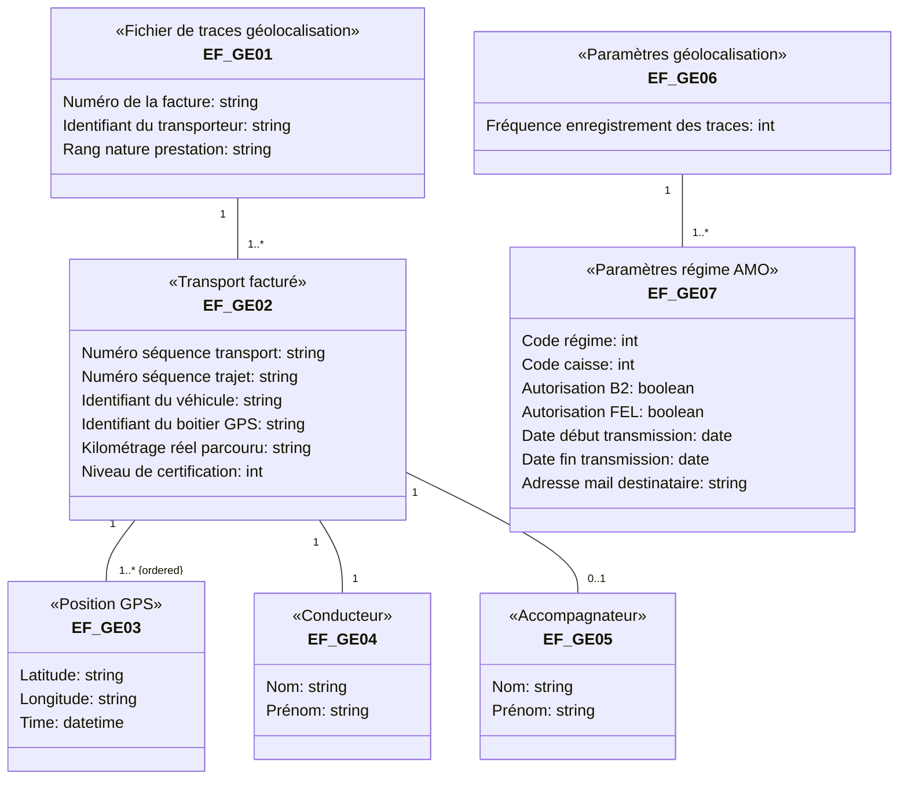

***SFG Facturation Transporteur***
***FACT-SFG-039*** ***GE - Constituer et transmettre les traces de géolocalisation*** ***Version : 1.05***

# 4 **Synthèse des entités fonctionnelles**

Les entités fonctionnelles sont organisées comme suit :

**Figure 10 : Synthèses des entités fonctionnelles**

Les entités fonctionnelles utilisées pour l’enregistrement des traces de géolocalisation sont les suivantes :

|  |  | Nom | Format | Description | RG |
| --- | --- | --- | --- | --- | --- |
| EF_GE01 |  | Fichier de traces géolocalisation |  |  |  |
| 01 | Numéro de la facture | 9 N | Numéro de la facture B2 ou FEL | GE102 |  |
| 02 | Identifiant du transporteur | 9 N | Identifiant AM du transporteur | GE102 |  |
| 03 | Rang nature prestation | 2 AN | Valeur fixe « TA » | GE102 |  |
| EF_GE02 |  | Transport facturé |  |  |  |
| 01 | Numéro séquence transport | 2 N | Numéro de séquence dans la facture | GE103 |  |
| 02 | Numéro séquence trajet | 2 N |  | GE103 |  |
| 03 | Identifiant du véhicule | 9 AN |  | GE103 |  |
| 04 | Identifiant du boitier GPS | 15 N |  | GE103 |  |
| 05 | Distance réelle parcourue | 4 N |  | GE107 |  |
| 06 | Niveau de certification | 1 N |  | GE108 |  |

***14/02/2024*** ***GIE SESAM-Vitale*** ***31 / 38***
***Ce document ne peut être diffusé sans l'autorisation d'une personne habilitée au GIE SESAM-Vitale***