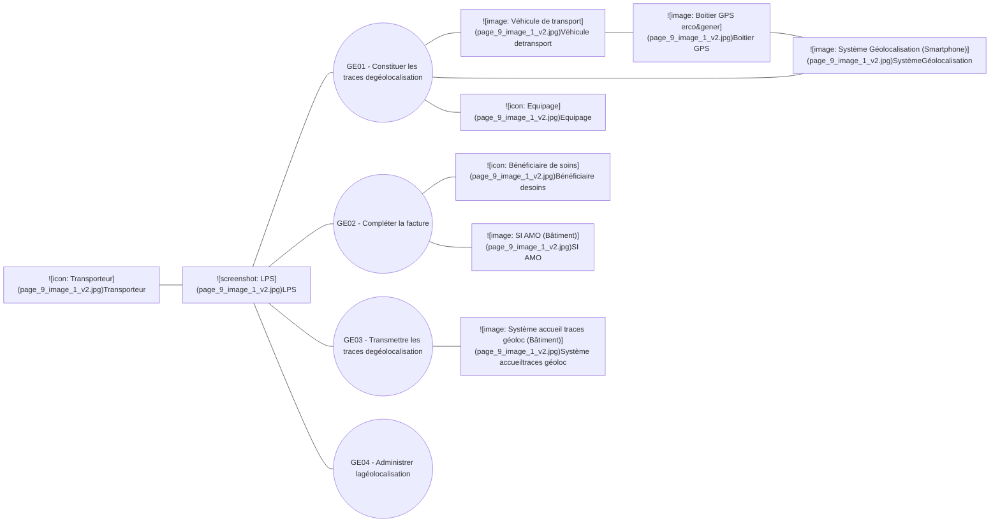

**Facturation Transporteur**
**Spécifications Fonctionnelles Générales**

## **Facturation Transporteur**

# **GE - Constituer et transmettre les traces de géolocalisation**

*Version* 1.05
*Date* 14/02/2024
*Référence* FACT-SFG-039
*Information* RESTREINTE
*Etat* REFERENCE

**GIE SESAM-Vitale**
5, boulevard Marie et Alexandre Oyon – 72 019 LE MANS Cedex 2
<u>www.sesam-vitale.fr</u>

***SFG Facturation Transporteur***
***FACT-SFG-039*** ***GE - Constituer et transmettre les traces de géolocalisation*** ***Version : 1.05***

Ce document a été élaboré par le GIE SESAM-Vitale.

Conformément à l'article L.122-4 du code de la propriété intellectuelle, toute représentation ou reproduction (intégrale ou partielle) du présent ouvrage, quel que soit le support utilisé, doit être soumise à l’accord écrit préalable de son auteur.

Il en est de même pour sa traduction, sa transformation, son adaptation ou son arrangement, quel que soit le procédé utilisé.

Tout manquement à ces obligations constituerait un délit de contrefaçon, au sens des articles L 335-2 et suivants du code de la propriété intellectuelle, susceptible d’entraîner des sanctions pour l’auteur du délit.

## **CONTACTS**


Pour toute demande d'évolution, comme pour toute question technique ou fonctionnelle, contactez le Centre de services :
*   e-mail : **centre-de-service@sesam-vitale.fr**
*   téléphone : **02 43 57 42 88**

***14/02/2024*** ***GIE SESAM-Vitale*** ***2 / 38***
***Ce document ne peut être diffusé sans l'autorisation d'une personne habilitée au GIE SESAM-Vitale***

**SFG Facturation Transporteur**
**FACT-SFG-039** **GE - Constituer et transmettre les traces de géolocalisation** **Version : 1.05**

## **TABLES DES MATIERES**

| 1 | INTRODUCTION.........................................................................................................................................4 |
| --- | --- |
|  | 1.1 OBJECTIF DU DOCUMENT .......................................................................................................................4 |
|  | 1.2 STATUT DU DOCUMENT ..........................................................................................................................4 |
|  | 1.3 CONTENU DU DOCUMENT .......................................................................................................................4 |
|  | 1.4 DOCUMENTS DE REFERENCE ..................................................................................................................4 |
| 2 | PRESENTATION GENERALE...................................................................................................................5 |
|  | 2.1 INTRODUCTION ......................................................................................................................................5 |
|  | 2.2 ACTEURS ET OBJECTIFS METIERS ...........................................................................................................8 |
|  | 2.3 DESCRIPTION GENERALE DU PROCESSUS..............................................................................................10 |
| 3 | DESCRIPTION DETAILLEE DU PROCESSUS ......................................................................................11 |
|  | 3.1 FONCTION « GE01 – CONSTITUER LES TRACES DE GEOLOCALISATION »................................................11 |
|  | 3.1.1 Cadrage fonctionnel .............................................................................................................11 |
|  | 3.1.2 GE01.01 - Initialiser le fichier de trace et récupérer les caractéristiques de la facture ........13 |
|  | 3.1.3 GE01.02 - Constituer les données d’un trajet ......................................................................15 |
|  | 3.2 FONCTION « GE02 – COMPLETER LA FACTURE »..................................................................................22 |
|  | 3.3 FONCTION « GE03 – TRANSMETTRE LES TRACES DE GEOLOCALISATION » .............................................25 |
|  | 3.4 FONCTION « GE04 – ADMINISTRER LES TRACES DE GEOLOCALISATION »...............................................28 |
| 4 | SYNTHESE DES ENTITES FONCTIONNELLES....................................................................................31 |

## **TABLE DES ILLUSTRATIONS**

| FIGURE 1 : PROCESSUS SIMPLIFIE DE LA FACTURATION TRANSPORTEUR .................................................................. | 5 |
| --- | --- |
| FIGURE 2 : PERIMETRE DES SPECIFICATIONS.......................................................................................................... | 7 |
| FIGURE 3 : ILLUSTRATION DES REPARTITIONS DES FONCTIONS D’UN LPS................................................................. | 7 |
| FIGURE 4 : ACTEURS ET OBJECTIFS METIERS.......................................................................................................... | 9 |
| FIGURE 5 : PROCESSUS GLOBAL DE CONSTITUTION ET TRANSMISSION DES TRACES DE GEOLOCALISATION............... | 10 |
| FIGURE 6 : FONCTION GE01 - CONSTITUER LES TRACES DE GEOLOCALISATION ..................................................... | 12 |
| FIGURE 7 : FONCTION GE02 - COMPLETER LA FACTURE ....................................................................................... | 23 |
| FIGURE 8 : FONCTION GE03 - TRANSMETTRE LES TRACES DE GEOLOCALISATION .................................................. | 26 |
| FIGURE 9 : ALGORITHME D’AUTORISATION DE LA TRANSMISSION DES TRACES DE GEOLOCALISATION ....................... | 27 |
| FIGURE 10 : SYNTHESES DES ENTITES FONCTIONNELLES ...................................................................................... | 31 |

## **TABLE DES ANNEXES**

| ANNEXE 1 | GUIDE DE LECTURE ..........................................................................................................33 |
| --- | --- |
| ANNEXE 2 | MISE A JOUR DE LA NORME B2 ......................................................................................35 |
| ANNEXE 3 | SCHEMA XML DU FICHIER DE TRACES..........................................................................36 |

**14/02/2024** **GIE SESAM-Vitale** **3 / 38**
**Ce document ne peut être diffusé sans l'autorisation d'une personne habilitée au GIE SESAM-Vitale**

***SFG Facturation Transporteur***
***FACT-SFG-039*** ***GE - Constituer et transmettre les traces de géolocalisation*** ***Version : 1.05***

# **1 Introduction**

## **1.1 Objectif du document**

Ce document a pour but de spécifier le processus « Constituer et transmettre les traces de géolocalisation » associées à une facture de transport.

Ce document constitue le cahier des charges technique rénové à destination des éditeurs transporteurs sanitaires défini dans le cadre de l’avenant n°7 de la convention publié en juillet 2014, dans le cadre de l’avenant n°10 de la convention publié en mars 2021 et dans le cadre de l’avenant n°11 de la convention publié en mai 2023.

## **1.2 Statut du document**

Version de travail.

## **1.3 Contenu du document**

Outre ce chapitre introductif, ce document de spécifications fonctionnelles générales présente les opérations :

*   de constitution des traces de géolocalisation associées à une facture transport,
*   de modification du processus de facturation permettant d’inclure dans la facture les informations liées à la géolocalisation,
*   de transmission des traces de géolocalisation vers l’assurance maladie,
*   d’administration de la constitution et la transmission des traces de géolocalisation.

## **1.4 Documents de référence**

| Appellation | Type et titre | Référence |
| --- | --- | --- |
| [B2-2007] | Norme B2 inter-régime | Juin 2007 |
| [B2-2005] | Norme B2 inter-régime | Novembre 2005 |
| [CNV07] | Avenant n°7 à la convention des transporteurs sanitaires | Juillet 2014 |
| [CDC] | Cahier des charges « rénovation de la facturation par géolocalisation – expérimentation » de l’avenant n°5 | Version 2.6 du 04/01/2010 |
| [CNV10] | Avenant n°10 à la convention des transporteurs sanitaires | Mars 2021 |
| [SEFI] | Documentation éditeurs pour le téléservice SEFi transport | Cf. Espace Industriels |

**14/02/2024** **GIE SESAM-Vitale** **4 / 38**
***Ce document ne peut être diffusé sans l'autorisation d'une personne habilitée au GIE SESAM-Vitale***

***SFG Facturation Transporteur***
***FACT-SFG-039*** ***GE - Constituer et transmettre les traces de géolocalisation*** ***Version : 1.05***

# **2 Présentation générale**

## **2.1 Introduction**

### **Contexte**

La fiabilisation de la facturation repose sur l’intégration du dispositif de géolocalisation qui fait l’objet d’une option prévue dans le cadre de l’avenant n°7 et de l’avenant 10 à la convention transporteur sanitaire.

Le processus de constitution et de transmission des traces de géolocalisation associées à une facture s’intègre sur le processus de facturation existant illustrés ci-après :

```mermaid
graph TD
    subgraph Step1 [1]
        S1_Icons[  Bénéficiaire de soins / Médecin Prescripteur]
        S1_Text[Un médecin ou établissement de santé prescrit à un patient un transport. Il lui remet la prescription générateur de la prise en charge \(identification du malade à transporter, lieu de prise en charge et destination, etc.\)]
    end

    subgraph Step2 [2]
        S2_Text[Le patient remet la prescription au transporteur et éventuellement l'entente préalable.]
    end

    subgraph Step3_Left [3]
        S3L_Icons[  Bénéficiaire de soins / Transporteur]
        S3L_Text[Le transporteur réalise la prise en charge et le transport du malade]
    end

    subgraph Step3_Top [3]
        S3T_Text[Le transporteur récupère les éléments relatifs au transport effectué :- La prescription et l'entente préalable éventuelle- L'identification du bénéficiaire de soins- L'identification du véhicule utilisé et de l'équipage- Les caractéristiques du trajet effectué \(lieu de prise en charge, destination, kilométrage parcouru...\)]
    end

    subgraph Step4 [4]
        S4_Icons[  Bénéficiaire de soins absent / Transporteur]
        S4_Text[Le transporteur effectue la facturation des trajets effectués \(facture et annexes\)]
    end

    subgraph Step5 [5]
        S5_Text[Le transporteur transmet ses factures, les pièces justificatives et les traces de géolocalisation vers l'assurance maladie.]
    end

    AMO[AMO]

    Step1 --> Step2
    Step2 --> Step3_Left
    Step3_Left --> Step3_Top
    Step3_Top --> Step4
    Step4 --> Step5
    Step5 --> AMO
```

**Figure 1 : Processus simplifié de la facturation transporteur**

### **Principes**

Le système de constitution et de transmission des traces de géolocalisation s’appuie sur les principes suivants :

*   L’utilisation par le Transporteur de la facturation B2 ou de la facturation en ligne (SEFi).
    *   La facturation B2 et la facturation en ligne (SEFi) sont exclusives l’une de l’autre. S’il s’agit d’une facture B2, seules les données relatives à cette facture doivent être renseignées dans les traces de géolocalisation. S’il s’agit d’une facture SEFi seules les données relatives à la FEL doivent être renseignées dans les traces de géolocalisation.
    *   Le transporteur a la possibilité de passer d’une facture SEFI à une facture B2 comme indiqué dans la documentation SEFI.

*14/02/2024* *GIE SESAM-Vitale* **5 / 38**
*Ce document ne peut être diffusé sans l'autorisation d'une personne habilitée au GIE SESAM-Vitale*

***SFG Facturation Transporteur***
***FACT-SFG-039*** ***GE - Constituer et transmettre les traces de géolocalisation*** ***Version : 1.05***

*   Le fichier de trace de géolocalisation est une pièce complémentaire à la facture, non intégré à la facture B2 ou la facture en ligne (FEL).
*   La transmission des traces de géolocalisation se fait vers le point d’accueil des traces de géolocalisation.
*   Ce cahier des charges a été construit initialement sur la base du cahier des charges version 2.6 (cf. document [CDC]) qui décrivait les conditions de l’expérimentation de la géolocalisation mises en œuvre avec l’avenant 5 à la convention nationale des transporteurs sanitaires.
*   En cas de facture B2, la version de norme de facturation pouvant être utilisée est a minima la version B2 2005-B ou version supérieure (cf. document [B2-2005]).
*   Ce cahier des charges intègre la facturation en ligne (SEFi).
*   En cas de facture en ligne (FEL), la version de SEFi pouvant être utilisée est a minima la version 03.31.01 ou version supérieure (cf. documentation [SEFI]).

## **Périmètre**

Ces spécifications portent sur les modalités de constitution et de transmission des traces de géolocalisation des trajets facturés (cf. fonctions GE01 et GE03, respectivement décrites au §3.1 et au §3.3), ainsi que sur le complément de la facturation associé à cette géolocalisation (cf. fonction GE02 décrite au §3.2).

## **Hors périmètre**

Ne sont pas spécifiées dans cette version de spécification l’identification et la transmission de l’identification de l’assuré et bénéficiaire de soins dans les traces de géolocalisation. Ces données sont actuellement renseignées uniquement dans la facture et certaines pièces justificatives. Les traces de géolocalisation ne contiennent pas ces données et font référence à la facture correspondante.

Ne sont pas spécifiées dans ce document :

*   Les modalités de mise à jour du parc des véhicules utilisés et des personnels associés dans les bases de l’assurance maladie.
*   Les modalités de mise en place du système de géolocalisation chez le transporteur ainsi que les modalités de récupération des données de géolocalisation (position GPS enregistrées) dans le LPS du transporteur.

***14/02/2024*** ***GIE SESAM-Vitale*** ***6 / 38***
***Ce document ne peut être diffusé sans l'autorisation d'une personne habilitée au GIE SESAM-Vitale***

***SFG Facturation Transporteur***
***FACT-SFG-039*** ***GE - Constituer et transmettre les traces de géolocalisation*** ***Version : 1.05***

Le périmètre de ces spécifications est illustré par le schéma suivant :

### Périmètre des spécifications

Le schéma illustre le flux d'informations entre différents acteurs et systèmes, centré sur le périmètre des spécifications.

*   **Véhicule** (équipé d'un boîtier de géolocalisation) :
    *   
    *   Action : **Enregistrement des positions GPS de tous les trajets** (représenté par un bloc bleu).
    *   Une flèche pointe de cet enregistrement vers le **Poste de travail**.

*   **Périmètre des spécifications** (zone encadrée en orange) :
    *   **Poste de travail** : 
    *   Le poste de travail génère deux types de documents liés par une ligne pointillée :
        1.  **Fichier trace géoloc** (icône de document bleu) :
            *   Annotation orange : *Fichier contenant des informations de la facture et les positions GPS enregistrées uniquement pour la facture correspondante*.
            *   Ce fichier est transmis au **Système d’accueil des traces de géolocalisation** (représenté par une icône de serveur informatique ).
        2.  **Facture B2 ou FEL** (icône de document violet) :
            *   Annotation orange : *La facture est complétée par les informations de géolocalisation (distance réelle parcourue, niveau de certification, utilisation d’un distancier, n° autorisation du LPS)*.
            *   Cette facture est transmise à l'**AMO** (représenté par une icône de bâtiment ).

**Figure 2 : Périmètre des spécifications**

Un exemple de répartition des fonctionnalités dans le LPS du transporteur est illustré par le schéma suivant :

```mermaid
graph LR
    subgraph SG [Système géolocalisation]
        direction TB
        SG_Text[Système géolocalisation]
        SG_Img[]
    end

    subgraph LPS [LPS]
        direction TB
        subgraph LPS_Content [ ]
            direction LR
            Interface[Interface système géoloc]
            
            subgraph Metier_Ref [ ]
                direction TB
                Metier[Métier : planification des missions]
                Ref[Référentiel : véhicules et équipages]
            end
            
            subgraph Spec_Perimeter [Périmètre des spécifications]
                direction TB
                Const[Constitution des fichiers de traces géoloc]
                Trans[Transmission des fichiers de traces géoloc]
            end
            
            Fact[Facturation AM]
        end
    end

    subgraph External [ ]
        direction TB
        Acc[Système d'accueil des traces de géolocalisation]
        Acc_Img[ ]
        
        AMO_Img[ ]
    end

    Fichier[Fichier trace géoloc]
    Facture[Facture B2 ou FEL]

    SG -- " " --> Interface
    Trans -- " " --> Fichier
    Fichier -- " " --> Acc_Img
    Fact -- " " --> Facture
    Fact -- " " --> AMO_Img

    %% Legend
    Legend[Périmètre des spécifications]
    Legend_Box[ ]
    
    style SG fill:#4F81BD,stroke:#385D8A,color:white
    style LPS fill:#FDE9D9,stroke:#F79646,stroke-width:2px
    style Interface fill:#4F81BD,stroke:#385D8A,color:white
    style Metier fill:#4F81BD,stroke:#385D8A,color:white
    style Ref fill:#4F81BD,stroke:#385D8A,color:white
    style Const fill:#9BBB59,stroke:#4F6228,color:white
    style Trans fill:#9BBB59,stroke:#4F6228,color:white
    style Fact fill:linear-gradient(to right, #4F81BD, #9BBB59),stroke:#4F6228,color:white
    style Fichier fill:#DCE6F1,stroke:#4F81BD
    style Facture fill:#E4DFEC,stroke:#60497A
    style Legend_Box fill:#9BBB59,stroke:#4F6228
    style Spec_Perimeter fill:none,stroke:none
    style Metier_Ref fill:none,stroke:none
    style LPS_Content fill:none,stroke:none
    style External fill:none,stroke:none
```

**Figure 3 : Illustration des répartitions des fonctions d’un LPS**

**14/02/2024** **GIE SESAM-Vitale** **7 / 38**
***Ce document ne peut être diffusé sans l'autorisation d'une personne habilitée au GIE SESAM-Vitale***

***SFG Facturation Transporteur***
***FACT-SFG-039*** ***GE - Constituer et transmettre les traces de géolocalisation*** ***Version : 1.05***

## **2.2** **Acteurs et objectifs métiers**

### **Acteurs**

| Nom | Définition du rôle |
| --- | --- |
| Bénéficiaire des soins | Personne bénéficiant d’une protection sociale et pour laquelle un soin est prodigué par le Partenaire de Santé. Ce soin fait l’objet d’une facturation à destination de l’Assurance Maladie. Le bénéficiaire des soins (ou son représentant légal) signe l’annexe de la facture attestant de la réalisation du soin. |
| Transporteur sanitaire | Le Transporteur sanitaire (TS) réalise la facturation de prestations relatives à une prescription et transmet ses factures, ses pièces justificatives (P.J.) et les traces de géolocalisation aux organismes d’Assurance Maladie Obligatoire. |
| LPS | Logiciel du Professionnel de Santé : il s’agit du progiciel utilisé par le transporteur pour gérer son processus métier, la facturation vers l’assurance maladie et l’interface avec le système de géolocalisation. |
| Système de géolocalisation | Système permettant l’enregistrement des positions GPS des véhicules de la flotte du transporteur. |
| Véhicule de transport | Véhicule ayant servi au transport du bénéficiaire de soins |
| Equipage | Equipage (conducteur, accompagnateur…) du véhicule de transport |
| Boitier GPS | Boitier associé au véhicule de transport enregistrant les positions GPS de géolocalisation pendant le transport du bénéficiaire de soins. Il est installé dans le véhicule et le N° de boîtier (IMEI) est référencé dans l’entreprise par le LPS en association avec le véhicule. Il fait partie du système de géolocalisation. |
| Système d’accueil des traces de géolocalisation | Le système d’accueil des traces de géolocalisation : ● reçoit et traite les traces de géolocalisation transmises par les transporteurs sanitaires |
| S.I. AMO | Le Système d’Information de l’Assurance Maladie Obligatoire : ● reçoit, contrôle et assure la liquidation des factures, ● transmet les RSP (Noémie), ● procède au règlement des factures conformes. |

*14/02/2024* *GIE SESAM-Vitale* **8 / 38**
*Ce document ne peut être diffusé sans l'autorisation d'une personne habilitée au GIE SESAM-Vitale*

*SFG Facturation Transporteur*
*FACT-SFG-039* *GE - Constituer et transmettre les traces de géolocalisation* *Version : 1.05*

## Objectifs métier

Les objectifs métiers justifiant l’utilisation du système sont les suivants :

* constituer les traces de géolocalisation des trajets de transport effectués,
* compléter la facturation avec les données issues de la géolocalisation,
* transmettre les traces de géolocalisation vers l’assurance maladie,
* administrer la constitution et la transmission des traces de géolocalisation.

## Croisement objectifs / acteurs

### acteurs

Le schéma suivant illustre les interactions entre différents acteurs et les objectifs métiers (GE01 à GE04) liés à la géolocalisation.



Figure 4 : Acteurs et objectifs métiers

*14/02/2024* *GIE SESAM-Vitale* 9 / 38
*Ce document ne peut être diffusé sans l'autorisation d'une personne habilitée au GIE SESAM-Vitale*

*SFG Facturation Transporteur*
*FACT-SFG-039*
*GE - Constituer et transmettre les traces de géolocalisation*
*Version : 1.05*

## 2.3 Description générale du processus

Le processus global de constitution et de transmission des traces de géolocalisation est illustré par le schéma suivant :

```mermaid
graph TD
    Start(( )) --> Fork[ ]
    
    Fork --> GE04[GE04 - Administrer les traces de géolocalisation]
    Fork --> GE01[GE01 - Constituer les traces de géolocalisation]
    
    GE01 --> Decision1{Fichier de trace présent ?}
    Decision1 -- oui --> GE02[GE02 - Compléter la facture]
    Decision1 -- non --> Join[ ]
    
    GE02 --> Decision2{Facture transmise ?}
    Decision2 -- oui --> GE03[GE03 - Transmettre les traces de géolocalisation]
    Decision2 -- non --> Join
    
    GE04 --> Join
    GE03 --> Join
    
    Join --> End((( )))

    style Start fill:#000
    style Fork fill:#333,stroke:#333,stroke-width:4px
    style Join fill:#333,stroke:#333,stroke-width:4px
    style GE01 fill:#f5e6d3,stroke:#000
    style GE02 fill:#f5e6d3,stroke:#000
    style GE03 fill:#f5e6d3,stroke:#000
    style GE04 fill:#f5e6d3,stroke:#000
    style Decision1 fill:#f5e6d3,stroke:#000
    style Decision2 fill:#f5e6d3,stroke:#000
```



Figure 5 : Processus global de constitution et transmission des traces de géolocalisation

*14/02/2024*
*GIE SESAM-Vitale*
10 / 38
*Ce document ne peut être diffusé sans l'autorisation d'une personne habilitée au GIE SESAM-Vitale*