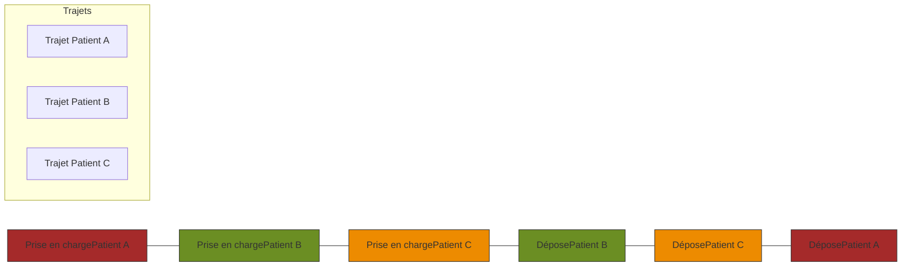

***SFG Facturation Transporteur***
***FACT-SFG-039*** ***GE - Constituer et transmettre les traces de géolocalisation*** ***Version : 1.05***

# **3** **Description détaillée du processus**

Les entités fonctionnelles mentionnées dans ce chapitre sont décrites en détail au §4.

## **3.1** **Fonction « GE01 – Constituer les traces de géolocalisation »**

### **3.1.1** **Cadrage fonctionnel**

**Pré-requis**

Un (des) transport(s) a (ont) été réalisé(s) par le transporteur pour un bénéficiaire de soins avec un (des) véhicule(s) de transport équipé(s) d’un boitier GPS de géolocalisation dont l’enregistrement des positions GPS a été activé¹.

**Evénement déclencheur**

Facturation par le transporteur du (des) trajet(s) effectué(s).

**Description**

A chaque facture réalisée, un fichier de traces de géolocalisation est constitué qui comprend, pour chaque trajet facturé :

*   L’identification du véhicule (immatriculation) utilisé
*   L’identifiant du boitier GPS associé au véhicule (n° IMEI)
*   Le niveau de certification attribué pour le trajet permettant de définir le niveau de fiabilité des données enregistrées.
*   Les positions GPS de géolocalisation enregistrées entre le début et la fin de prise en charge du trajet pour le bénéficiaire (coordonnées GPS et horodatage par minute)
*   Le kilométrage réel parcouru calculé à partir des traces de géolocalisation
*   L’identification du personnel conducteur et accompagnant (équipage) du véhicule utilisé
*   L’identifiant du transporteur sanitaire (n° assurance maladie)
*   Le numéro de la facture associée
*   Le rang de la nature de prestation
*   La séquence du transport correspondant au transport

**Données en entrée**

Facture en cours

***

¹ Dans le cas d’utilisation d’un véhicule de remplacement non équipé de boitier GPS, il n’y a pas de constitution de traces de géolocalisation pour ce trajet.

***14/02/2024*** ***GIE SESAM-Vitale*** **11 / 38**
***Ce document ne peut être diffusé sans l'autorisation d'une personne habilitée au GIE SESAM-Vitale***

***SFG Facturation Transporteur***
***FACT-SFG-039*** ***GE - Constituer et transmettre les traces de géolocalisation*** ***Version : 1.05***

# **GE - Constituer et transmettre les traces de géolocalisation**

## **Données en sortie**

Fichier de traces de géolocalisation contenant les traces de chaque trajet facturé (EF_GE01 à EF_GE05)

## **Illustration**

```mermaid
graph TD
    Start(( )) --> GE01_01
    
    GE01_01[GE01.01 - Initialisation du  fichier de trace et récupération  caractéristiques facture] --> GE01_02
    
    GE01_02[GE01.02 - Constituer les traces  d'un trajet] --> Decision{Autres trajets ?}
    
    Decision -- oui --> GE01_02
    Decision -- non --> End((( )))

    style Start fill:#000,stroke:#000
    style End fill:#000,stroke:#000,stroke-width:4px
    style GE01_01 fill:#f2e3cc,stroke:#000
    style GE01_02 fill:#f2e3cc,stroke:#000
    style Decision fill:#f2e3cc,stroke:#000
```



**Figure 6 : Fonction GE01 - Constituer les traces de géolocalisation**

## **Situations spécifiques**

SP1 – Génération des fichiers de traces de géolocalisation dans le cas des transports partagés.

SP2 – Génération des fichiers de traces de géolocalisation dans le cas d’une réémission d’une facture précédemment rejetée.

***14/02/2024*** ***GIE SESAM-Vitale*** **12 / 38**
***Ce document ne peut être diffusé sans l'autorisation d'une personne habilitée au GIE SESAM-Vitale***

**SFG Facturation Transporteur**
**FACT-SFG-039** ***GE - Constituer et transmettre les traces de géolocalisation*** **Version : 1.05**

# **3.1.2** **GE01.01 - Initialiser le fichier de trace et récupérer les caractéristiques de la facture**

## **Vue générale**

***Description*** Lors de la facturation des trajets effectués, un fichier de traces XML de géolocalisation est initialisé à partir des données de la facture :

*   Nommage du fichier à partir des éléments de la facture suivants :
    *   Type et numéro émetteur facture
    *   Type et numéro destinataire facture
    *   Identification du fichier de facture
    *   Numéro de la facture
*   Récupération des caractéristiques de la facture à inclure dans le fichier de traces :
    *   Numéro de la facture
    *   Identifiant du transporteur (numéro d’émetteur)
    *   Nature de la prestation

**Entrées** Facture en cours
**Sorties** Fichier de traces de géolocalisation initialisé **EF_GE01**

***Situations spécifiques***
*   SP1 – transports partagés : dans ce cas, il y a autant de factures que de bénéficiaires transportés, et donc autant de fichiers de traces de géolocalisation que de factures produites.
*   SP2 – réémission de facture : émission d’un nouveau fichier de traces de géolocalisation

## **Règles de gestion**

### ***[RG_GE101] Nommage du fichier de traces XML de géolocalisation***

Le nommage du fichier de traces XML de géolocalisation est constitué par concaténation des éléments suivants de la facture, suivi de l’extension « .xml ».

Dans le cas d’une facture B2 :

| Nom | Origine B2 | Exemple |
| --- | --- | --- |
| Type émetteur | Type 000 pos 4-5 | TP00000762522746 ou SI12345678901234 |
| Numéro émetteur | Type 000 pos 6-19 |  |
| Type destinataire | Type 000 pos 26-27 | CT00000001001764 |
| Numéro destinataire | Type 000 pos 28-41 |  |
| Identification du fichier | Type 000 pos 50-55 | CPA249 ou 812653 |
| Date de création du fichier | Type 000 pos 56-61 (AAMMJJ) | 150528 |
| Numéro de la facture | Type 2 pos 27-35 | 000000330 ou 020080475 |

Exemple de nom de fichier :

`TP00000762522746CT00000001001764812653150528000000330.xml`

**14/02/2024** **GIE SESAM-Vitale** **13 / 38**
***Ce document ne peut être diffusé sans l'autorisation d'une personne habilitée au GIE SESAM-Vitale***

***SFG Facturation Transporteur***
**FACT-SFG-039** *GE - Constituer et transmettre les traces de géolocalisation* **Version : 1.05**

# GE - Constituer et transmettre les traces de géolocalisation

Dans le cas d’une facture en ligne (FEL) :

| Nom | Origine FEL | Précisions / exemple |
| --- | --- | --- |
| Type émetteur | - | Valeur fixe « TS » |
| Numéro émetteur | EF_FTE51_01 | Sur 14 caractères. Cadrer à droite, compléter avec des zéros à gauche si le numéro fait moins de 14 caractères. |
| Type destinataire | - | Type 000 pos 26-27 (Cf. norme B2) |
| Numéro destinataire | EF_FTE57_04 et EF_FTE71_03 | Numéro composé comme suit : - six 0 (zéro) - le code régime (EF_FTE57_04) - trois 0 (zéro) - n° d’organisme destinataire (EF_FTE71_03). |
| Identification du fichier | - | Type 000 pos 50-55 (Cf. norme B2) |
| Date de création du fichier | EF_FTE50_02 | Mettre la date au format AAMMJJ. Exemple : 150528 |
| Numéro de la facture | EF_FTE50_01 | Exemples : 000000330 ou 020080475 |

Exemple de nom de fichier :

```text
TS00000762522746CT00000001000764812653150528000000330.xml
```

### *[RG_GE102] Enregistrement des caractéristiques de la facture*

Les caractéristiques suivantes de la facture sont enregistrées dans le fichier de traces de géolocalisation :

Dans le cas d’une facture B2 :

| Référence | Nom | Origine B2 | O/F |
| --- | --- | --- | --- |
| EF_GE01_01 | Numéro facture | Type 2 pos 27-35 | O |
| EF_GE01_02 | Identifiant transporteur | Type 2 pos 2-10 | O |
| EF_GE01_03 | Rang nature prestation | Valeur fixe = « TA » | O |

Dans le cas d’une facture en ligne (FEL) :

| Référence | Nom | Origine FEL | O/F |
| --- | --- | --- | --- |
| EF_GE01_01 | Numéro facture | EF_FTE50_01 | O |
| EF_GE01_02 | Identifiant transporteur | EF_FTE61_01 | O |
| EF_GE01_03 | Rang nature prestation | Valeur fixe = « TA » | O |

## **Situations**
## **Spécifiques**

### *SP2 – réémission de facture*

En cas de réémission d’une facture suite à un rejet, un nouveau numéro de facture est affecté.

**14/02/2024** **GIE SESAM-Vitale** **14 / 38**
***Ce document ne peut être diffusé sans l'autorisation d'une personne habilitée au GIE SESAM-Vitale***

***SFG Facturation Transporteur***
**FACT-SFG-039** ***GE - Constituer et transmettre les traces de géolocalisation*** **Version : 1.05**

En conséquence, parallèlement à la réémission de la facture, le fichier de trace de géolocalisation correspondant à ce trajet facturé doit également être retransmis à l’assurance maladie en l’état, exception faite de la prise en compte du nouveau numéro de facture attribué qui doit être présent dans les enregistrements des caractéristiques de la facture (donnée EF_GE01_01) et dans le nom du fichier généré (RG_GE101).

---

## **3.1.3** **GE01.02 - Constituer les données d’un trajet**

### **Vue générale**

***Description*** Pour chaque trajet facturé, les caractéristiques suivantes sont enregistrées dans le fichier de trace XML de géolocalisation associé à la facture :

*   Numéro de séquence du transport effectué
*   Numéro de séquence du trajet
*   Identifiant du véhicule utilisé
*   Identifiant du boitier GPS utilisé
*   Identifiant du conducteur du véhicule
*   Identifiant de l’accompagnateur

Les lieux et heure de début de prise en charge et de fin de prise en charge sont déterminés à partir :

*   Soit par géolocalisation préalable des lieux et heure si ceux-ci sont connus à l’avance (solution recommandée lorsque c’est possible)
*   Soit par déclenchement manuel par le conducteur lors du début et de la fin de prise en charge

Les positions GPS de géolocalisation récupérées depuis le boitier GPS du véhicule et situées entre le début et la fin de prise en charge sont enregistrées dans le fichier de traces.

La distance réelle parcourue est ensuite calculée à partir des positions GPS récupérées.

Le niveau de certification des données enregistrées est ensuite déterminé.

| Entrées | Facture en cours |  |
| --- | --- | --- |
| Fichier de traces de géolocalisation initialisé | EF_GE01 |  |
| Paramètres de géolocalisation | EF_GE06 et EF_GE07 |  |
| Sorties | Fichier de traces de géolocalisation complété avec | EF_GE01 |
| les données des trajets enregistrées | EF_GE02 |  |
|  | EF_GE03 |  |
|  | EF_GE04 |  |
|  | EF_GE05 |  |

***Situations spécifiques*** • SP1 – transports partagés : chaque fichier de traces de géolocalisation contiendra uniquement les positions GPS correspondant au parcours effectué par le bénéficiaire transporté objet de la facture associé.

**14/02/2024** **GIE SESAM-Vitale** **15 / 38**
**Ce document ne peut être diffusé sans l'autorisation d'une personne habilitée au GIE SESAM-Vitale**

***SFG Facturation Transporteur***
***FACT-SFG-039*** ***GE - Constituer et transmettre les traces de géolocalisation*** **Version : 1.05**

**Règles de**
**gestion**

### *[RG_GE103] Enregistrement des caractéristiques d’un transport*

Pour chaque transport facturé, les caractéristiques suivantes sont enregistrées dans le fichier de traces de géolocalisation, en cohérence avec les données correspondantes de la facture en cours :

Dans le cas d’une facture B2 :

| Référence | Nom | Origine B2 | O/F |
| --- | --- | --- | --- |
| EF_GE02_01 | Numéro séquence transport | B2 Type 4T pos 37-38 | O |
| EF_GE02_02 | Numéro séquence trajet | B2 Type 4U pos 37-38 | O |
| EF_GE02_03 | Identification véhicule | B2 Type 4U pos 54-62 | O |
| EF_GE04_01 | Nom conducteur | B2 Type 4U pos 63-70 | O |
| EF_GE04_02 | Prénom conducteur | B2 Type 4U pos 71-73 | O |
| EF_GE05_01 | Nom accompagnateur | B2 Type 4U pos 74-81 | O/F(*) |
| EF_GE05_02 | Prénom accompagnateur | B2 Type 4U pos 82-84 | O/F(*) |
| EF_GE02_04 | Identifiant boitier GPS | Numéro IMEI du boitier GPS installé dans le véhicule (15 chiffres dont une clé de contrôle) enregistré et référencé dans l’entreprise | O |

Dans le cas d’une facture en ligne (FEL) :

| Référence | Nom | Origine FEL | O/F |
| --- | --- | --- | --- |
| EF_GE02_01 | Numéro séquence transport | Valeur fixe « 01 » ? | O |
| EF_GE02_02 | Numéro séquence trajet | Valeur sur 2 chiffres initialisée à « 01 » pour le premier trajet dans la facture et incrémentée de 1 pour chaque trajet supplémentaire dans la facture : « 02 », … | O |
| EF_GE02_03 | Identification véhicule | EF_FTE64_01 | O |
| EF_GE04_01 | Nom conducteur | EF_FTE64_02 | O |
| EF_GE04_02 | Prénom conducteur | EF_FTE64_03 | O |
| EF_GE05_01 | Nom accompagnateur | EF_FTE64_04 | O/F(*) |
| EF_GE05_02 | Prénom accompagnateur | EF_FTE64_05 | O/F(*) |
| EF_GE02_04 | Identifiant boitier GPS | Numéro IMEI du boitier GPS installé dans le véhicule (15 chiffres dont une clé de contrôle) enregistré et référencé dans l’entreprise | O |

(*) Dans le cas d’une facture B2 ou d’une facture en ligne (FEL) :
*   lorsque le type de véhicule utilisé est une ambulance, alors les données EF_GE05_01 et EF_GE05_02 (Nom et prénom de l’accompagnateur) sont obligatoires.
*   sinon (véhicule de type VSL), ces données sont facultatives.
*   toutes les autres données ci-dessus doivent obligatoirement être renseignées par le LPS.

**14/02/2024** **GIE SESAM-Vitale** **16 / 38**
***Ce document ne peut être diffusé sans l'autorisation d'une personne habilitée au GIE SESAM-Vitale***

***SFG Facturation Transporteur***
***FACT-SFG-039*** ***GE - Constituer et transmettre les traces de géolocalisation*** ***Version : 1.05***

## ***[RG_GE104] Détermination du lieu et de l’heure de début de prise en charge du bénéficiaire***

Si le lieu de début de prise en charge du bénéficiaire est connu à l’avance, le LPS doit avoir géolocalisé (géocodé) le lieu de début prise en charge (détermination des coordonnées GPS via un logiciel de cartographie).

Le conducteur du véhicule peut déclencher manuellement la prise en charge via le dispositif informatique embarqué dans le véhicule. La position du lieu de début de prise en charge du bénéficiaire correspondra alors à la position GPS du boitier au moment du déclenchement manuel.

La détermination du lieu et de l’heure de début de prise en charge vis-à-vis des positions GPS issues du boitier GPS se fait selon les règles suivantes :

*   Positionnement du véhicule dans un rayon inférieur à 500 mètres vis-à-vis de la position théorique géolocalisée en préalable ou positionnée par le conducteur manuellement.
*   Détection d’un arrêt du véhicule dans un intervalle de +/- 5 minutes vis-à-vis de l’heure théorique positionnée en préalable ou positionnée par le conducteur manuellement.

## ***[RG_GE105] Détermination du lieu et de l’heure de fin de prise en charge du bénéficiaire***

Si le lieu de fin de prise en charge du bénéficiaire est connu à l’avance, le LPS doit avoir géolocalisé le lieu de fin de prise en charge (détermination des coordonnées GPS via un logiciel de cartographie).

Le conducteur du véhicule peut déclencher manuellement la fin de prise en charge via le dispositif informatique embarqué dans le véhicule. La position du lieu de fin de prise en charge du bénéficiaire correspondra alors à la position GPS du boitier au moment du déclenchement manuel.

La détermination du lieu et de l’heure de fin de prise en charge vis-à-vis des positions GPS issues du boitier GPS se fait selon les règles suivantes :

*   Positionnement du véhicule dans un rayon inférieur à 500 mètres vis-à-vis de la position théorique géolocalisée en préalable ou positionnée par le conducteur manuellement.
*   Détection d’un arrêt du véhicule dans un intervalle de +/- 5 minutes vis-à-vis de l’heure théorique positionnée en préalable ou positionnée par le conducteur manuellement.

## ***[RG_GE106] Enregistrement des positions GPS***

Les positions GPS enregistrées (EF_GE03) sont issues du boitier GPS embarqué dans le véhicule utilisé pour le trajet et sont récupérées/transmises via le système de géolocalisation.

Les positions GPS enregistrées pour le trajet référencé sont celles situées entre le début de prise en charge (cf. RG_GE104) et la fin de prise en charge (cf. RG_GE105).

Le format d’enregistrement doit respecter le format ouvert GPX (GPS Exchange Format) en version 1.1 (cf. [www.topografix.com/GPX)](http://www.topografix.com/GPX).

***14/02/2024*** ***GIE SESAM-Vitale*** ***17 / 38***
***Ce document ne peut être diffusé sans l'autorisation d'une personne habilitée au GIE SESAM-Vitale***

**SFG Facturation Transporteur**
**FACT-SFG-039** **GE - Constituer et transmettre les traces de géolocalisation** **Version : 1.05**

Pour chaque position GPS enregistrée, seules les données suivantes du format GPX (cf. Annexe 3) sont utilisées et doivent obligatoirement être renseignées :

| Référence | Nom | Origine | O/F |
| --- | --- | --- | --- |
| EF_GE03_01 | Latitude | Boitier GPS | O |
| EF_GE03_02 | Longitude | Boitier GPS | O |
| EF_GE03_03 | Date et heure de l’enregistrement (time) | Boitier GPS | O |

 ***Recommandation***

Le nombre de traces enregistrées doit être cohérent avec la fréquence d’enregistrement des traces paramétrée sur le système de géolocalisation (EF_GE06_01). Une tolérance de 15% de perte de traces est admise.

Le nombre théorique de traces enregistrées est calculé de la façon suivante :

$$N = \frac{Hf - Hd}{f} + 1$$

Où :

*   **$N$** représente le nombre de trace théorique
*   **$Hf$** représente l’heure de fin de prise en charge exprimée en seconde
*   **$Hd$** représente l’heure de début de prise en charge exprimée en seconde
*   **$f$** représente la fréquence d’enregistrement des traces exprimée en seconde (valeur fournie dans le paramétrage entité EF_GE06_01).

 ***Cas d’erreur***

***CE_GE02 : Absence de positions GPS***

Dans le cas où les positions GPS pour ce trajet ne sont pas disponibles, le fichier de traces doit contenir a minima la position du point de prise en charge et la position du point de fin de prise en charge qui peuvent être obtenus à partir de la cartographie utilisée par le LPS.

***[RG_GE107] Calcul de la distance réelle parcourue***

La distance réelle parcourue (EF_GE02_05) ne doit pas être nulle et est déterminée de la façon suivante :

*   La distance est fournie directement par le boitier GPS embarqué dans le véhicule utilisé lorsque celui-ci permet de faire ce calcul (par différence entre la valeur du compteur au moment du dépôt du patient et la valeur du compteur au moment de sa prise en charge).
*   Si le boitier GPS ne permet pas de calculer la distance parcourue, ou que la valeur relevée par celui-ci est égale à zéro, la distance est recalculée a posteriori par le LPS à partir de la totalité des positions GPS enregistrées (EF_GE03) (cf. RG_GE106) selon la norme GPX.
*   Si les positions GPS enregistrées ne permettent pas de recalculer la distance parcourue (nombre insuffisant de positions GPS, valeur aberrante dans les positions GPS…), la distance est recalculée a posteriori par le LPS à partir de la cartographie utilisée.

**14/02/2024** **GIE SESAM-Vitale** **18 / 38**
*Ce document ne peut être diffusé sans l'autorisation d'une personne habilitée au GIE SESAM-Vitale*

***SFG Facturation Transporteur***
***FACT-SFG-039*** ***GE - Constituer et transmettre les traces de géolocalisation*** ***Version : 1.05***

## ***[RG_GE108] Détermination du niveau de certification***

Une donnée est dite certifiée à partir du moment où il y a garantie que celle-ci n’a pas été modifiée manuellement entre son acquisition / calcul et son enregistrement dans le fichier de trace.

La certification repose sur un niveau de certification atteint selon que les informations communiquées répondent favorablement à un nombre plus ou moins important d’exigences. Elle ne garantit pas que les données enregistrées soient exemptes d’erreurs.

Les exigences à respecter sont résumées dans le tableau ci-après :

| Information | Critères validant le caractère certifié de l’information |
| --- | --- |
| Identification du véhicule | Association entre le boîtier GPS et le véhicule doit être effectuée avant la prestation de transport Ne doit pas être modifiée une fois la prise en charge débutée |
| Identification du boîtier GPS | Information issu du boîtier GPS et transmise/récupérée au moins une fois au cours du trajet Ne doit pas être modifié |
| Coordonnées GPS et horodatage de début et de fin de la prise en charge de l’assuré | Si déclenchement manuel, les coordonnées GPS et horodatage sont celles qui correspondent aux lieux et instants du déclenchement manuel Si connu avant le début du transport, le déclenchement peut-être automatique : ● Point GPS avec +/- 500 m du lieu de prise en charge ou fin de prise en charge ● arrêt du véhicule dans la zone sur une durée suffisante détectée par le GPS ● +/– 5 minutes par rapport à l’heure mentionnée sur la facture Ne doit pas être modifié |
| Positions GPS | Information transmise par le boîtier GPS Ne pas dépasser 15% de perte sur le parcours total Ne doit pas être modifié |
| Kilométrage réel parcouru | Calculé à partir des données issues du boîtier GPS (compteur kilométrique) ou obtenu suite à un traitement de géolocalisation exploitant l’intégralité des coordonnées des positions GPS Ne doit pas être modifié et ne doit pas être nul. |
| Ident. Conducteur et accompagnant | Identification manuelle ou automatique réalisée dès la première utilisation du véhicule par le LPS ou le système de géolocalisation Ne doit pas être modifiée une fois le transport amorcé |
| Identité de l’assuré | Ne doit pas être modifiée une fois le transport amorcé |

***14/02/2024*** ***GIE SESAM-Vitale*** ***19 / 38***
***Ce document ne peut être diffusé sans l'autorisation d'une personne habilitée au GIE SESAM-Vitale***

**SFG Facturation Transporteur**
**FACT-SFG-039**
**Version : 1.05**

# **GE - Constituer et transmettre les traces de géolocalisation**

Le niveau de certification du trajet (EF_GE02_06) est déterminé selon le tableau suivant :

|  | Toutes les données GPS : - Ident. boîtier GPS - Coord. GPS et horodatage début et fin de prise en charge - Positions GPS - Km réel parcouru | Ident. véhicule | Ident. assuré | Ident. conducteur et accompagnant |  |
| --- | --- | --- | --- | --- | --- |
| Niveau de certification | 1 | Non certifié (*) | Non certifié | Non certifié | Non certifié |
| 2 | Certifié | Non certifié | Non certifié | Non certifié |  |
| 3 | Certifié | Certifié | Non certifié | Non certifié |  |
| 4 | Certifié | Certifié | Certifié | Non certifié |  |
| 5 | Certifié | Certifié | Certifié | Certifié |  |

(*) La valeur « Non certifié » s’applique à partir du moment où l’une des données GPS est absente ou incomplète, par exemple toutes les positions GPS n’ont pas été enregistrées par le boîtier dans le véhicule.

**Situations**
**Spécifiques**

### *SP1 – transport partagé*

Des exemples de transport partagé sont illustrés par les schémas suivants.



<u>**Exemple 1**</u> : **points de prise en charge et de dépose différents pour les trois bénéficiaires**

**Départ commun**


*   **Trajet Patient A** : De "Départ commun" jusqu'à "Dépose Patient A" (ligne rouge)
*   **Trajet Patient B** : De "Départ commun" jusqu'à "Dépose Patient B" (ligne verte)
*   **Trajet Patient C** : De "Départ commun" jusqu'à "Dépose Patient C" (ligne orange)

<u>**Exemple 2**</u> : **point de prise en charge commun pour l’ensemble des bénéficiaires**

**14/02/2024** **GIE SESAM-Vitale** **20 / 38**
*Ce document ne peut être diffusé sans l'autorisation d'une personne habilitée au GIE SESAM-Vitale*