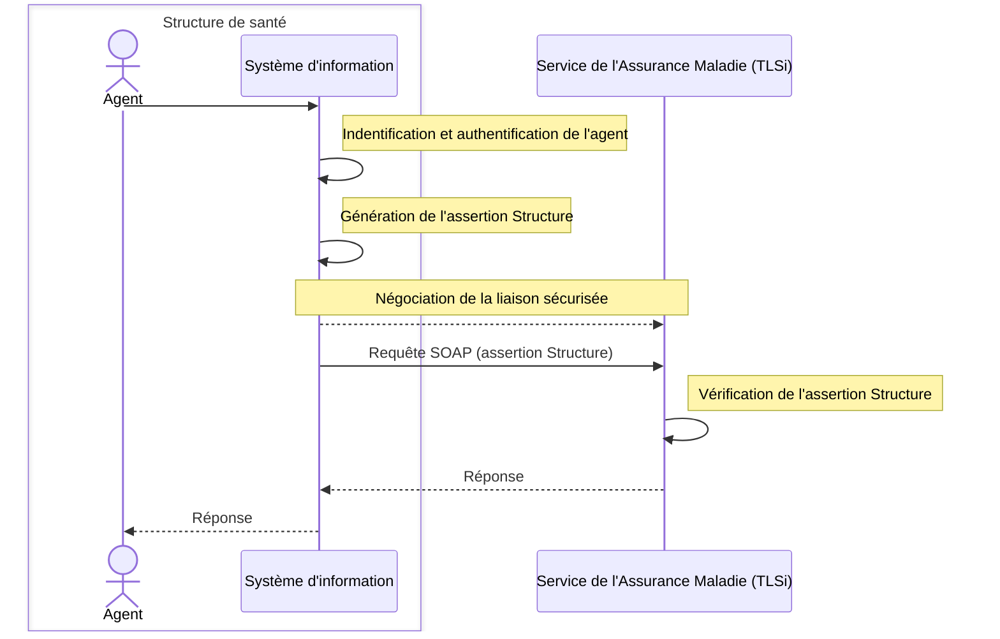

Cadre d’interopérabilité des TLSi

## 3.3 Authentification indirecte d’une personne physique

Ce mode d’authentification correspond aux usages des TLSi par un agent (administratifs, PS…) dans une structure de santé.

Ce mode est possible lorsque la structure de santé a signé une convention avec l’Assurance Maladie.

Figure 6 – Authentification indirecte

19/12/2025  33 / 102

Ce document à diffusion restreinte ne peut être diffusé sans l'autorisation d'une personne habilitée au GIE SESAM-Vitale