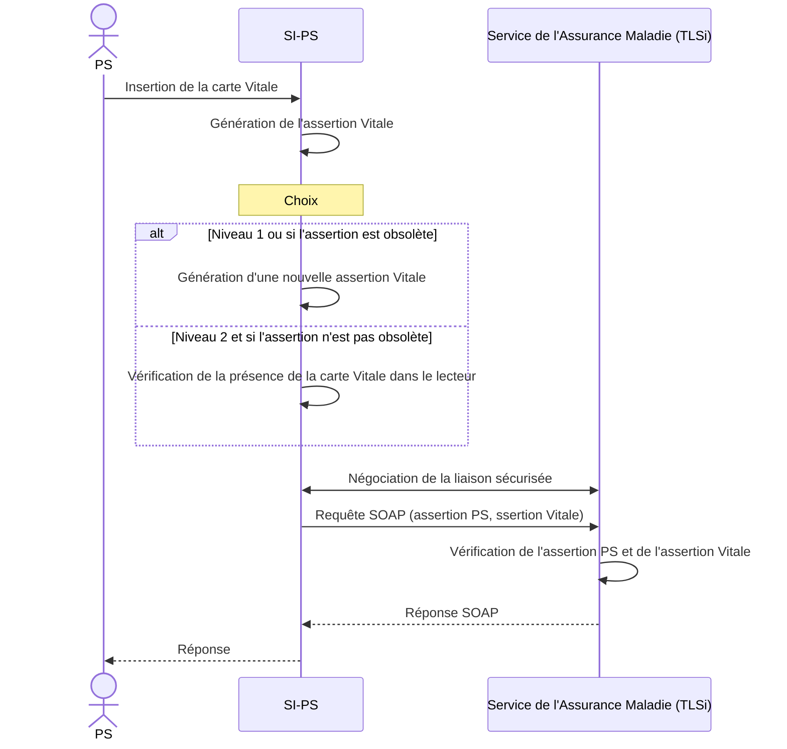

Cadre d’interopérabilité des TLSi

## 3.5 Authentification de la carte Vitale

Figure 7 – Assertion Vitale

19/12/2025  38 / 102

Ce document à diffusion restreinte ne peut être diffusé sans l'autorisation d'une personne habilitée au GIE SESAM-Vitale