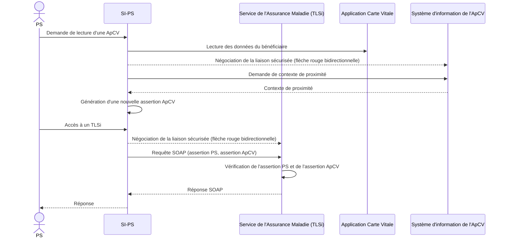

Cadre d’interopérabilité des TLSi

## 3.6 Authentification d'une application Carte Vitale

Figure 8 – Assertion ApCV

19/12/2025 40 / 102

Ce document à diffusion restreinte ne peut être diffusé sans l'autorisation d'une personne habilitée au GIE SESAM-Vitale