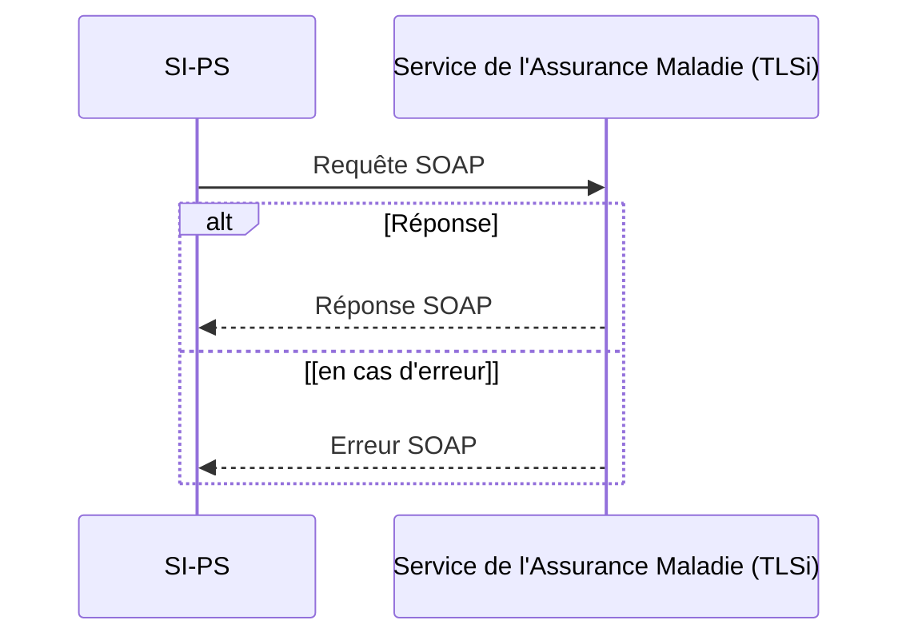
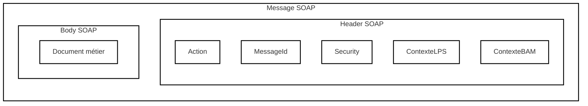

Cadre d’interopérabilité des TLSi

Une assertion ApCV permet d’établir un contexte de sécurité « application Carte Vitale ». Chaque guide d’intégration TLSi mentionnera si dans son domaine d'application, l’assertion ApCV peut être utilisée ou non.

En premier lieu, le SI-PS doit acquérir les données d’une <mark><u>ApCV et doit</u></mark> interroger le système d’information des ApCV afin de récupérer un <mark>*contexte ApCV.*</mark> Ce dernier contient, en complément des informations sur le bénéficiaire, un numéro de série ApCV, un jeton d’autorisation ApCV ainsi qu’une durée de validité du contexte.

Pour acquérir un contexte ApCV, il est nécessaire d’utiliser une assertion PS ou une assertion Structure.

Le SI-PS reçoit le contexte ApCV uniquement si l’ApCV est authentique et n’est pas mise en opposition.

Il convient de vérifier que la date de fin de validité du contexte ApCV n'est pas dépassée avant de créer ou d'utiliser une assertion ApCV.

Ces opérations de récupération du contexte ApCV sont décrites dans le guide d’intégration « *Authentifier et gérer le contexte ApCV PS* » (ApCV-MP-001) fourni par le GIE SESAM-Vitale.

Ensuite, le SI-PS génère une assertion ApCV en y incluant le numéro de série de l’ApCV et le jeton d’autorisation ApCV. L’assertion ApCV n’est pas signée.

Au moment de solliciter une opération d’un TLSi, le SI-PS doit s’assurer que la durée de vie de l’assertion (l'objet XML SAML) n’est pas dépassée (soit 20 minutes).

Enfin, le SI-PS insère l'assertion ApCV dans l'en-tête des requêtes SOAP vers le SIR.

Lorsque le service reçoit une assertion ApCV, il vérifie que le jeton d’autorisation ApCV est toujours valide.

Le jeton d’autorisation ApCV est invalide dans les cas suivants :

− à la demande d’un SI-PS lors du départ du patient,
− lors de la lecture d’une nouvelle ApCV par le PS,
− lors de l’utilisation de l’ApCV chez un autre PS,
− ou après le dépassement de la durée de validité du contexte ApCV.

19/12/2025 41 / 102

Ce document à diffusion restreinte ne peut être diffusé sans l'autorisation d'une personne habilitée au GIE SESAM-Vitale

Cadre d’interopérabilité des TLSi

# Chapitre 4

# Échanges SOAP

## 4.1 Principe général



Figure 9 – Échange SOAP en mode synchrone

Ces échanges respectent les principes décrits dans le document SOAP HTTP Binding 1. Les requêtes et les réponses sont des messages SOAP 1.2 transmis sur le protocole HTTP 1.1.

Les requêtes HTTP sont de type **POST** et doivent être encodées en **UTF-8**.

L’en-tête HTTP Content-Type doit être positionné à :

Content-Type=application/soap+xml;charset=utf-8

Dans le cas de l’utilisation de Pro Santé Connect, l’en-tête **Authorization: Bearer** contient le jeton d’accès AM retourné par le service d’autorisation de l’Assurance Maladie.

Le corps de la requête HTTP contient la requête SOAP.

19/12/2025 42 / 102
Ce document à diffusion restreinte ne peut être diffusé sans l'autorisation d'une personne habilitée au GIE SESAM-Vitale

Cadre d’interopérabilité des TLSi

Le codage littéral doit être utilisé ; l’élément `encodingStyle` n’est pas présent dans la requête SOAP<sup>6</sup>.

```text
POST/nomService HTTP/1.1
Host:server.example.fr
Content-Type:application/soap+xml;charset=utf-8
Content-Length:nnnn
```

Les réponses peuvent prendre l’une des formes suivantes : erreur HTTP, réponses SOAP positives ou erreur SOAP.

```text
HTTP/1.1 200 OK
Content-Type:application/soap+xml;charset=utf-8
Content-Length:nnnn
```

Une réponse SOAP positive possède un code de statut HTTP égal à 200 et contient toujours un message SOAP.

Si une erreur se produit, plusieurs cas sont à envisager :

− Si une erreur HTTP intervient au niveau du protocole HTTP, les codes de statut HTTP sont utilisés. Cette réponse ne contient pas de message SOAP.
− Si le corps du message contient une erreur SOAP, le code de statut HTTP est soit 400 pour une erreur imputée au client soit 500 pour une erreur imputable au serveur.

| Type de réponse | Code HTTP | Description |
| --- | --- | --- |
| Erreur HTTP | 4xx, 5xx | Tous types d’erreurs HTTP. La réponse ne contient pas de message ni d’erreur SOAP. |
| Erreur SOAP | 400, 500 | Tous types d’erreurs SOAP. La réponse contient une erreur SOAP. |
| Aucune erreur | 200 | La réponse contient un message SOAP. |

<sup>6</sup> http://www.w3.org/TR/2003/REC-soap12-part2-20030624
19/12/2025
43 / 102
Ce document à diffusion restreinte ne peut être diffusé sans l'autorisation d'une personne habilitée au GIE SESAM-Vitale

Cadre d’interopérabilité des TLSi

## 4.2 Requêtes SOAP

Une requête SOAP est composée d’un en-tête `<Header>` et d’un corps de message `<Body>`.

```xml
<soap:Envelope>
  <soap:Header> ... </soap:Header> [1]
  <soap:Body> ... </soap:Body> [1]
</soap:Envelope>
```

L’élément XML `<soap:header>` contient des informations techniques destinées à être traitées par le SIR. Ces informations permettent, par exemple, le contrôle d’accès, la traçabilité des échanges, l’adressage du TLSi au sein du SIR, le maintien d’un dialogue avec celui-ci ou la gestion de la sécurité.

L’élément XML `<soap:Body>` contient le corps du message, c’est-à-dire le document métier propre au TLSi.



Figure 10 – Requête SOAP

19/12/2025 44 / 102

Ce document à diffusion restreinte ne peut être diffusé sans l'autorisation d'une personne habilitée au GIE SESAM-Vitale

Cadre d’interopérabilité des TLSi

## 4.2.1 Header SOAP

```xml
<soap:Envelope>
  <soap:Header>
    <wsa:Action> ... </wsa:Action> [1]
    <wsa:MessageId> ... </wsa:MessageId> [1]
    <wsse:Security> ... </wsse:Security> [0..1]
    <ContexteLPS> ... </ContexteLPS > [1]
    <ContexteBAM> ... </ContexteBAM > [0..1]
  </soap:Header>
  <soap:Body> ... </soap:Body> [1]
</soap:Envelope>
```

### **En-tête <Action>**

L’élément XML `<Action>` de la norme WS-Addressing indique l’action à réaliser au sein du SIR. C’est une URN qui doit respecter le format suivant :

```text
"urn:"<TLSi>":"<version>":"<operation>
```

La version est composée du triplet :

```text
<version de référence>"."<version majeure>"."<version mineure>
```

La valeur de l’élément XML `<Action>` est définie dans le contrat WSDL du TLSi.

Par exemple : `"urn:hr:1.0.12:GetHistorique"`

### **En-tête <MessageID>**

L’élément XML `<MessageID>` de la norme WS-Addressing transporte l’identifiant de la requête. Un nouvel identifiant est généré à chaque appel. Il permet de suivre le cheminement du message dans les différentes couches d’infrastructure. Cet identifiant est du type URI et est composé d’un UUID. Le format de cet élément est `"uuid:"<UUID>`.

Par exemple : `"uuid:550e8400-e29b-41d4-a716-446655440000"`

19/12/2025  45 / 102

Ce document à diffusion restreinte ne peut être diffusé sans l'autorisation d'une personne habilitée au GIE SESAM-Vitale

Cadre d’interopérabilité des TLSi

## **En-tête <Security>**

Selon les spécifications d’OASIS Web Services Security (WSS) TC, l’en-tête `<wsse:Security>` fournit un mécanisme pour attacher des assertions SAML (le profil WS-Security Basic Profile) ou un identifiant et un mot de passe.

L’insertion des assertions SAML dans la requête SOAP doit être conforme au SAML Binding.

Par exemple : cas de transmission d’une assertion <mark>SAML</mark> (PS ou Structure) :

```xml
<wsse:Security xmlns:wsse="...">
  <saml:Assertion xmlns:saml="...">
  ...
  </saml:Assertion>
</wsse:Security>
```

L’assertion PS et l’assertion Structure ne sont pas utilisées en même temps.

L’assertion Vitale <mark><u>ou l’assertion ApCV</u></mark> n’est pas systématiquement présente, cela dépend du TLSi appelé. L’assertion ApCV et l’assertion Vitale ne sont jamais présentes en même temps.

Par exemple : cas de transmission d’une assertion PS avec une assertion Vitale ou une assertion ApCV :

```xml
<wsse:Security xmlns:wsse="...">
  <!-- Assertion PS -->
  <saml:Assertion xmlns:saml="...">
  ...
  </saml:Assertion>
  <!-- Assertion Vitale ou Assertion ApCV -->
  <saml:Assertion xmlns:saml="...">
  ...
  </saml:Assertion>
</wsse:Security>
```

L’en-tête WS-Security permet également de transmettre un identifiant et un mot de passe. Pour les TLSi, le mot de passe est transmis en clair. Seuls les éléments XML `<wsse:Username>` et `<wsse:Password>` sont utilisés.

Cas de transmission d’un mot de passe :

```xml
<wsse:Security xmlns:wsse="...">
  <wsse:Username> ... </wsse:Username>
  <wsse:Password> ... </wsse:Password>
</wsse:Security>
```

19/12/2025  46 / 102

Ce document à diffusion restreinte ne peut être diffusé sans l'autorisation d'une personne habilitée au GIE SESAM-Vitale

Cadre d’interopérabilité des TLSi

<u>**Cas sans assertion PS ou assertion Structure** : Dans le cas d’une authentification</u> mutuelle sans assertion, l’en-tête `<wsse:Security>` <u>n’est pas présent. Les contrôles</u> <u>d’accès sont effectués à partir des contextes LPS/BAM et des informations d’identité</u> <u>issues du certificat de la structure.</u>

## En-tête `<ContexteLPS>`

Les requêtes SOAP sont accompagnées d’informations techniques caractérisant le SI-PS. Ces informations permettant d’effectuer des contrôles d’accès vis-à-vis du numéro d’autorisation du SI-PS `<IDAM>`. En ce qui concerne la description XSD de ce contexte, il faut se référer à la dernière version du document `ROOT_ctxlps_CTXLPS_Vxx_xx.xsd`.

Son espace de nommage est `urn:siram:lps:ctxlps`.

```xml
<ContexteLPS xmlns:ctxlps="..." Nature="CTXLPS" Version="...">
  <Id> ... </Id> [1]
  <Temps> ... </Temps> [1]
  <Emetteur> ... </Emetteur> [1]
  <LPS>
    <IDAM R=" ... "> ... </IDAM> [1]
    <Version> ... </Version> [1]
    <Instance> ... </Instance> [1]
    <Nom> ... </Nom> [1]
  </LPS>
</ContexteLPS>
```

### avec :

Nature **[optionnel] [AN]**

> Cet attribut XML contient la nature fonctionnelle du contenu du contexte LPS. La valeur est fixée à "CTXLPS".

Version **[obligatoire] [AN]**

> Cet attribut XML contient la version du contexte précisée dans le fichier XSD associé. La valeur actuelle est fixée à "01_00".

`<Id>` **[obligatoire] [36AN]**

> Cet élément XML contient l’identifiant unique du contexte. Ce numéro prend la forme d’un UUID sous sa forme canonique (36 caractères) et doit être régénéré à chaque nouveau contexte.
>
> Par exemple : "06c6bece-28d6-11e6-86d7-e6618c2586e4"

19/12/2025  47 / 102

Ce document à diffusion restreinte ne peut être diffusé sans l'autorisation d'une personne habilitée au GIE SESAM-Vitale

Cadre d’interopérabilité des TLSi

## `<Temps>` **[obligatoire] [DT]**

Cet élément XML contient la date et l’heure UTC de création du contexte LPS.

Par exemple : "2011-10-17T12:59:49Z"

## `<Emetteur>` **[obligatoire] [AN]**

Cet élément XML contient l’identifiant <mark><u>de l’émetteur</u></mark> à l’origine du contexte.
C’est-à-dire :

– Soit le `<Subject><NameID>` de l’assertion PS ou de l’assertion Structure ;
– Soit l’identifiant `<username>` utilisé lors d’un accès par identifiant et mot de passe.

<mark><u>Dans le cas où le contexte LPS est émis sans assertion PS ou Structure, cet élément XML reprend la valeur de l’identifiant de la structure de santé (idNatStruct<sup>[5]</sup>).</u></mark>

## `<IDAM>` **[obligatoire] [AN]**

Cet élément XML contient le numéro d’autorisation attribué par l’Assurance Maladie et obtenu lors de la vérification de la conformité du SI-PS.

Ce numéro joue le rôle d’identifiant du logiciel. Il est utilisé pour contrôler l’accès du TLSi par le SI-PS.

Le numéro d’autorisation est confidentiel. Il ne doit pas être accessible ou paramétrable par le PS ou par la structure de santé.

## `IDAM@R` **[obligatoire] [2N]**

Cet attribut XML contient le type de vérification de conformité :

– "1" pour un numéro d’agrément ;
– "2" pour un NCC ;
– "3" pour un certificat de conformité ;
– "4" pour un numéro d’autorisation.

Dans le cas des TLSi, R="4" pour des numéros d’autorisation délivrés par le CNDA.

19/12/2025 
  48 / 102
Ce document à diffusion restreinte ne peut être diffusé sans l'autorisation d'une personne habilitée au GIE SESAM-Vitale

Cadre d’interopérabilité des TLSi

<Version> **[obligatoire] [AN]**

Cet élément XML contient le numéro de version du logiciel autorisé pour le TLSi appelé.

La version du SI-PS est celle déclarée au CNDA lors du processus de vérification de conformité du TLSi considéré.

La valeur de cette version reste identique tant qu’il n’y a pas eu de nouvelle autorisation du SI-PS sur le TLSi considéré.

Cette information ne doit pas être modifiable par le PS ou par la structure de santé.

La version est utilisée pour contrôler l’accès au TLSi par le SI-PS.

<Instance> **[obligatoire] [36AN]**

Cet élément XML contient le numéro de série ou identifiant de l’installation du logiciel.

Cet élément XML correspond dans sa définition au champ « LPS_ID » du jeton VIHF<sup>7</sup> du CI-SIS. Si le SI-PS implémente un des volets transport du CI-SIS, la valeur de cet élément XML doit être identique à la valeur du champ LPS_ID de jeton VIHF.

Cet identifiant est généré lors de l’installation du SI-PS. Cet identifiant prend la forme d’un UUID sous sa forme canonique. Il doit être pérenne pour une installation d’un logiciel. Ce numéro est une aide au support, car il permet de regrouper les requêtes d’un même logiciel. Il permet également de compter le nombre de logiciels distincts accédant au TLSi.

Par exemple : "9f822c04-cb46-49c1-9a7b-da18b97f6f65"

<Nom> **[obligatoire] [AN]**

Cet élément XML contient le nom et la version commerciale du SI-PS.

Format de cette donnée est une URN : urn:lps:[nom du LPS]:[version commerciale du SI-PS]

***

<sup>7</sup> CI-SIS_TRANSPORT_VOLET-SYNCHRONE_V3.0 au chapitre 4.3.1.10.1.1.

19/12/2025

 49 / 102

Ce document à diffusion restreinte ne peut être diffusé sans l'autorisation d'une personne habilitée au GIE SESAM-Vitale

Cadre d’interopérabilité des TLSi

Par exemple : `<ci:nom>urn:lps:MYPRODUIT:13B.RC8<ci:nom>`

Le nom et la version commerciale ne doivent pas contenir de caractère «:».

Le nom du SI-PS est celui déclaré au CNDA lors du processus de vérification de conformité. Cette information ne doit pas être modifiable par le PS ou par la structure de santé.

La version commerciale du SI-PS est la version connue et vue par le PS. Cette information ne doit pas être modifiable par le PS ou par la structure de santé.

## **En-tête <ContexteBAM>**

Ces informations concernent les données de l’assuré et du bénéficiaire objet de la requête. Ce contexte est construit à partir des informations issues de la carte Vitale, de l'ApCV ou du SI-PS. En ce qui concerne la description XSD de ce contexte, il faut se référer à la dernière version du document ROOT_ctxbam_CTXBAM_Vxx_xx.xsd.

**En-tête <ContexteBAM>**

```xml
<ContexteBAM Nature="CTXBAM" Version="..." xmlns="...">
  <Id> ... </Id> [1]
  <Temps> ... </Temps> [1]
  <Emetteur> ... </Emetteur> [1]
  <DateRef> ... </DateRef> [0..1]
  <COUVERTURE> [0..1]
    <GrandRegime> ... </GrandRegime> [0..1]
    <Organisme> ... </Organisme> [0..1]
    <CodeCentre> ... </CodeCentre> [0..1]
    <ASSURE> [0..1]
      <Id>
        <Num> ... </Num> [0..1]
        <Cle> ... </Cle> [0..1]
      </Id>
    </ASSURE>
    <BENEFICIAIRE> [0..1]
      <Nir>
        <Num> ... </Num> [0..1]
        <Cle> ... </Cle> [0..1]
        <DateCertification> ... </DateCertification> [0..1]
      </Nir>
      <DateNai> ... </DateNai> [0..1]
      <Rang> ... </Rang> [0..1]
    </BENEFICIAIRE>
  </COUVERTURE>
</ContexteBAM>
```

19/12/2025


Ce document à diffusion restreinte ne peut être diffusé sans l'autorisation d'une personne habilitée au GIE SESAM-Vitale