# Parcours SEFi des transporteurs sanitaires et des taxis

**Référentiel documentaire :** package SEFi Transporteur Sanitaire **3.50**, package SEFi Taxi **V50**, fiches de périmètre TS 3.07 et Taxi 3.08 disponibles dans le dossier au 31 octobre 2026.

Cette carte présente séparément les deux parcours, puis rassemble leurs sources originales et les limites de lecture. Les phases FTE01 (prestations), FTE02 (facturation) et FTE03 (pièces justificatives) peuvent être indépendantes : les flèches expriment les dépendances d’une opération donnée, pas un ordre d’écrans obligatoire. Les consultations de référentiels dépendent du contexte et du paramétrage.

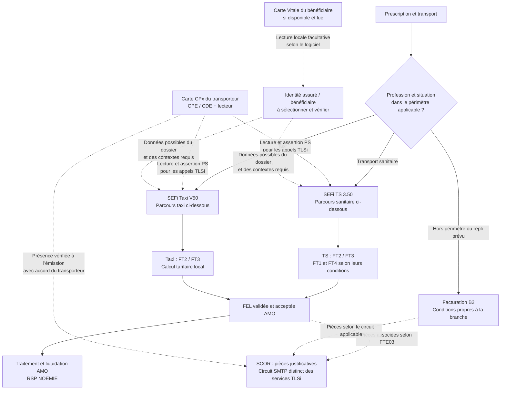

Une **FEL** est une facture électronique en ligne. Son accusé de validation, les retours SCOR et le RSP NOEMIE décrivent trois événements différents ; l’acceptation de la FEL ne prouve pas le paiement. La description d’une capacité dans un package ne vérifie pas l’ouverture opérationnelle du service au jour d’utilisation.

Les conditions documentaires de déploiement comportent également une **présérie encadrée et un bilan**, suivis d'une décision de la CNAM : le document TS utilisé est la version 6 d'août 2026 ; le document Taxi disponible date de novembre 2024. Cette dernière pièce est antérieure au package V50 et ne suffit pas à établir les conditions d'ouverture effectivement en vigueur pour ce package. Sources : [TS-PRESERIE], p. 2–5 ; [TX-PRESERIE], p. 2–5. Les étapes de présérie ne sont pas des appels supplémentaires à effectuer pour chaque facture.

La **CPx** représente ici la carte du professionnel qui autorise les appels aux services selon leur profil ; la **carte Vitale** peut contribuer aux données du bénéficiaire lorsqu'elle est lue. Les données peuvent aussi provenir de la PEL, de la prescription papier, des services BS ou du dossier du logiciel. Les flèches de la carte Vitale ne rendent pas sa lecture obligatoire pour chaque facture. Voir [TS.1](#transport-sanitaire) et [TX.1](#taxi) pour les deux parcours détaillés.

## Sommaire

1. [Repères et vocabulaire](#reperes)
2. [Carte CPx : lecture, signature et présence](#carte-cpx)
3. [Parcours complet transport sanitaire](#transport-sanitaire)
4. [Parcours complet Taxi](#taxi)
5. [Comparaison TS / Taxi](#comparaison)
6. [Services, données échangées et états de la facture](#services)
7. [SCOR, retours et supervision](#scor)
8. [Exemples commentés](#exemples)
9. [Registre des documents originaux](#sources)

<a id="reperes"></a>
## Repères de lecture

Les vues de chaque branche suivent le dossier de la prescription à la facture puis aux pièces justificatives. Les développements techniques et les exemples en fin de document détaillent les échanges et les décisions ; le registre cite les originaux et précise la couverture de lecture. Les flèches portant « selon le contexte » représentent une possibilité conditionnelle, et non un appel à déclencher pour chaque facture.

| Terme | Sens dans les schémas |
|---|---|
| **TR, TS, TX** | Transporteur ; transporteur sanitaire ; taxi. |
| **PEL / PP** | Prescription en ligne / prescription papier. Une prestation de PEL correspond à un trajet ; un aller-retour comprend deux trajets. |
| **FTE01 à FTE06** | Fonctions du système : prestations, facturation, pièces justificatives, consultation des référentiels, administration et supervision. |
| **LPS / AMO / AMC** | Logiciel du partenaire de santé / assurance maladie obligatoire / assurance maladie complémentaire. |
| **CPx / CPE / CDE** | Famille des cartes de professionnel ; pour les parcours transporteur étudiés, carte CPE ou CDE utilisée pour l'accès professionnel. |
| **PS émetteur, facturant, exécutant** | Respectivement celui qui envoie la FEL, celui qui réalise la facture et celui qui effectue la prestation ; ces rôles ne sont pas nécessairement tenus par la même entité. |
| **PL, PS, BS, PEC, FT** | Familles d’opérations : prescription, partenaires et transporteur, bénéficiaire, prise en charge et facture. Les numéros désignent les opérations de chaque famille. |
| **FEL P, R, A, V** | Facture proposée, recevable, validable, validée ; **A** est un état intermédiaire du logiciel. |
| **EFT** | Élément de facturation d’une prestation : les types et leurs données diffèrent selon TS et Taxi. |
| **TUPH / AIG / AHG** | Transport urgent préhospitalier ; AIG est réalisé durant la garde, AHG en dehors de la garde ou du planning de garde. |
| **TMR / TPMR** | Transport de personnes à mobilité réduite ; les guides distinguent notamment la prestation secondaire TS et le supplément Taxi. |
| **TOD / RNT** | Table des organismes destinataires / Répertoire national transporteur. |
| **PJ / SCOR / ARL** | Pièce justificative / circuit de dématérialisation et transmission des justificatifs / accusé de réception logique propre au flux concerné. |
| **RSP / NOEMIE** | Retour de rejet, signalement ou paiement / norme utilisée pour les échanges de retours. |

Sources : dictionnaire [TS-DICO], p. 8–10, 14, 18 et 30 ; présentations générales [TS-PG], p. 13–20, et [TX-PG], p. 12–19. Les objets échangés et les règles de chaque branche restent définis dans leurs guides respectifs.

<a id="carte-cpx"></a>
## Carte CPx : où elle intervient dans SEFi TS et Taxi

La carte professionnelle **CPx**, ici une **CPE/CDE** dans les guides transporteur étudiés, intervient avant les appels aux services SEFi et de nouveau comme contrôle de présence au moment de l'émission SCOR. Les deux utilisations sont liées à la présence du professionnel, mais n'ont pas la même fonction technique.

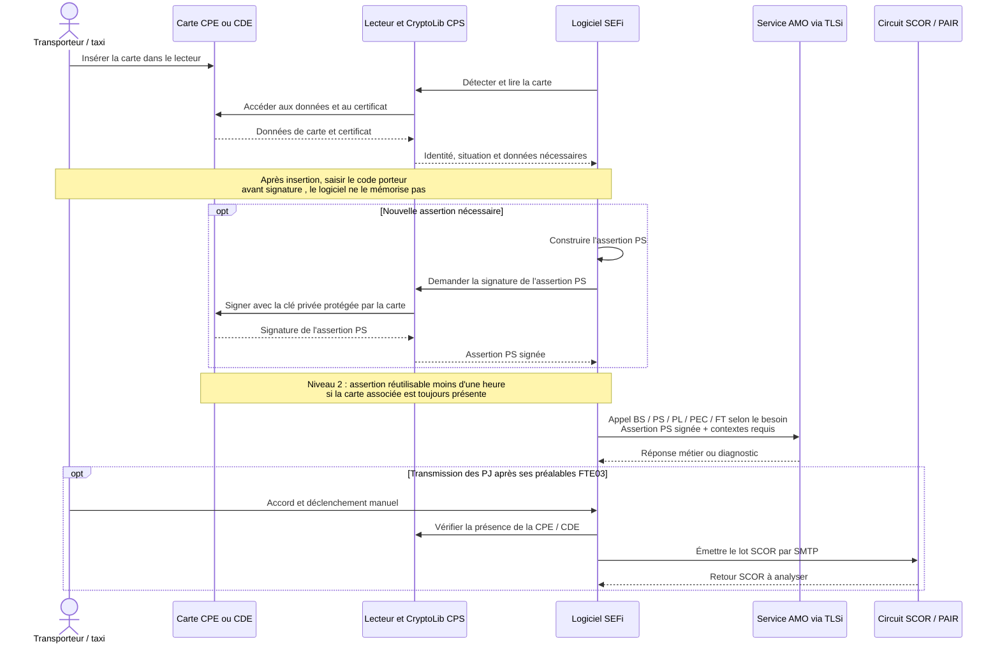

| Moment | Rôle précis de la carte | Effet sur le parcours |
|---|---|---|
| Ouverture du poste / accès aux services | Le lecteur et la CryptoLib CPS permettent au logiciel d'accéder à la CPx. Après insertion, le porteur saisit son code avant la signature de l'assertion. La clé privée est protégée par la carte ; le code porteur ne doit pas être mémorisé par le logiciel. | Le LPS prépare l'identité et, s'il y a plusieurs situations d'exercice, permet la sélection de la situation de facturation. |
| Appel d'un service en ligne | Le LPS construit une **assertion PS signée par la CPx**, puis l'accompagne des contextes prévus et de la requête métier. Le serveur vérifie l'accès avant le traitement du service. | La carte n'est pas elle-même une prescription ou une facture : elle contribue à l'authentification et à l'autorisation de l'appel. |
| Appels successifs | Pour le niveau 2 demandé par les guides SEFi étudiés, une assertion de moins d'une heure peut être réutilisée **si la carte liée est toujours présente** et si les attributs de l'assertion conviennent à l'opération et à la société concernée. Si l'assertion a expiré ou si une autre identité est nécessaire, le logiciel en fait signer une nouvelle ; si la carte est absente, il ne peut pas la réutiliser ni en faire signer une nouvelle avec cette carte absente. Le niveau 1, plus strict, reste possible. | Il n'est pas nécessaire d'insérer de nouveau la carte ou de signer une nouvelle assertion à chaque opération lorsque les conditions de réutilisation restent remplies. |
| Absence de l'utilisateur | La carte et son lecteur restent sous son contrôle exclusif ; le logiciel doit pouvoir être verrouillé lorsque le porteur quitte son poste, y compris si la carte y reste insérée. | Ne pas confondre carte physiquement présente et autorisation pour un tiers d'utiliser une session restée ouverte. |
| Retrait de la carte | Détecter son retrait dès que possible et désactiver les accès et connexions ouverts avec elle ; ne plus réutiliser l'assertion comme si la carte était présente. | Le logiciel doit reprendre le contrôle de carte et reconstruire les éléments nécessaires avant de poursuivre selon le profil du service. |
| Émission SCOR | FTE03 demande le déclenchement manuel, l'accord du transporteur et la vérification de la présence CPE/CDE. | La transmission des PJ est un circuit SMTP distinct : cette étape ne doit pas être représentée comme un appel métier TLSi ni comme une nouvelle signature SOAP imposée par FTE03. |

Pour les appels **PS1/PS3/PS4 et PL1/PL2/PL3**, les guides demandent l'assertion PS niveau 2 et le contexte LPS. Pour **PEC1 et FT2/FT3**, ils demandent aussi le contexte BAM ; **FT1/FT4** s'ajoutent uniquement pour TS et selon leurs conditions. Les profils de **BS1/BS2** incluent également les contextes prévus par le guide bénéficiaire. Le détail par opération figure dans les tableaux TS.8, TX.7 et « Profils, contextes et cohérence en-tête / corps ».

La signature décrite ici est celle de **l'assertion PS**. Elle ne signifie pas que le logiciel signe systématiquement l'ensemble du corps SOAP ou toute la facture FEL avec la carte.

En **multi-sociétés**, la carte présentée est celle de la société **mandataire** ; l'identifiant de facturation dans l'assertion dépend de l'opération. Pour **FT2/FT3**, il doit correspondre à la société **mandante facturante** portée dans la FEL. Il ne faut donc pas supposer que le nom du porteur de la carte, l'émetteur et le facturant sont toujours interchangeables.

La **carte Vitale** sert à obtenir des informations liées au bénéficiaire lorsqu'elle est lue ; elle n'est pas la carte CPx qui signe l'assertion du transporteur. Le contexte BAM est un ensemble de données XML distinct de l'assertion PS : il peut être alimenté à partir d'une carte Vitale lue ou des données disponibles dans le logiciel, selon les règles du service. Sa présence n'impose pas automatiquement celle de la Vitale. Le cadre général décrit aussi une *assertion Vitale*, éventuellement signée, mais les guides BS, PS, PL, PEC et FT TS/TX examinés n'en font pas un élément requis de ces appels. Il ne faut donc pas transformer une lecture Vitale en signature systématique de la FEL ni de la requête. Sources : [TLSI-CI], p. 39, 44–46 et 50 ; [BS], p. 10–11 ; [TS-FT], p. 26–27 ; [TX-FT], p. 25–26.

Lorsque la carte Vitale présente plusieurs bénéficiaires, le logiciel doit utiliser **le bénéficiaire choisi pour le transport**, avec sa date de naissance et son rang, et distinguer cette identité du NIR de l'ouvrant droit. La lecture de la carte ne remplace pas à elle seule la détermination des modalités de prise en charge PEC à la date du trajet. Sources : [TLSI-CARTES], p. 18–19 ; [BS], p. 5–8 ; [TS-PEC] et [TX-PEC], p. 5–7.

Sources : [Cadre TLSi AMO 1.2.3 du dossier 1.2.3v2][TLSI-CI], p. 26–28 et 42–53 ; [modalités cartes et certificats 1.43][TLSI-CARTES], p. 7–10, 13–16 ; [TS-PS], p. 12–13 ; [TX-PS], p. 12–13 ; [TS-FT], p. 26–27 ; [TX-FT], p. 25–26 ; [TS-FTE03] et [TX-FTE03], p. 19. Ces deux documents du socle ont fait l'objet d'une lecture textuelle intégrale lors de l'analyse TLSi précédente ; les passages ci-dessus ont été relus pour cet ajout.

<a id="transport-sanitaire"></a>
## Parcours SEFi transport sanitaire — package TS 3.50

Ce parcours décrit le package **SEFi Transporteur Sanitaire 3.50**, avec PG 05.48, FTE02 03.60 et WS_FT 03.52. Les étapes sont des dépendances fonctionnelles ; elles ne constituent pas un ordre imposé d'écrans. FTE01, FTE02 et FTE03 peuvent être mobilisées indépendamment, sous réserve de disposer des données et états requis lors de leur utilisation. Sources : [TS-PG], p. 13–20 ; [TS-FTE02], p. 6.

### TS.1 — Acteurs, autorisation et conditions de départ

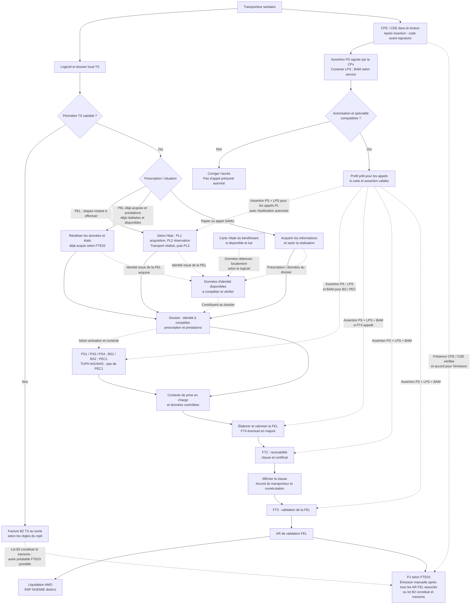

Dans ce schéma, les flèches de la CPx indiquent le profil de sécurité de l'appel, pas une nouvelle insertion ou une nouvelle signature forcément nécessaire à chaque opération. La saisie locale d'un dossier n'est pas en elle-même un appel en ligne ; l'absence de CPx ne conduit pas, à elle seule, à une bascule B2 automatique. La lecture éventuelle de la carte Vitale alimente le dossier local ; le guide TS décrit aussi les données provenant de la PEL, de la prescription papier ou du SAMU et des services BS. Elle n'est pas un préalable universel de FTE02. Les appels de référentiels restent conditionnels et les étapes de pièces peuvent être préparées indépendamment ; les branches d'erreur FT2/FT3 figurent en TS.5–TS.6. Sources : [TLSI-CI], p. 50 ; [TLSI-CARTES], p. 7–10 ; [TS-FTE02], p. 11–16 ; [TS-FT], p. 26–27 ; [TS-FTE03], p. 7 et 19.

L'autorisation TS seule est compatible avec la spécialité **55** ; une autorisation TS et TX accepte 55 ou 56 selon le tableau de compatibilité. L'identification du transporteur pour les services repose sur sa CPE/CDE. La présence d'un moyen d'accès dans le cadre TLSi commun ne suffit pas à l'autoriser pour une opération SEFi. Sources : [TS-PG], p. 11 ; guides [TS-PS], p. 12–13, [TS-PL], p. 17–18, [TS-PEC], p. 9–10 et [TS-FT], p. 26–27.

**Divergence documentaire :** la fiche de diffusion 920v2 p. 1 mentionne la spécialité « 56 » pour les transporteurs sanitaires, tandis que le tableau détaillé `RG_FTE099` de la présentation générale TS p. 11 autorise `55` pour une autorisation TS seule et `55` ou `56` pour une autorisation TS + TX. Le parcours reproduit ce tableau détaillé ; aucun erratum officiel résolvant cet écart n'a été trouvé dans les pièces examinées. Sources : [TS-DIFF-920], p. 1 ; [TS-PG], p. 11.

Le périmètre livré TS couvre les régimes **01, 02, 04, 05, 06, 07, 08, 10, 90**, et **99 limité aux caisses 609/939**. La restriction sur les NIR migrants commençant par 5 ou 6 reste active. La restriction transfrontalière comporte des exceptions selon régime : lire les critères C1.3 et C2.1 ensemble, sans élargir la liste des régimes à partir d'une seule note. Les anciennes lignes sur la garde ambulancière sont barrées ; le TUPH figure dans le périmètre courant. Sources : [TS-PER], p. 2, contrôle des marques de révision ; [TS-PG], p. 7–8.

### TS.2 — Prescription en ligne, papier et urgence préhospitalière

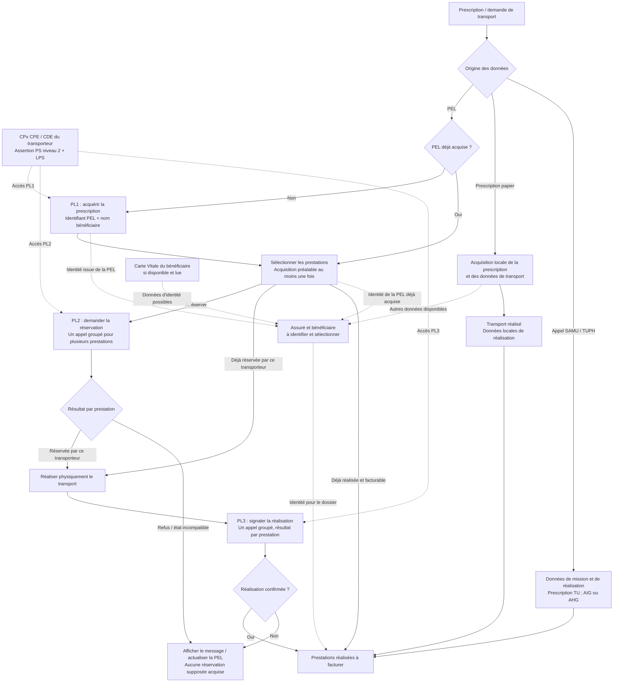

Une prestation à l'état prescrite ou réservée peut être réservée ; une réservation peut être reprise par un autre transporteur. Une prestation réalisée ou facturée n'est plus réservable. PL3 exige une réservation par le transporteur appelant. Les demandes groupées donnent une réponse unique contenant un résultat au niveau de chaque prestation : une réponse reçue n'autorise pas à traiter tous les éléments comme réussis. Sources : [TS-FTE01], p. 6–12 ; [TS-PL], p. 12–15.

Le transporteur connaît les états et l'appartenance de gestion, sans obtenir l'identité de l'autre transporteur. Un aller-retour représente deux trajets. Les états de prestation comprennent PRES, RES, REA, FAC et NFA ; la présence de NFA dans la table ne suffit pas à inventer une transition automatique. Sources : [TS-FTE01], p. 6 ; [TS-DICO], p. 14, 29–30.

Pour une facture TUPH, une seule prestation AIG ou AHG est transmise ; le type de prescription attendu est TU. Ces conditions spécifiques ne se déduisent pas du seul plafond général paramétrable de la FEL. Source : [TS-DICO], p. 48, diagnostics ERR_FT_301 et ERR_FT_308.

### TS.3 — Acquérir et contrôler les informations nécessaires

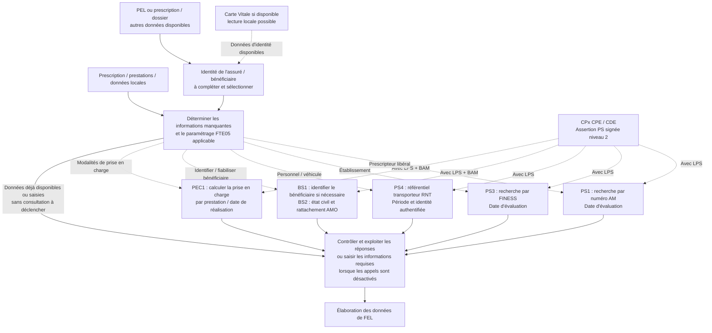

La carte Vitale peut être lue localement lorsqu'elle est disponible et que le logiciel le permet ; ses données ne constituent pas, à elles seules, le calcul PEC pour la date du trajet. En PEL, le guide prévoit l'identité issue de la prescription puis BS2 si activé ; en papier ou appel SAMU, les données disponibles et BS1/BS2 peuvent être utilisés selon activation. Le contexte BAM est construit avec les données requises, qu'elles proviennent notamment du dossier ou d'une carte lue : sa présence n'impose pas une lecture immédiate de la carte Vitale. Sources : [TS-FTE02], p. 14–15 ; [TLSI-CI], p. 50 ; [TLSI-CARTES], p. 8–10.

Ces appels ne sont pas une chaîne obligatoire PS → BS → PEC. Les fonctions **CONSULTER FTE04** sont indépendantes des indicateurs d'activation utilisés en facturation. PS1/PS3/PS4/BS1/BS2/PEC1 sont activés par défaut, mais désactivables dans FTE05 ; les informations métier nécessaires restent à fournir. Sources : [TS-FTE04], p. 5–21 ; [TS-FTE05], p. 8–13.

| Opération | Résultat utile au parcours | Condition déterminante |
|---|---|---|
| PS1 | Identité, spécialité et éventuellement RPPS du prescripteur | Recherche par numéro AM à une date d'évaluation ; ne pas dessiner une recherche RPPS directe comme fonction livrée |
| PS3 | Identité et adresse de l'établissement | Recherche FINESS à une date d'évaluation |
| PS4 | Personnel, diplômes et véhicules du transporteur | Recherche rattachée à l'identité authentifiée ; informations contrôlées à la période pertinente |
| BS1/BS2 | Identification, état civil, régime/caisse/centre | BS2 ne fournit pas à lui seul les taux, droits détaillés ou modalités de prise en charge |
| PEC1 | Couverture, assurance, contexte de prise en charge, exonération, taux et cadre réglementaire | Date de référence = réalisation ; cohérence entre en-tête BAM et corps ; date ou identifiant AT selon le cas |
| PEC1 en TUPH AIG/AHG | Aucun appel | FTE04 exclut cet appel pour ce cas TS |

Sources : [TS-PS], p. 4–17 ; [TS-PEC], p. 4–13 ; [TS-FTE04], p. 11–16. Le guide bénéficiaire commun reste la référence détaillée de BS1/BS2.

### TS.4 — Construire, valoriser et proposer la FEL

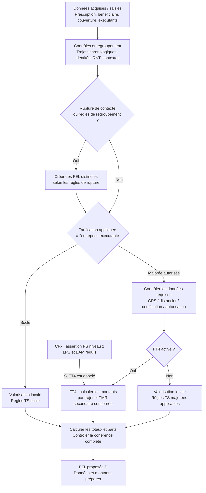

L'activation de la tarification majorée est réservée à l'éditeur, entreprise par entreprise, après accord de la CPAM de rattachement ; sinon, le socle s'applique. FT4 est facultatif, activé par défaut en majoré et désactivé en socle. Il calcule les montants d'une prestation ; il ne valide pas la FEL. Sources : [TS-FTE05], p. 7–13 ; [TS-FT], p. 8–11 ; [TS-FTE02], p. 61–66.

Les données de géolocalisation et de certification exigées par les conditions de tarification majorée ne sont pas modifiables manuellement. FT4 ne calcule pas les contrats AMC privés ; leur bloc contrat doit être omis dans la demande correspondante. Les modalités précises de certification et de constitution des traces relèvent de leurs documents dédiés ; ce bloc décrit leur point d'utilisation dans la facturation. Sources : [TS-FTE02], p. 34, 38–39, 61–63 ; [TS-FT], p. 16.

| Contrôle structurant | Effet sur l'élaboration |
|---|---|
| Changement de contexte PEC, type de forfait, exonération TM, taux, tarif, nature de prestation ou refus du partagé | Rupture de facture selon les conditions FTE02 ; une même prescription peut produire plusieurs FEL |
| TMR secondaire | Ne peut être seule ; elle suit immédiatement le trajet associé dans le XML ; incompatible avec ABA et TUPH ; appel FT4 dédié si ce service est utilisé. Les exceptions aux ruptures P2.1–P2.6 préservent son rattachement au trajet selon FTE02 |
| Refus du transport partagé | Cas des transports itératifs ou en série en VSL : cadre TPR, une personne, absence d'abattement ; tiers payant AMO non, sauf AME ou C2S où il est accordé |
| Exonération TM | Justificatif obligatoire selon la règle métier, même si une cardinalité XML générique est 0..1 |
| Adhérent AMC | Ne pas transmettre son numéro dans FT2/FT3 ; distinguer données locales, données de consultation et données du flux |
| Limites de prestations | Maximum paramétré de trajets ou prestations : 20 par défaut ; les TMR sont comptées, avec un maximum de neuf TMR par facture. L’ancienne note excluant les TMR du décompte est barrée dans FTE02 p. 40 |

Sources : [TS-FTE02], p. 7–8, 33–45, 58, 63 ; [TS-FT], p. 15–17, 24, 36–44 ; [TS-FTE05], p. 14.

Le cas de refus visé ici concerne les transports **itératifs ou en série en VSL** ; il ne s'applique pas à l'ambulance ni à tout trajet VSL indistinctement. Le refus reste tracé dans les cas AME/C2S, même lorsque le tiers payant AMO est maintenu. Sources : [TS-FTE02], p. 35 ; [TS-PG], p. 9.

Les types de suppléments forfaitaires ne se mélangent pas lorsque la règle de rupture FTE02 l'interdit. Les exceptions propres aux TMR doivent être vérifiées avant de séparer une prestation secondaire de son trajet. Source : [TS-FTE02], p. 7–8.

### TS.5 — Recevabilité, acceptation puis validation

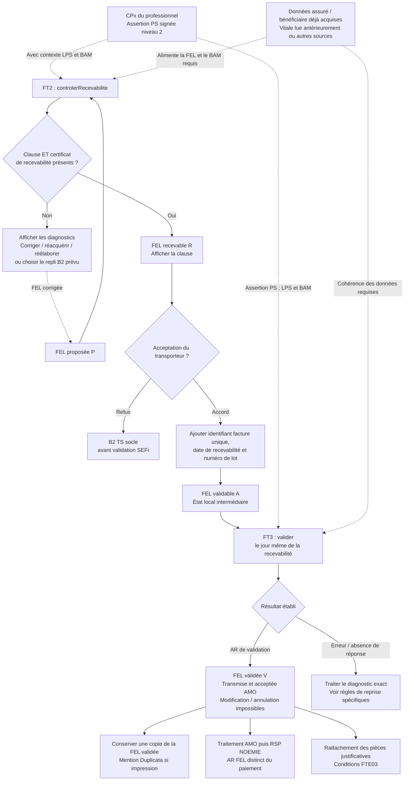

La carte CPx contribue au profil de sécurité des deux appels ; l'identité du bénéficiaire est issue du dossier et du contexte BAM. Les guides FT n'imposent pas que la carte Vitale soit présente devant le lecteur à l'instant de FT2 ou de FT3. Sources : [TS-FT], p. 26–27 ; [TLSI-CI], p. 50.

Un résultat FT2 positif requiert **les deux éléments**, clause et certificat. Une réponse SOAP ou des diagnostics seuls ne créent pas l'état recevable. FT3 exige la recevabilité préalable et l'accord effectif du transporteur. Si la FEL est modifiée après recevabilité ou si le délai est dépassé, le nouveau contrôle prévu doit être effectué. Sources : [TS-FTE02], p. 67–75 ; [TS-FT], p. 6–7, 35–47 ; [TS-DICO], p. 18 et 42.

Le forçage des données AMO, le refus de clause et les autres choix de repli documentés interviennent **avant** validation. Le repli B2 TS est en tarification socle. Après validation obtenue, aucune bascule automatique ne doit créer une seconde facture. Sources : [TS-PG], p. 8, 18 ; [TS-FTE02], p. 10, 68–76.

Pour ce repli TS, FTE02 prévoit une facture B2 de **36 trajets au maximum** et la génération automatique de l'image CERFA PDF directement dans le dossier FSNC, sans impression ni numérisation préalables. Sources : [TS-FTE02], p. 76 et 88.

Le lot réunit au maximum **999 factures** répondant aux mêmes critères de regroupement : PS facturant, régime, organisme destinataire, tiers payant AMO et AMC, date de création, type de prescription, type de facturation et critère spécifique AMO. La date de création du lot est celle de la FEL. Les plages de numéros sont paramétrables selon prescription et facturation ; l'ordre est chronologique par société mandante, et le rang des FEL commence à un. Si l'organisme destinataire ne peut pas être déterminé dans la TOD, la facture ne peut être réalisée. Sources : [TS-FTE02], p. 71–73.

### TS.6 — Erreurs et reprises autorisées

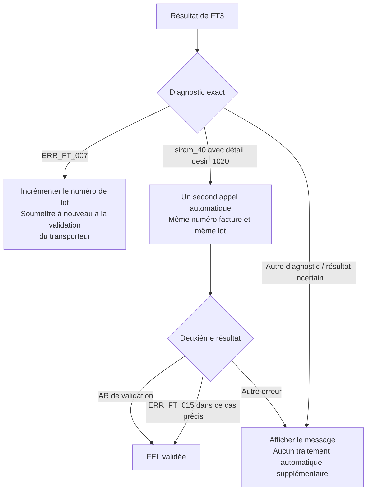

Les reprises ne sont pas une politique universelle de nouvelle tentative. L'absence d'AR ne prouve pas l'absence de traitement. Les fautes SOAP techniques, les diagnostics fonctionnels FEL et les retours de liquidation sont des couches distinctes ; afficher les messages et rendre accessibles les détails et préconisations correspondants. Sources : [TS-FTE02], p. 74–75 ; [TS-PG], p. 24 ; [TS-FT], p. 50–51.

### TS.7 — Pièces justificatives, SCOR et supervision

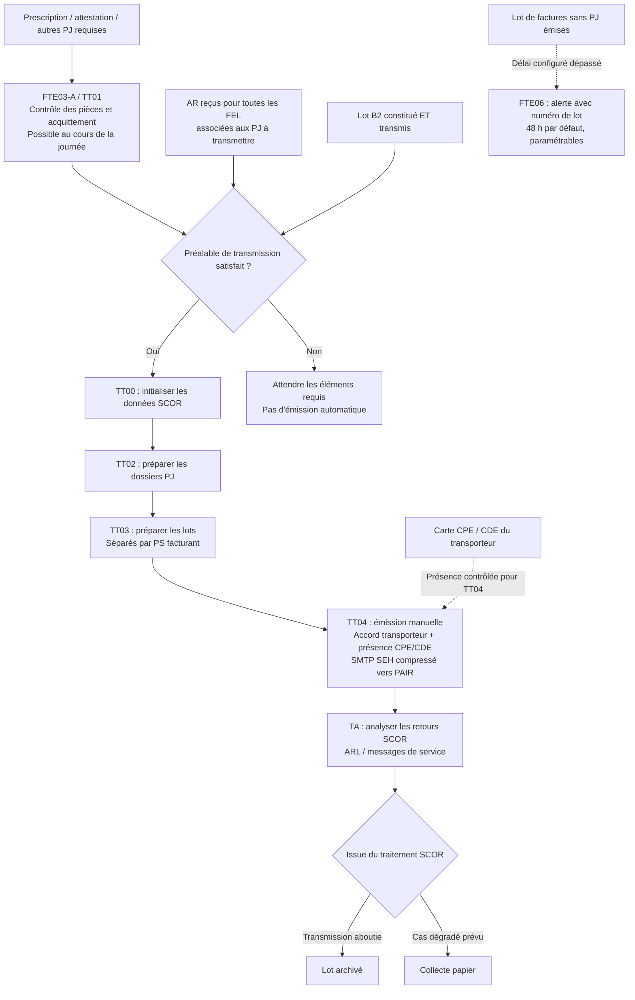

Ce circuit PJ n'appelle pas un service en ligne AMO TLSi. L'émission se fait à l'issue de l'activité de facturation, après intervention manuelle et contrôles. L'alerte de supervision ne déclenche pas l'émission. ANST/ASF restent dans le tableau TS, FSNC est prévu pour le circuit B2, et TU pour l'appel SAMU selon les cas documentaires. Une DAP TS applicable est transmise dans le circuit SCOR prévu. Sources : [TS-FTE03], p. 4, 7–19 ; [TS-FTE05], p. 14 ; [TS-FTE06], p. 5 ; [TS-PG], p. 7.

Une PJ oubliée peut être transmise ultérieurement dans un autre lot. Après réémission d'une facture B2 rejetée, retransmettre ses PJ. La réutilisation d'un identifiant PJ suppose un dossier initial avec ARL positif **et** une FEL correspondante validée/acceptée avec AR FEL reçu. Un ARL SCOR ne se substitue ni à l'AR FEL ni au RSP de paiement. Sources : [TS-FTE03], p. 7, 12, 17 ; [TS-PG], p. 15–17.

### TS.8 — Identités, sécurité et multi-sociétés

| Opérations TS | Assertion PS | LPS | BAM | Identité en multi-sociétés |
|---|---|---|---|---|
| BS1 / BS2 | Niveau 2, issue de la CPx | Obligatoire | BS1 : assuré et NIR + clé ; BS2 : ajoute naissance et rang du bénéficiaire | Mandante ou mandataire selon organisation prévue |
| PS1 / PS3 | Niveau 2 | Obligatoire | Non requis par ces guides | Mandante ou mandataire selon organisation |
| PS4 | Niveau 2 | Obligatoire | Non requis | Mandante réalisatrice |
| PL1 / PL2 / PL3 | Niveau 2 | Obligatoire | Non requis | Mandante réalisatrice |
| PEC1 | Niveau 2 | Obligatoire | Obligatoire, DateRef = réalisation | Mandante ou mandataire selon organisation |
| FT1 / FT4 | Niveau 2 | Obligatoire | Couverture régime/caisse/centre | Mandante réalisatrice |
| FT2 / FT3 | Niveau 2 | Obligatoire | Couverture + assuré/bénéficiaire | Mandante, identique au PS facturant de la FEL |

La carte utilisée en multi-sociétés est celle de la mandataire ; l'identité de facturation portée par l'assertion dépend de l'opération. La FEL porte aussi le **numéro de la CPx effectivement utilisée pour émettre** : il est distinct du numéro du PS facturant et, en multi-sociétés, correspond à la carte de la mandataire. Les sociétés doivent appliquer la même tarification socle/majorée. Les lots SCOR sont séparés par PS facturant et les lots de factures sont numérotés chronologiquement par mandante. Sources : [TS-PG], p. 18–20 ; [TS-PS], p. 12–13 ; [TS-PL], p. 17–18 ; [TS-PEC], p. 9–10 ; [TS-FT], p. 15, 26–27 ; [TS-FTE02], p. 25, 73 ; [BS], p. 10–11.

Les XSD constituent la référence syntaxique des échanges ; ils ne suppriment pas les obligations métier conditionnelles. Le contrat TS **SEMaFELTransport 1.1.0** expose FT1, FT2, FT3 et FT4. Ses Actions SOAP restent `urn:semafeltransport:1.0.0:<opération>` : la version du nom de fichier ne sert pas à reconstruire l'Action. FT1 consulte une FEL déjà validée sans restituer certificat ni AR ; ce n'est pas un mécanisme générique de récupération d'AR perdu. Sources : [TS-FT], p. 5, 25–27 ; [TS-WSDL].

### TS.9 — Paramétrage et traçabilité qui traversent le parcours

| Fonction | Effet |
|---|---|
| FTE05 : identification | Renseigner l'entreprise exécutante, facturante et émettrice et leurs informations nécessaires |
| FTE05 : options de services | Activer/désactiver les acquisitions optionnelles de facturation ; FTE04 reste indépendant |
| FTE05 : tarification | Activation du majoré réservée éditeur après accord CPAM ; retour au socle possible |
| FTE05 : délai PJ | 48 h par défaut, paramétrables ; FTE06 alerte sur les lots concernés |
| Historisation FT2/FT3 | Historisation activable des requêtes et réponses pendant 12 mois ; éléments présentables à la demande de l'AMO |
| Consultations seules | Ne pas assimiler une consultation PEL hors facturation à un archivage libre ou à une copie imprimable de la prescription |

Sources : [TS-FTE05], p. 6–15 ; [TS-FTE06], p. 5 ; [TS-PG], p. 12 ; [TS-FTE04], p. 17.

### TS.10 — Du dossier de transport aux données facturables

L'élaboration ne consiste pas à recopier une prescription dans une facture. Elle rapproche quatre familles de données : ce qui a été prescrit, ce qui a effectivement été réalisé, la situation de prise en charge à la date de chaque trajet et les règles tarifaires applicables à l'entreprise. La FEL n'atteint l'état **P** qu'une fois ses données et ses montants élaborés. La date de prescription, la date de départ, la date de consultation d'un référentiel et la date de facture ont donc des fonctions différentes. Sources : [TS-FTE02], p. 6, 15–22, 37, 69–71.

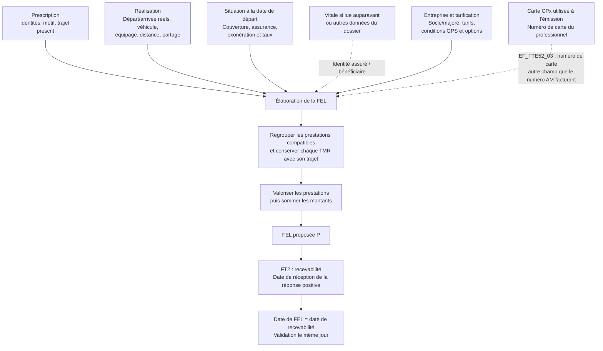

| Donnée à préparer | Prescription en ligne | Prescription papier / appel SAMU | Règle et source |
|---|---|---|---|
| Carte du professionnel | Numéro de la CPx utilisée pour émettre | Même règle | `EF_FTE52_03` est obligatoire dans la FEL ; en multi-sociétés, numéro de la carte de la mandataire. Source : [TS-FTE02], p. 25 ; [TS-FT], p. 15. |
| Origine | PL1 acquiert la PEL ; pas de nouvel appel nécessaire si déjà acquise pour FTE01 | Pas d'appel PL1 pour fabriquer une prescription à partir du papier | RG_FTE200, [TS-FTE02], p. 13 |
| Type de prescription `EF_FTE54_02` | `PL` | `PP` hors TUPH ; `TU` pour TUPH | RG_FTE215, p. 30 |
| Identifiant de prescription | Identifiant PEL `EF_FTE30_01` | Sans objet dans le tableau de constitution PP | p. 28 |
| Prescripteur libéral | Identifiant AM de la PEL ; RPPS éventuellement présent | Identifiant AM lu sur la prescription ; données complémentaires acquises ou saisies | p. 13–14, 28–29 |
| Prescripteur en établissement | Identifiant FINESS de la structure ; RPPS éventuellement présent | FINESS de la structure ; cas TUPH spécifique ci-dessous | p. 13–14, 29 |
| Spécialité du prescripteur | Récupération PS1 ou PS3 si activation ; sinon saisie | Même principe | RG_FTE215 [53.02], p. 29 ; [TS-FTE05], p. 9 |
| Bénéficiaire | État civil, naissance, rang et NIR ouvrant droit issus de la PEL ; BS2 complète le rattachement selon activation | Acquisition BS1/BS2 ou saisie à partir des supports ; les champs requis restent nécessaires | [TS-FTE02], p. 14–15, 26–27 ; [TS-FTE05], p. 10–12 |
| Identifiant de prestation | Reprendre celui de la prestation PEL ; exception TMR décrite en TS.16 | Le LPS attribue un identifiant unique au sein de la FEL | RG_FTE217, [TS-FTE02], p. 33 |
| Nature de prestation | Choisie en cohérence avec le mode de transport prescrit | Renseignée par le transporteur | RG_FTE217, p. 33–34 |
| Dates et heures de trajet | Saisie des données de réalisation par le transporteur | Saisie des données de réalisation par le transporteur | RG_FTE219, p. 36–37 |
| Adresses du trajet | Initialisation à partir de la PEL ; conserver valeur, format et casse selon la règle, sous réserve du traitement explicite des localités longues | Saisie par le transporteur | RG_FTE219, p. 36–38 |

**Deux différences entre consultation et facturation sont déterminantes.** Une PEL peut décrire `ATP` (transport en commun) ou `VP` (moyen individuel) : leur présence dans le résultat de consultation ne permet pas de les facturer en SEFi. Par ailleurs, la prescription décrit un transport prévu ; la date et l'heure du transport réellement exécuté doivent encore être renseignées. Sources : [TS-DICO], p. 29, note 1 ; [TS-FTE02], p. 36–37.

Les localités dépassant 33 caractères font l'objet d'une consigne explicite de troncature à 33 caractères, liée à `ERR_FT_069`, malgré les formats génériques plus larges du dictionnaire. Cette exception de constitution du message doit rester distincte d'une modification métier de l'adresse. La donnée « date de départ » ne peut pas être future ; si PEC a été consulté, sa date d'évaluation doit correspondre à cette date de départ. Sources : [TS-FTE02], p. 37 ; [TS-DICO], p. 28.

### TS.11 — RNT, véhicule et équipage : ce qui doit arriver dans la FEL

PS4 fournit des listes utilisables pour préparer la facture. Le transporteur renseigne ensuite **le véhicule et les personnes ayant effectivement assuré chaque trajet**. Le LPS peut proposer les listes acquises ; il ne doit pas assimiler leur présence à la sélection de l'équipage réel. Si PS4 est désactivé pour la facturation, les listes préalables ne sont pas acquises et les champs restent à renseigner. Sources : [TS-FTE02], p. 16, 39 ; [TS-FTE05], p. 9–10.

| Niveau | Données utiles | Conséquence fonctionnelle |
|---|---|---|
| Paramétrage entreprise | Identifiant AM de l'exécutant ; entreprise facturante et émettrice | Le choix d'une société fixe le contexte d'identité et le paramétrage socle/majoré ; le véhicule n'identifie pas à lui seul la société facturante |
| Listes RNT | Personnel, véhicules et, dans la branche TS, diplômes | Préparer la sélection ; tenir compte des dates de validité décrites dans PS4 |
| Trajet facturé | Immatriculation `EF_FTE64_01`, nom/prénom du conducteur `02/03` | Champs obligatoires dans RG_FTE221 |
| Deuxième membre d'équipage | Nom/prénom `EF_FTE64_04/05` | RG_FTE221 les rend obligatoires pour la nature `ABA` |
| TMR secondaire | Même véhicule et même équipage que le trajet associé | Héritage explicite, sans créer un second transport physique |

Sources : [TS-FTE02], p. 23–25, 39 ; [TS-FTE04], p. 8–10 ; [TS-PS], p. 8–11 ; [TS-FTE05], p. 6–7, 9–10. Les limites et divergences de dates des messages PS4 sont détaillées dans le volet des services ; elles ne sont pas résolues en supposant une actualité permanente des listes.

### TS.12 — De PEC aux contextes AMO/AMC et aux règles de tiers payant

Le résultat PEC est réparti entre le contexte commun de la prescription `EF_FTE28` et les données propres à la prestation `EF_FTE29`. La **date d'évaluation** de PEC est la date de départ du trajet ; cette règle ne prescrit pas que l'appel ait lieu ce jour-là. Si le contexte reçu diffère de celui d'un trajet précédent, la prescription ne tient plus dans une seule FEL. La TMR reprend la prise en charge de son trajet ; elle ne justifie pas un nouveau contexte indépendant. Sources : [TS-FTE02], p. 15–16, 63–64.

| Élément | Alimentation et contrôle dans la FEL | Repère |
|---|---|---|
| Régime / caisse / centre AMO | Initialisés depuis le contexte PEC si acquis ; restent à renseigner sinon | RG_FTE222, p. 42–43 |
| Nature d'assurance | `AS`, `ATMP` ou `MA` ; même nature dans les occurrences AMO et AMC | RG_FTE224, p. 46 ; [TS-DICO], p. 31 |
| Maternité | Date de maternité obligatoire pour l'assurance maternité ; non renseignée dans l'occurrence AMC | [TS-FTE02], p. 46–47 |
| ATMP | **Date AT ou identifiant AT, exclusivement l'un des deux** dans la couverture AMO ; chacun est obligatoire si l'autre est absent ; aucun des deux dans la couverture AMC | p. 47 |
| Accident causé par un tiers | Indicateur et date dans la couverture AMO, éventuellement initialisés depuis la PEL ; absents de la couverture AMC | p. 47–48 |
| Contrat AMO | Reprendre le contrat particulier PEC ou renseigner la valeur adaptée ; table `BASE`, `ALM`, `FSV` | p. 43 ; [TS-DICO], p. 31 |
| Contrat AMC | Transcodifier l'indicateur PEC ; le code d'échange `CMUC` reste utilisé pour C2S | [TS-FTE02], p. 44–45 ; [TS-DICO], p. 31 |
| Organisme complémentaire | À renseigner pour l'AMC privée ; pas de numéro d'organisme dans les situations où le code du contrat particulier est significatif ; hors situation particulière, valeur par défaut `123456789` si non renseignée par le transporteur | [TS-FTE02], p. 45–46 |
| Numéro d'adhérent | Ne pas renseigner dans la FEL, même si connu localement | p. 45, révision active |
| Justificatif d'exonération et taux | Obligatoires au niveau prestation ; initialisés depuis PEC lorsqu'il a été consulté | p. 63–64 |
| Nature de justificatif de droits | Donnée distincte du justificatif d'exonération ; la table comprend notamment `9` pour l'utilisation de PEC | p. 42, 44 ; [TS-DICO], p. 31–32 |

L'option « positionnement par défaut du TP AMO » ne se confond pas avec le tiers payant réglementaire retourné par PEC. Quand l'option est active, RG_FTE222 applique la table TB222, appréciée à la date du jour ; cette initialisation n'utilise pas la valeur du TP réglementaire PEC. La table livrée comporte la condition C3 à effet du 01/01/2017, toutes natures d'assurance et tous rapports à l'ALD. Le paramètre est actif par défaut. Les règles spécifiques de C2S, d'AME et de refus du partagé restent applicables après cette initialisation. Sources : [TS-FTE02], p. 42–43 ; [TS-DICO], p. 36 ; [TS-FTE05], p. 14–15.

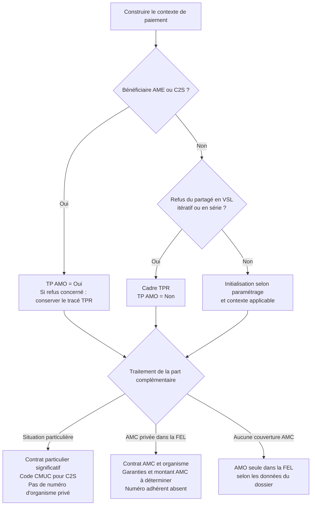

Le modèle conserve des règles pour l'éclatement à la source : TP AMC et montant remboursable AMC non renseignés ; `ERR_FT_094` exclut également certaines informations AMC. Toutefois, la présentation générale décrit le remboursement de l'AMC privée **hors éclatement à la source**. Ces règles de données ne prouvent donc pas l'ouverture d'un parcours de remboursement AMC privé avec éclatement à la source : les articuler au périmètre réellement applicable, sans l'inclure dans le parcours nominal. Sources : [TS-PG], p. 7 ; [TS-FTE02], p. 44, 65 ; [TS-DICO], p. 48.

Pour un transport soumis à accord préalable, **code d'accord et date d'accord** sont obligatoires ; ils sont absents dans les autres cas. La table livrée prévoit `0` pour absence de réponse dans le délai réglementaire, `4` pour réponse favorable, `5` pour urgence. Le **code de demande** et le **numéro d'accord** sont en revanche réservés à une utilisation future dans FTE02 et ne doivent pas être renseignés. Cette distinction évite de remplir quatre champs au seul motif qu'un accord préalable existe. La pièce DAP suit SCOR. Sources : [TS-FTE02], p. 46, 48 ; [TS-DICO], p. 30–31 ; [TS-PG], p. 7.

### TS.13 — Ruptures de facture : la matrice complète

Une rupture de facture sépare des prestations d'une même prescription en plusieurs FEL. Une rupture de lot sépare ensuite des **factures** selon leurs destinataires et leur contexte de transmission. Les deux contrôles n'agissent ni au même moment ni au même niveau. Sources : [TS-FTE02], p. 7–8, 71–73.

| Critère entre trajets | Décision | Traitement de la TMR secondaire | Source |
|---|---|---|---|
| Contexte PEC différent | Nouvelle FEL pour le contexte différent | Exception explicite ; conserver avec son trajet | P2.1, p. 7 ; RG_FTE203, p. 16 |
| Type de forfait différent | Ne pas mélanger les types de forfait de trajet | Son forfait `9` ne provoque pas la séparation du trajet | P2.2, p. 7 ; RG_FTE218, p. 35 |
| Justificatif d'exonération différent | Séparer les prestations | Exception explicite | P2.3, p. 7 |
| Taux de remboursement différent | Séparer les prestations | Exception explicite | P2.4, p. 7 |
| Réalisations avant et après un changement de tarif | Deux factures | Exception explicite pour la prestation secondaire | P2.5, p. 7 |
| Nature de prestation différente | Une seule nature de trajet dans chaque facture | La nature `TMR` ne déclenche pas la rupture avec le trajet support | P2.6, p. 7 |
| Refus du transport partagé différent | Une facture de trajets avec refus et une facture de trajets sans refus | P2.7 ne reprend pas la formulation d'exception TMR ; conserver la cohérence avec le trajet rattaché | P2.7, p. 7 |
| Types de supplément forfaitaire différents | Pas de mixage des types | Exception explicite pour la TMR | Précision p. 8 |
| Nombre de prestations | Respecter `EF_FTE92_10`, 20 par défaut dans le package | Compter les TMR ; neuf TMR au plus dans chaque facture | RG_FTE250, p. 40 ; [TS-FTE05], p. 14 |

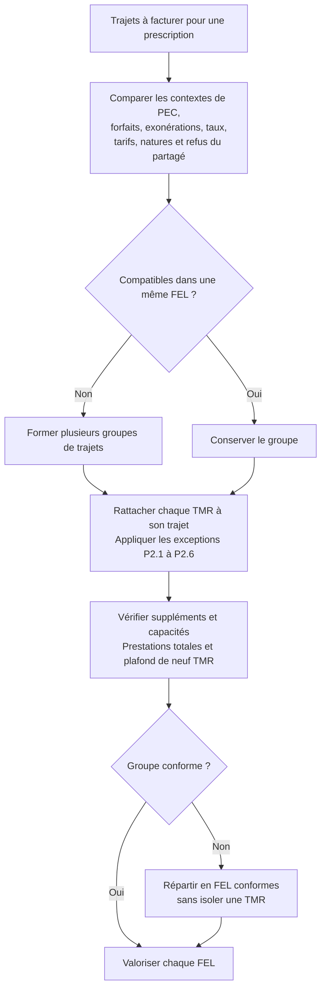

**Exemples de lecture, sans ajout de règle :** douze trajets et huit TMR représentent vingt prestations et satisfont les seuls plafonds numériques du paramétrage par défaut ; les autres critères restent à vérifier. Dix trajets avec dix TMR atteignent vingt prestations mais dépassent la sous-limite de neuf TMR et ne tiennent donc pas dans une seule FEL. Deux trajets identiques par ailleurs, dont un seul porte un refus du partagé, doivent être séparés. Le fait que la TMR ait un forfait différent de son trajet ne doit pas, à l'inverse, l'isoler dans une facture. Sources des règles appliquées : [TS-FTE02], p. 7–8, 35, 40.

### TS.14 — Socle, majoré, géolocalisation et distances

La tarification majorée est un paramètre **par entreprise exécutante identifiée par son numéro AM**, activable uniquement par l'éditeur après accord de la CPAM. Ce n'est pas un choix libre trajet par trajet. La tarification retenue concerne les factures SEFi de cette entreprise. L'option conventionnelle du transporteur constitue un autre paramètre, notamment utilisé pour l'abattement ; elle ne se confond pas avec l'activation de la tarification majorée. Sources : [TS-FTE02], p. 8, 58 ; [TS-FTE05], p. 6–7.

| Notion | Sens | Traitement |
|---|---|---|
| Distance parcourue `EF_FTE62_04` | Distance réelle sans déduction du forfait | Valeur non négative, sans décimale ; en majoré, niveaux de certification 3 à 5 : ne pas dépasser la distance GPS |
| Distance GPS `EF_FTE63_22` | Distance issue du dispositif de géolocalisation | FTE02 la décrit non négative, sans décimale ; pour le majoré, une autre fiche exige une valeur strictement positive. Divergence détaillée ci-dessous ; pas de correction manuelle par le transporteur dans les cas requis |
| Distance facturée `EF_FTE62_12` | Distance parcourue diminuée des kilomètres couverts par le forfait | Donnée intermédiaire du calcul ; déterminée par le LPS ou retournée par FT4 selon activation |
| Indicateur distancier `EF_FTE63_23` | Mode de détermination de la distance facturée | `D` si distancier utilisé ; `N` sinon dans le profil majoré documenté. Le cas général de FTE02 évoque aussi l'absence de valeur ; ne pas l'étendre au profil où le champ est obligatoire |
| Niveau de certification `EF_FTE63_24` | Périmètre des éléments certifiés | Table 1 à 5 : non certifié ; GPS ; GPS + véhicule ; ajout assuré ; ajout conducteur et accompagnant le cas échéant |
| Numéro d'autorisation `EF_FTE63_25` | Autorisation du LPS obtenue lors de sa certification de géolocalisation | Cinq caractères alphanumériques ; donnée issue du LPS, à ne pas confondre avec un identifiant du boîtier GPS |

Sources : [TS-FTE02], p. 34, 38–39, 53 ; [TS-DICO], p. 32 ; [TS-GEO-105], p. 24–25 ; [TS-GEO-818], p. 3. Les conditions détaillées de production et de certification des traces restent définies dans les documents de géolocalisation et d'avenant cités par FTE02.

**Valeur zéro : divergence non arbitrée.** FTE02 p. 38 décrit une distance GPS non négative et le dictionnaire p. 48 donne un exemple où 400 mètres conduisent à `0`. Pour le profil TS majoré concerné, la fiche 818 v4 p. 3 exige au contraire une distance GPS **strictement supérieure à zéro** et prévoit `1` en cas de défaillance du dispositif. La fiche de diffusion TS 920v2 p. 2 annonce également l'impossibilité de transmettre une distance inférieure ou égale à zéro, sans préciser le champ. Les documents lus ne permettent pas de résoudre cette différence ni de l'étendre automatiquement à la distance facturée. Il faut obtenir une clarification applicable au contrôle concerné avant d'implémenter la frontière. Sources : [TS-FTE02], p. 38 ; [TS-DICO], p. 48 ; [TS-GEO-818], p. 3 ; [TS-DIFF-920], p. 2.

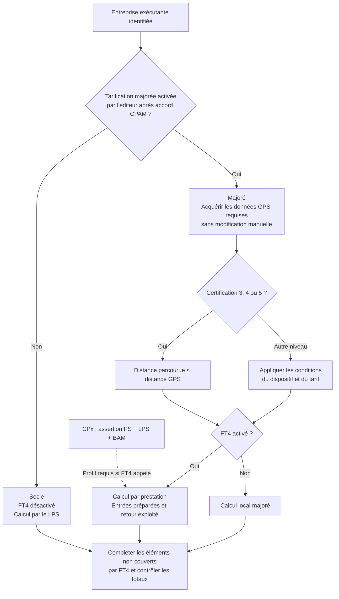

Les quatre informations GPS de RG_FTE220 sont obligatoires lorsque les conditions d'application indiquées sont réunies ; le tableau générique les marque `F(*)`, mais la note conditionnelle précise cette obligation. Pour les autres transporteurs, elles ne sont pas renseignées. Dans le profil majoré documenté, l'indicateur distancier est renseigné `D` ou `N` ; la possibilité d'absence mentionnée dans le cas général ne supprime pas cette obligation. La TMR reprend ces informations de son trajet. Sources : [TS-FTE02], p. 38–39 ; [TS-GEO-818], p. 3 ; [TS-GEO-105], p. 24.

### TS.15 — Ventilation du montant : ordre de calcul et périmètre de FT4

Les trois composantes initiales sont le **forfait**, la **part kilométrique** et la **majoration de trajet court**. Les suppléments forfaitaires sont ajoutés **avant** abattement ; les autres suppléments remboursables sont ajoutés **après** abattement. Les suppléments non remboursables augmentent le montant facturé mais pas la base de remboursement. Cet ordre est nécessaire pour comprendre les écarts entre base, part AMO et total réclamé. Sources : [TS-FTE02], p. 48, 51–61.

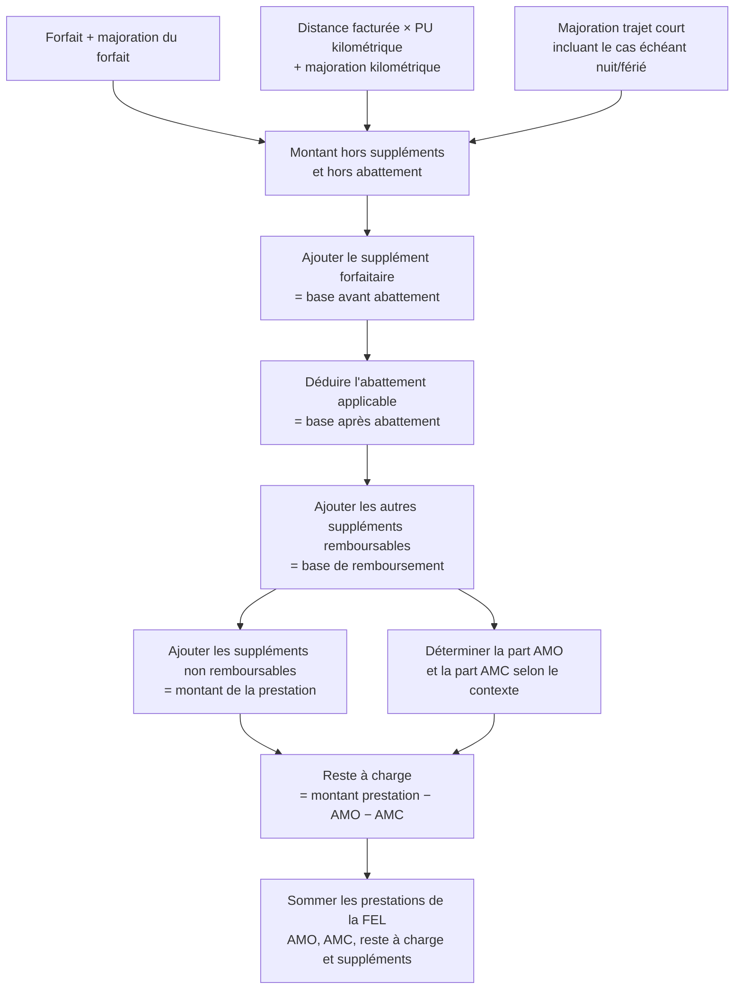

| Étape | Calcul ou alimentation | Point à conserver |
|---|---|---|
| Forfait | Montant avant majoration ; puis majoration en fonction du type nuit ou dimanche/férié | Les pourcentages de majoration sont exprimés de 0 à 100 ; la règle détaillée applique la division par 100 |
| Kilométrique | Distance facturée × PU kilométrique | La majoration kilométrique est calculée en deux étapes : majoration du **PU**, puis multiplication par la distance |
| Trajet court | Montant selon distance parcourue | Ce montant inclut déjà, le cas échéant, nuit/férié ; ne pas lui ajouter une nouvelle majoration non prévue |
| Supplément forfaitaire | Un type et un montant selon la prestation | Type Centre 15 : numéro d'appel obligatoire et uniquement dans ce cas ; TUPH : montant zéro |
| Abattement | Application au montant après ajout du supplément forfaitaire | Dépend du nombre de malades, de la convention et de l'option conventionnelle ; refus partagé : taux absent ; TMR : aucun abattement |
| Autres suppléments remboursables | Au plus deux occurrences, péage et voie d'eau selon TB67-01 | Montant et quantité sont liés : quantité non nulle exige montant ; montant non nul exige quantité |
| Base de remboursement | Base après abattement + somme des autres suppléments remboursables | La TMR a pour base son seul forfait |
| Total prestation | Base de remboursement + suppléments non remboursables | La TMR a pour total son seul forfait |
| Part AMO | Appliquer le taux de prise en charge à la base | Ne pas appliquer le taux au total incluant les suppléments non remboursables |
| Part AMC | Garanties connues en tiers payant et règles de situation particulière | Ce n'est pas systématiquement « total − AMO » ; FT4 ne calcule pas les contrats privés |
| Reste à charge | Total prestation − part AMO − part AMC | Conserver la cohérence avec les cas d'absence de part AMC dans le flux |
| Totaux facture | Cumul de chaque catégorie sur les prestations | Inclure les prestations secondaires facturées ; les totaux ne remplacent pas la ventilation |

Sources : RG_FTE225–242 et RG_FTE249, [TS-FTE02], p. 53–67 ; [TS-DICO], p. 33.

Pour la situation spécifique **AME**, RG_FTE242 [64.12] indique que le montant remboursable AMC de la prestation `EF_FTE64_12` est égal à sa base de remboursement `EF_FTE64_09`. Si FT4 est utilisé dans les conditions du majoré, le service renseigne cette information. Cette règle particulière ne doit pas être généralisée aux contrats AMC privés. Source : [TS-FTE02], p. 61 et 65.

**Arrondis :** P3 exige l'arrondi au centime à **chaque opération** : troisième décimale ≥ 5, centime supérieur ; ≤ 4, centime inférieur. Calculer la majoration kilométrique directement sur le total kilométrique puis arrondir peut donc donner un autre résultat que l'enchaînement prescrit « arrondir la majoration du PU, puis multiplier par la distance ». Sources : [TS-FTE02], p. 8, 55–56.

| FT4 peut retourner | Ce qui reste à préparer ou à compléter |
|---|---|
| Forfait, majorations du forfait et du kilométrique, montant kilométrique, trajet court | Nature, forfait, dates/heures, lieux, distance parcourue, nombre de malades, type de supplément, taux et contexte de couverture |
| Distance facturée, montant de l'abattement | Vérifier le cas de l'option conventionnelle : RG_FTE231 précise que FT4 ne prend pas en compte la variation du taux liée à cette adhésion |
| Montants AMO, AMC des situations prises en charge par le service et reste à charge | Pour une AMC privée : omettre son bloc contrat dans l'appel FT4 et calculer/compléter la part à partir des garanties connues |
| Résultat d'une prestation secondaire TMR | Faire un appel dédié à cette TMR, après avoir repris les données du trajet concerné |

Sources : [TS-FTE02], p. 58, 61–65. Le retour d'abattement FT4 est prévu par RG_FTE231 si l'option conventionnelle n'est pas souscrite (`EF_FTE91_05 = N`). Cette restriction est **active et non barrée** dans le PDF courant ; la seule activation FT4 ne suffit donc pas à garantir que tous les résultats tarifaires sont directement applicables au transporteur.

**Précision de lecture des formules :** p. 58, le PDF imprime le montant d'abattement comme « base × % abattement » sans rendre explicite la conversion du pourcentage en coefficient ; p. 64 utilise une rédaction analogue pour le taux AMO, alors que le taux TUPH par défaut est décrit comme la valeur `100`. Les règles détaillées de majoration p. 54 et 56 rendent `/100` explicite. Le schéma ci-dessus décrit l'ordre fonctionnel ; il ne faut pas transformer ces notations hétérogènes en formules exécutables sans expliciter l'unité des taux et vérifier les cas de qualification.

### TS.16 — TMR : une prestation secondaire attachée, pas un trajet supplémentaire

| Propriété | Règle TS | Source [TS-FTE02] |
|---|---|---|
| Support obligatoire | Une TMR ne se facture jamais seule ; elle suit immédiatement son trajet support dans le XML | p. 8 |
| Compatibilités | Incompatible avec un trajet `ABA` ; impossible avec un TUPH | p. 33–34 |
| Identifiant en PEL | Même identifiant que la prestation PEL du trajet support | p. 33 |
| Identifiant en PP | Règle générale de l'identifiant unique au sein de la FEL | p. 33 |
| Forfait | Type `9` quel que soit le forfait du trajet | p. 35 |
| Nombre de malades | Toujours `1` pour la TMR, même si le trajet support transporte plusieurs patients | p. 35 |
| Données reprises | Distance parcourue, départ/arrivée, données GPS, véhicule et équipage | p. 34, 37, 39 |
| Prise en charge | Contexte, justificatif et taux du trajet support | p. 15, 64 |
| Valorisation | Base et montant de prestation égaux au forfait TMR | p. 59–61 |
| Éléments exclus | Pas de majoration, d'abattement, de supplément forfaitaire, d'autre supplément remboursable, ni de supplément non remboursable | p. 54–60 |
| FT4 | Appel dédié si service utilisé dans les conditions prévues | p. 54, 61 |
| Plafonds | Compte dans le total des prestations ; neuf TMR maximum par facture | p. 40 |

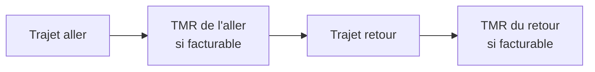

Ce schéma représente l'ordre des occurrences d'une FEL qui contient ces quatre éléments, pas une obligation de facturer une TMR à l'aller et au retour. Si une rupture ou une limite impose plusieurs FEL, conserver l'attachement de chaque prestation secondaire à son trajet. En PEL, l'identifiant partagé trajet/TMR est une exception explicite à ne pas supprimer au moyen d'un contrôle d'unicité généralisé depuis le scénario papier. Sources : [TS-FTE02], p. 7–8, 33.

### TS.17 — TUPH : un scénario complet à traiter séparément

Le TUPH décrit un transport primaire demandé par le SAMU–centre 15, assuré obligatoirement en ambulance pour l'admission dans un établissement, avec ou sans hospitalisation ultérieure. Ses tarifs spécifiques sont utilisables avec un LPS paramétré en socle ou en majoré. Le forfait inclut les vingt premiers kilomètres et le tarif kilométrique spécifique s'applique à partir du vingt-et-unième. Les exclusions tarifaires sont celles détaillées ci-dessous ; le supplément Centre 15 reste obligatoire, avec un montant nul. Sources : [TS-PG], p. 8–9 ; [TS-FTE02], p. 53, 56–57.

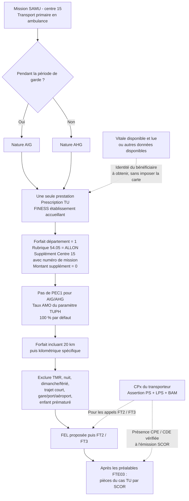

| Donnée / contrôle | Valeur ou règle | Preuve |
|---|---|---|
| Nombre de prestations | Une seule prestation `AIG` ou `AHG` | [TS-DICO], p. 48, `ERR_FT_301` |
| Type de prescription | `TU` ; cohérence imposée avec AIG/AHG | [TS-FTE02], p. 30 ; [TS-DICO], p. 48, `ERR_FT_308` |
| Identifiant du prescripteur | FINESS de l'établissement de santé accueillant le patient | [TS-FTE02], p. 29 |
| Justificatif de prise en charge, rubrique `54.05` | `ALLON` | p. 28, 30 |
| Nature | `AIG` pendant la garde ; `AHG` hors garde | p. 34 |
| Type de forfait | Département, valeur `1` | p. 35 |
| Supplément Centre 15 | Obligatoire, type `3`, montant `0` | p. 57 ; [TS-DICO], p. 33 |
| Numéro d'appel / mission | Obligatoire pour Centre 15 ; format alphanumérique | [TS-FTE02], p. 57 ; [TS-DICO], p. 48, `ERR_FT_302` |
| Prise en charge | Pas de PEC1 pour AIG/AHG ; taux paramétré `EF_FTE92_13`, 100 par défaut, évolutif | [TS-FTE04], p. 14 ; [TS-FTE02], p. 64 ; [TS-FTE05], p. 15 |
| Exclusions tarifaires | Pas de nuit, dimanche/férié, trajet court, gare/port/aéroport ou enfant prématuré | [TS-FTE02], p. 53, 56–57 |
| TMR | Impossible | p. 33 |

La rubrique `[54.05]` est intitulée « Descriptif du transport » dans le corps p. 30, alors que le tableau p. 28 désigne `EF_FTE54_05` comme le **justificatif de prise en charge**. Le repère de champ est conservé ici pour éviter de renseigner `ALLON` dans `EF_FTE54_04`, dont les codes sont notamment `TLD` et `TS`. Sources : [TS-FTE02], p. 28–30 ; [TS-DICO], p. 31.

### TS.18 — Validation, lots et preuves : relier chaque décision à son objet

| Moment | Ce que le LPS doit avoir ou établir | Ce que cela ne remplace pas |
|---|---|---|
| Fin d'élaboration | Une FEL proposée cohérente, montants inclus | Un calcul FT4 réussi ne vaut pas recevabilité |
| Retour FT2 positif | Clause **et** certificat, puis affichage de la clause | La seule absence de diagnostic ne suffit pas |
| Acceptation du transporteur | Accord sur la clause ; identifiant facture unique, chronologique et continu ; date = date de réception de recevabilité | L'accord du transporteur reste distinct de l'acceptation AMO au retour FT3 |
| Constitution du lot | Critères de rupture, destinataire déterminé par TOD, numéro dans la plage applicable et rang mémorisé | Un numéro de lot ne constitue pas un accusé de réception |
| Retour FT3 | AR de validation, ou reconnaissance dans le cas précis de reprise documenté | Le résultat n'est pas un paiement NOEMIE |
| Après validation | Copie de la facture ; original conservé par l'AMO ; « Duplicata » si impression | FT1 ne restitue ni certificat ni AR |
| Historisation activée | Requêtes et réponses FT2/FT3 conservables douze mois, présentables à l'AMO | L'historisation technique ne remplace ni la copie de facture ni les preuves SCOR |

Sources : [TS-FTE02], p. 19, 67–75 ; [TS-FTE04], p. 20–21 ; [TS-FTE05], p. 15.

Le CRL est la concaténation des critères de rupture de lot : identifiant du facturant, régime, organisme destinataire, TP AMO, TP AMC, date de création, type de prescription, type de facturation et critère spécifique AMO. Ce dernier vaut `T` pour l'AT du régime `08`, `A` dans les autres cas du tableau. Une recherche TOD infructueuse empêche la réalisation de la facture. Le rang commence à 1 et est mémorisé pour permettre le rapprochement des FEL et des pièces. Sources : [TS-FTE02], p. 71–73.

Les plages livrées sont paramétrables : B2 de `001` à `500`, FEL PP de `501` à `750`, FEL PEL de `751` à `999`, selon les correspondances RG_FTE287 et RG_FTE591. Le numéro progresse de un en un, puis revient au début de sa plage ; les numéros doivent différer d'un lot à l'autre quel que soit le destinataire. En multi-sociétés, préserver la chronologie propre à chaque mandante. **Le tableau RG_FTE287 ne possède pas de ligne explicite TU : ne pas inventer silencieusement son affectation de plage à partir de la seule étiquette PP.** Sources : [TS-FTE02], p. 73 ; [TS-FTE05], p. 14.

Pour comprendre un incident, rapprocher au minimum la facture et son état local, le couple facture/lot transmis, la réponse reçue et les diagnostics avec leur élément concerné. Il s'agit d'une conséquence opérationnelle de la conservation des échanges et des reprises prescrites : `ERR_FT_007` change le lot, tandis que la reprise `siram_40` avec détail `desir_1020` le conserve, ainsi que le numéro de facture. `ERR_FT_015` n'établit la validation que dans le deuxième appel de ce scénario précis. Sources : [TS-FTE02], p. 74–75 ; [TS-FTE05], p. 15 ; [TS-DICO], p. 27.

### TS.19 — Repli B2 : recalcul et transformation, pas simple changement d'enveloppe

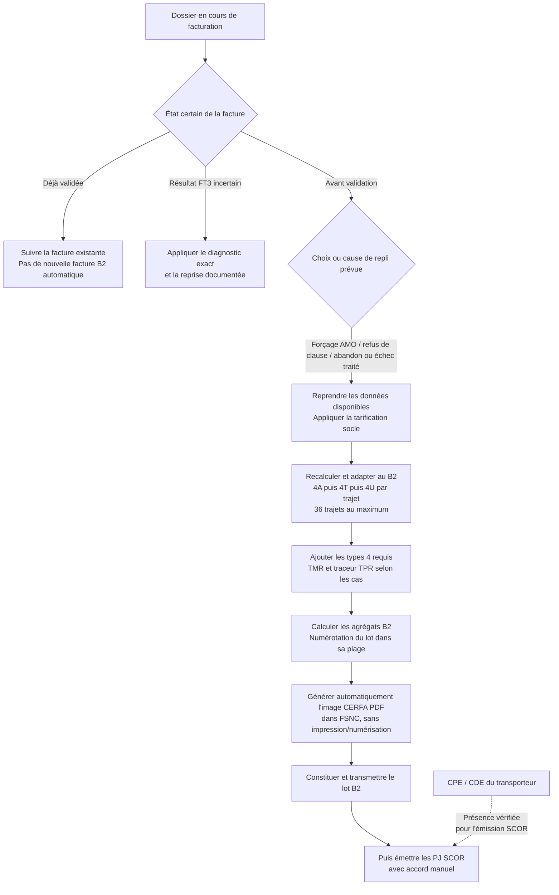

Le transporteur peut interrompre l'élaboration pour choisir B2. Le désaccord avec des données AMO qu'il souhaite modifier constitue un **forçage** et conduit nécessairement à B2. Une FEL non recevable permet soit la reprise de son élaboration, soit le repli socle ; le refus de la clause conduit aussi au repli. Les erreurs de validation suivent leurs traitements explicites. Ces possibilités ne permettent pas de refacturer automatiquement une facture déjà validée ou dont le résultat demeure incertain. Sources : [TS-PG], p. 8 ; [TS-FTE02], p. 10, 68, 70–71, 74–76.

| Transformation lors du repli | Détail à conserver | Source [TS-FTE02] |
|---|---|---|
| Tarification | Passage au socle ; une FEL élaborée en majoré ne bascule pas en conservant simplement ses montants | p. 76 |
| Formats | Respecter les valeurs admises B2 ; pour une donnée devenue entière, supprimer les décimales selon la règle de conversion | p. 76 |
| Structure des trajets | Type 4A obligatoirement suivi de 4T et d'un 4U par trajet ; 36 trajets au maximum | p. 76 |
| Montants du 4A | Reconstituer base, remboursement AMO, dépense et AMC par cumul selon B2 ; ne pas recopier directement les totaux FEL | p. 78 |
| Distance réelle du 4U | Distance GPS si dispositif certifié CNDA ; distance parcourue sinon | p. 85 |
| Données du dispositif dans 4U | Indicateur distancier et niveau de certification pour les équipés ; blanc sinon | p. 85 |
| TMR | Type 4 spécifique ; reprise des montants et identités prescrits par son tableau | p. 76, 86 |
| Refus partagé | Type 4 traceur `TPR`, placé après le dernier 4U ou après le dernier type 4 TMR ; sa valeur de PU ne s'ajoute pas au type 5 | p. 76, 87 et note 1 |
| Lot B2 | Respecter les plages prévues par RG_FTE287 | p. 88 |
| Image justificative | Génération automatique d'une image CERFA en PDF dans FSNC, sans intervention du transporteur | p. 88 |

### TS.20 — Points de lecture à préserver dans les futures versions

| Point documentaire | Constat dans les originaux utilisés | Conséquence pour ce parcours |
|---|---|---|
| Comptage TMR | Note « ne pas comptabiliser » barrée p. 40 ; maximum neuf actif | Inclure TMR dans le plafond de prestations et vérifier séparément leur sous-limite |
| Transport en série | Ancienne demande de ne pas renseigner le code `TS` barrée p. 30 | Ne pas réintroduire cette interdiction depuis l'extraction texte |
| Spécialité du prescripteur | Colonne `F` du tableau p. 28, mais obligation explicite dans RG_FTE215 [53.02] p. 29 | Retenir l'obligation métier explicite ; consigner la discordance du tableau |
| Référence RPPS | p. 29, le corps cite `EF_FTE10_05` à propos du RPPS ; l'acquisition p. 13 utilise `EF_FTE10_02`, `05` étant la spécialité | Ne pas mapper le RPPS depuis le champ spécialité ; conserver le renvoi erroné comme anomalie documentaire |
| Champ TUPH ALLON | Sous-titre « Descriptif » pour la rubrique `54.05`, alors que le tableau la nomme justificatif | Utiliser le repère `EF_FTE54_05` et la table TB54-05 |
| Formules de taux | Notations différentes entre majorations, abattement et part AMO | Expliciter les unités avant implémentation ; ne pas attribuer au PDF une formule corrigée silencieusement |
| Option conventionnelle | Limitation FT4 de p. 58 active | Compléter le calcul d'abattement dans le cas concerné |
| Éligibilité aux taux et capacité FT4 | La fiche 818 v4 p. 4 décrit des conditions d'éligibilité actualisées pour les taux 15 % / 33 % ; FTE02 p. 58 conserve la limite de calcul FT4 liée au paramètre d'option | Ces documents traitent respectivement de l'éligibilité tarifaire et de la capacité du service. Ne pas assimiler automatiquement le paramètre FT4 à l'ancien critère de signature ni supposer que FT4 prend désormais la variation en charge. Sources : [TS-GEO-818], p. 4 ; [TS-FTE02], p. 58 |
| Attestations du majoré en multi-sociétés | La fiche 818 v4 p. 2 indique que l'attestation de l'éditeur n'est plus à fournir depuis le 22 décembre 2025 ; sa p. 4 renvoie encore à « deux attestations » dans le cas multi-sociétés | La portée de ce renvoi n'est pas clarifiée par la fiche : elle peut dépendre du cas multi-sociétés ou d'un renvoi non actualisé. Ne pas en déduire une exigence générale de deux attestations sans confirmation. Source : [TS-GEO-818], p. 2 et 4 |
| Plage de lot TU | Pas de ligne TU explicite dans le tableau p. 73 | Affectation à confirmer dans les règles applicables, sans extrapolation non signalée |

Sources : [TS-FTE02], p. 13, 28–30, 40, 54–58, 64, 73. Les lectures intégrales antérieures du noyau TS restent celles attestées par le registre. Ce complément ajoute des relectures ciblées des règles citées et une inspection visuelle directe de **23 pages de FTE02** : 7, 8, 29, 30, 34, 35, 37, 40, 42, 45, 48, 53 à 61, 63 à 65. Il ne revendique pas une nouvelle lecture visuelle intégrale des 368 pages du noyau, ni celle des documents externes de tarification, géolocalisation et qualification auxquels les SFG renvoient.

### Sources TS de cette contribution

Les lectures intégrales du noyau TS ont été attestées dans les lots précédents. La présente contribution a rapproché le rapport détaillé de relecture et les passages fonctionnels utiles ; elle ne constitue pas une nouvelle affirmation de lecture intégrale de tous les documents de géolocalisation, de qualification ou des schémas importés. Les marques de révision doivent être lues sur les PDF originaux, car une extraction texte conserve aussi les passages supprimés.

[TS-PRESERIE]: </Users/mikail/Documents/Bon de transport/30_TRANSPORTEURS_SANITAIRES/SEFi/Conditions de présérie SEFi/Conditions et modalités d application de la présérie du SEFi transport sanitaire - v6 août 2026 (publication septembre 2026).pdf>
[TX-PRESERIE]: </Users/mikail/Documents/Bon de transport/20_TAXI/SEFi/Conditions de présérie SEFi/Conditions et modalités d application de la présérie du SEFi taxis.pdf>
[TS-GEO-105]: </Users/mikail/Documents/Bon de transport/30_TRANSPORTEURS_SANITAIRES/SEFi/Géolocalisation Transporteur Sanitaire/Package GEOLOCALISATION v1.05/Package GEOLOCALISATION v1.05/FACT-SFG-039 Facturation Transporteur - Constituer et Transmettre les traces de geolocalisation_1.05 sans MR.pdf>
[TS-GEO-818]: </Users/mikail/Documents/Bon de transport/30_TRANSPORTEURS_SANITAIRES/Métier TS/Convention et tarification/Mise en œuvre SEFi - Avenant 11/PDT-INF-818v4  Avenant 11 impacts pour les transporteurs sanitaires.pdf>
[TS-DIFF-920]: </Users/mikail/Documents/Bon de transport/30_TRANSPORTEURS_SANITAIRES/SEFi/Package SEFi TS 3.50/PDT-INF-920v2 Diffusion du package SEFi‐Transporteur Sanitaire v3.50.pdf>
[TS-PG]: </Users/mikail/Documents/Bon de transport/30_TRANSPORTEURS_SANITAIRES/SEFi/Package SEFi TS 3.50/Package SEFi Transporteur Sanitaire 3.50/Spécifications Fonctionnelles et Guides d'intégration/FACT-SFG-030 PG-Présentation Générale du système FTE TS v05.48_avec_MR.pdf>
[TS-FTE01]: </Users/mikail/Documents/Bon de transport/30_TRANSPORTEURS_SANITAIRES/SEFi/Package SEFi TS 3.50/Package SEFi Transporteur Sanitaire 3.50/Spécifications Fonctionnelles et Guides d'intégration/FACT-SFG-031 FTE01-Réaliser des Prestations d’une prescription TS v03.18_avec_MR.pdf>
[TS-FTE02]: </Users/mikail/Documents/Bon de transport/30_TRANSPORTEURS_SANITAIRES/SEFi/Package SEFi TS 3.50/Package SEFi Transporteur Sanitaire 3.50/Spécifications Fonctionnelles et Guides d'intégration/FACT-SFG-032 FTE02-Facturer des Prestations TS v03.60_avec_MR.pdf>
[TS-FTE03]: </Users/mikail/Documents/Bon de transport/30_TRANSPORTEURS_SANITAIRES/SEFi/Package SEFi TS 3.50/Package SEFi Transporteur Sanitaire 3.50/Spécifications Fonctionnelles et Guides d'intégration/FACT-SFG-033 FTE03-Contrôler et Transmettre les PJ TS v03.21_avec_MR.pdf>
[TS-FTE04]: </Users/mikail/Documents/Bon de transport/30_TRANSPORTEURS_SANITAIRES/SEFi/Package SEFi TS 3.50/Package SEFi Transporteur Sanitaire 3.50/Spécifications Fonctionnelles et Guides d'intégration/FACT-SFG-034 FTE04-Consulter les referentiels de l'AMO TS v03.18_avec_MR.pdf>
[TS-FTE05]: </Users/mikail/Documents/Bon de transport/30_TRANSPORTEURS_SANITAIRES/SEFi/Package SEFi TS 3.50/Package SEFi Transporteur Sanitaire 3.50/Spécifications Fonctionnelles et Guides d'intégration/FACT-SFG-035 FTE05-Administrer le poste PS TS v03.45_avec_MR.pdf>
[TS-FTE06]: </Users/mikail/Documents/Bon de transport/30_TRANSPORTEURS_SANITAIRES/SEFi/Package SEFi TS 3.50/Package SEFi Transporteur Sanitaire 3.50/Spécifications Fonctionnelles et Guides d'intégration/FACT-SFG-060 FTE06-Superviser le poste PS TS v03.37_avec_MR.pdf>
[TS-DICO]: </Users/mikail/Documents/Bon de transport/30_TRANSPORTEURS_SANITAIRES/SEFi/Package SEFi TS 3.50/Package SEFi Transporteur Sanitaire 3.50/Spécifications Fonctionnelles et Guides d'intégration/FACT-SFG-029 DICO-Dictionnaire du système FTE TS v03.54_avec_MR.pdf>
[TS-PS]: </Users/mikail/Documents/Bon de transport/30_TRANSPORTEURS_SANITAIRES/SEFi/Package SEFi TS 3.50/Package SEFi Transporteur Sanitaire 3.50/Spécifications Fonctionnelles et Guides d'intégration/SEL-MP-012 WS_PS TS v02.20_avec_MR.pdf>
[TS-PL]: </Users/mikail/Documents/Bon de transport/30_TRANSPORTEURS_SANITAIRES/SEFi/Package SEFi TS 3.50/Package SEFi Transporteur Sanitaire 3.50/Spécifications Fonctionnelles et Guides d'intégration/SEL-MP-014 WS_PL TS v03.17_avec_MR.pdf>
[TS-PEC]: </Users/mikail/Documents/Bon de transport/30_TRANSPORTEURS_SANITAIRES/SEFi/Package SEFi TS 3.50/Package SEFi Transporteur Sanitaire 3.50/Spécifications Fonctionnelles et Guides d'intégration/SEL-MP-016 WS_PEC TS v03.40_avec_MR.pdf>
[TS-FT]: </Users/mikail/Documents/Bon de transport/30_TRANSPORTEURS_SANITAIRES/SEFi/Package SEFi TS 3.50/Package SEFi Transporteur Sanitaire 3.50/Spécifications Fonctionnelles et Guides d'intégration/SEL-MP-015 WS_FT TS v03.52_avec_MR.pdf>
[TS-PER]: </Users/mikail/Documents/Bon de transport/30_TRANSPORTEURS_SANITAIRES/SEFi/PDT-INF-293v3.07 Périmètre SEFI-FTE Transporteur Sanitaire.pdf>
[TS-WSDL]: </Users/mikail/Documents/Bon de transport/30_TRANSPORTEURS_SANITAIRES/SEFi/Package SEFi TS 3.50/Package SEFi Transporteur Sanitaire 3.50/WSDL - SEFi Transporteurs Sanitaires/SEMaFELTransport_EXP_1.1.0/SEMaFELTransport_EXP_1.1.0/SEMaFELTransport_EXP_1.1.0.wsdl>

<a id="taxi"></a>
## TX. Parcours SEFi Taxi V50

La référence Taxi est le package **V50**, diffusé le 29 octobre 2026, avec PG 05.50, FTE02 03.62 et WS_FT 03.53. Le parcours décrit des dépendances fonctionnelles ; il n'impose pas une suite d'écrans. FTE01, FTE02 et FTE03 peuvent être mobilisées indépendamment. Le contrat de facturation Taxi expose **FT2 `controlerRecevabilite` et FT3 `valider`**. Les anciens paragraphes barrés évoquant FT1 ou FT4 ne constituent pas des opérations Taxi courantes.

Sources : [Diffusion V50][TX-DIFF], p. 1–3 ; [PG Taxi][TX-PG], p. 12–19 ; [WS_FT Taxi][TX-FT], p. 4–6 ; [WSDL Taxi][TX-WSDL].

### TX.1. Acteurs, conditions d'entrée et circuits

Le logiciel dispose de la certification B2 Taxi et de l'autorisation SEFi applicable. L'accès des professionnels utilise la CPE/CDE. L'autorisation et la spécialité du professionnel doivent être compatibles ; la configuration dédiée Taxi est la spécialité 56. Les capacités décrites par un modèle de données ne prouvent pas, seules, l'ouverture d'un cas à la facturation.

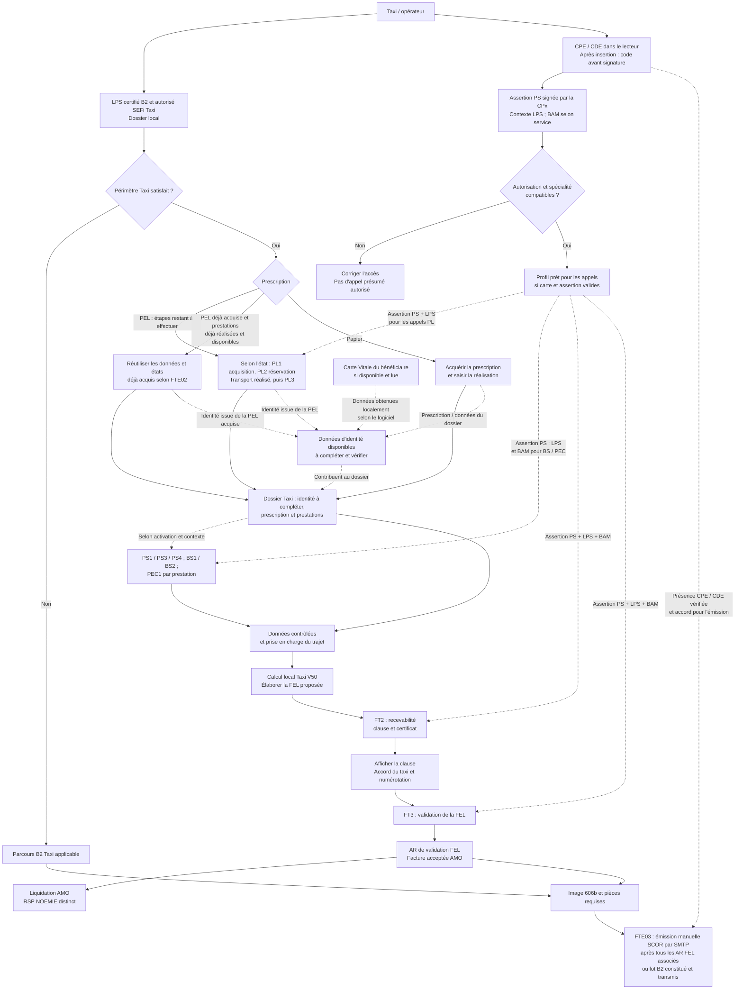

Les deux cartes contribuent à des moments différents : la CPx fournit l'assertion PS des appels indiqués, tandis que la lecture éventuelle de la carte Vitale peut alimenter localement l'identification du bénéficiaire. La saisie locale ne constitue pas elle-même un appel en ligne, et l'absence de CPx ne provoque pas, à elle seule, une bascule B2 automatique. La PEL, la prescription papier, le dossier et les services BS constituent les autres sources prévues selon le scénario ; la lecture Vitale n'est pas imposée à chaque facture par FTE02 Taxi. Les flèches ne rendent pas obligatoire une nouvelle lecture de carte à chaque service ni la présence du patient lors de FT2/FT3. Les branches d'erreur FT2/FT3 sont détaillées en TX.5. Sources : [TLSI-CI], p. 50 ; [TLSI-CARTES], p. 7–10 ; [FTE02][TX-FTE02], p. 11–16 ; [WS_FT][TX-FT], p. 25–26 ; [FTE03][TX-FTE03], p. 7 et 19.

Le périmètre actif de [PDT-INF-293 Taxi 3.08][TX-PERIM], p. 2, retient le **régime 01, hors CPRPF-RG / caisse 908**. Les anciennes restrictions DAP, transports transfrontaliers et NIR migrants sont barrées ; la colonne MSA 02 est également barrée. Leur présence dans le texte extrait ne les rend pas actives. Ce périmètre documentaire ne prouve pas à lui seul l’ouverture opérationnelle du service au jour de l’utilisation. Selon PG p. 8, SEFi Taxi V50 ne traite pas les factures antérieures à la bascule de la nouvelle convention : la date et l’heure de départ doivent être postérieures ou égales à cette bascule. Une réponse HTTP 200, un résultat PEC, un AR FEL, un ARL SCOR et un RSP correspondent à des événements différents.

Sources : [PG][TX-PG], p. 7–19 ; [Diffusion][TX-DIFF], p. 1–3 ; [Périmètre][TX-PERIM], p. 1–3.

### TX.2. Prescription papier ou PEL, réservation et réalisation

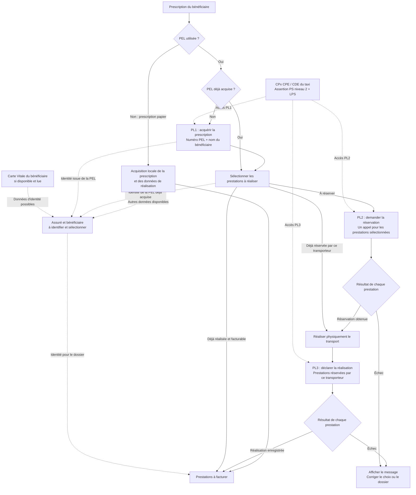

PL1 doit avoir été effectué au moins une fois avant réservation et déclaration de réalisation ; l'acquisition peut précéder la facturation et être réutilisée selon le contexte. PL2 accepte une prestation prescrite ou réservée, ce qui permet la reprise d'une réservation par un autre transporteur. Une prestation déjà réalisée ou facturée ne devient pas réservable. PL3 n'est utilisable que pour les prestations réservées par l'appelant. Une requête multiple est groupée, avec résultat individuel par prestation : un retour global ne suffit pas à considérer toutes les prestations réussies.

Une PEL peut couvrir davantage de prestations que la facture en cours. Un aller-retour correspond à deux prestations. Les informations retournées par consultation ne constituent pas une copie imprimable de la prescription ; consultation seule hors facturation et stockage des données doivent suivre les restrictions de FTE04.

Sources : [FTE01][TX-FTE01], p. 6–12 ; [WS_PL][TX-PL], p. 5–18 ; [DICO][TX-DICO], p. 13, 29–30 ; [FTE04][TX-FTE04], p. 17–19.

### TX.3. Acquisitions et modalités de prise en charge

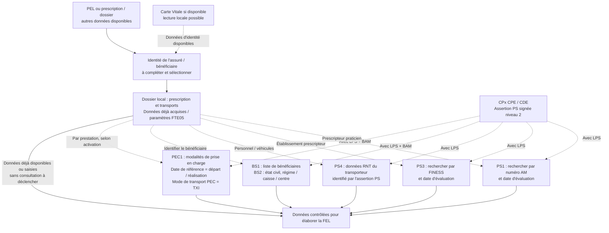

La carte Vitale, lorsqu'elle est disponible et lue par le logiciel, peut contribuer aux données locales du bénéficiaire ; elle ne calcule pas à elle seule les modalités PEC à la date du trajet. En scénario PEL, l'identité est issue de la prescription et peut être complétée par BS2 si activé ; en scénario papier, les données disponibles et BS1/BS2 sont exploités selon activation. Le BAM utilise les données requises provenant notamment du dossier ou d'une carte lue : il n'impose pas une lecture immédiate de la Vitale. Sources : [FTE02][TX-FTE02], p. 14–15 ; [TLSI-CI], p. 50 ; [TLSI-CARTES], p. 8–10.

Ces acquisitions dépendent des données disponibles et du paramétrage. Elles ne forment pas une chaîne obligatoire PS → BS → PEC. Les consultations indépendantes de FTE04 ne se confondent pas avec les indicateurs d'activation de FTE05 en facturation.

BS2 ne fournit pas les droits détaillés ni le taux AMO. PEC1 détermine notamment couverture, nature d'assurance, contrat AMO, situation complémentaire, tiers payant réglementaire, justificatif d'exonération et taux, à partir du bénéficiaire, de la prescription et de la date de prestation. Un changement de contexte peut imposer une autre facture. Le mode `TXI` est le mode de la **requête PEC** ; ne pas le confondre avec les codes actifs du dictionnaire de la FEL. En AT/MP, l'identifiant ou la date de l'AT est fourni suivant les règles de PEC ; ne pas imposer simultanément les deux.

Sources : [FTE02][TX-FTE02], p. 11–17 ; [FTE04][TX-FTE04], p. 5–19 ; [WS_PS][TX-PS], p. 5–14 ; [WS_PEC][TX-PEC], p. 5–11 ; [FTE05][TX-FTE05], p. 8–13.

### TX.3.a. De la prescription aux données effectivement facturées

Le dossier distingue trois niveaux : la prescription, qui décrit les transports prescrits ; chaque trajet réalisé pour une personne ; la facture, qui regroupe seulement les trajets compatibles. Un aller-retour produit deux prestations. Une prescription de `n` allers-retours produit donc `2 × n` trajets possibles, sans obligation de les facturer tous ensemble. La réalisation physique, sa déclaration PL3 et la validation financière FT3 constituent des étapes distinctes. Sources : [DICO][TX-DICO], p. 10, 13–15 ; [FTE02][TX-FTE02], p. 6–10, 33–35.

```mermaid
flowchart TB
    PC["Une prescription du patient<br/>PEL ou papier"] --> PRES["Prescripteur + identité du bénéficiaire<br/>Date, motif et contexte médical"]
    CV["Vitale si lue auparavant<br/>ou autres données du dossier"] -. "Données d'identité disponibles" .-> IDENT["Identité assuré / bénéficiaire<br/>à compléter et vérifier"]
    PC --> PT["Une occurrence par trajet réalisé<br/>Aller et retour séparés"]
    PT --> REEL["Horaires, lieux, véhicule, conducteur<br/>Distance, ADS, partagé, suppléments"]
    PT --> PEC["Prise en charge évaluée<br/>à la date de départ de ce trajet"]
    PEC --> CTX["EF_FTE28 : contexte commun<br/>régime/caisse/centre, assurance, contrat, TP"]
    PEC --> UNIT["EF_FTE29 : données de la prestation<br/>exonération et taux AMO"]
    PRES --> GROUPE["Regrouper les trajets compatibles<br/>pour ce seul patient"]
    IDENT -. "Identité retenue" .-> GROUPE
    REEL --> GROUPE
    CTX --> GROUPE
    UNIT --> GROUPE
    CPX["Carte CPx utilisée à l'émission<br/>Numéro de carte du professionnel"] -. "EF_FTE52_03 : numéro de carte<br/>autre champ que le numéro AM facturant" .-> VAL
    GROUPE --> VAL["Calculer localement les composantes<br/>et les montants de la FEL"]
    VAL --> P["FEL proposée P"]
```

| Données à obtenir | Prescription en ligne | Prescription papier | Affectation et contrôle |
|---|---|---|---|
| Carte du professionnel | Numéro de la CPx utilisée pour émettre | Même règle | `EF_FTE52_03` est obligatoire dans la FEL ; en multi-sociétés, numéro de la carte de la mandataire. Source : [FTE02][TX-FTE02], p. 27 ; [WS_FT][TX-FT], p. 8. |
| Prescription elle-même | PL1 fournit les données ; un résultat déjà acquis en FTE01 peut être utilisé | Lecture/saisie de la prescription | Type de prescription `PL` ou `PP` ; numéro PEL pour le scénario PL ; date de prescription obligatoire |
| Prescripteur libéral | Identifiant AM `EF_FTE32_01` ; RPPS de `EF_FTE33_01` lorsqu'il est fourni | Identifiant AM lu sur la prescription ; données complétées par PS1 si activé | `EF_FTE53_01` porte l'identifiant AM ; spécialité obligatoire selon RG_FTE215 [53.02] |
| Prescripteur en établissement | Identifiant de structure `EF_FTE35_01`, de type FINESS dans ce contexte ; RPPS de l'individu `EF_FTE33_01` | FINESS de la structure et RPPS de l'individu à acquérir ; PS3 peut compléter la spécialité de l'établissement | FINESS dans l'identifiant du prescripteur ; **RPPS obligatoire si exercice en établissement**, pour PL comme pour PP |
| Identité du patient | NIR et clé de l'ouvrant droit, nom, prénom, naissance et rang issus de la PEL | Prescription et/ou recherche BS1 puis BS2, selon activation | Bloc `EF_FTE55` : identité du bénéficiaire et immatriculation de l'assuré restent distinctes ; NIR individuel et clé sont des données supplémentaires |
| Régime/caisse/centre de référence | BS2 peut compléter les données PEL | BS1/BS2 permettent d'identifier le bénéficiaire | Les coordonnées de **prise en charge** de PEC initialisent ensuite la couverture de la FEL ; ne pas confondre identification BS et détermination des droits |
| Motif, prise en charge à 100 %, ALD, L115 | Depuis la PEL, selon le champ | Depuis les pièces présentées | Motif du transport et indicateur de prise en charge à 100 % dans `EF_FTE54` ; ALD exonérante également conservée comme donnée adjointe `EF_FTE71_07` |
| Identifiant de chaque prestation | Reprise de l'identifiant de prestation PEL `EF_FTE46_01` | Création par le LPS | Un identifiant distinct par prestation dans une même FEL |
| Nature de prestation | Choisie en cohérence avec le mode prescrit | Choisie par le transporteur | Table FEL courante : **`TXN`** pour Taxi ; **`TXI` demeure le mode de la requête PEC**, pas le code courant à recopier dans la nature FEL |

Sources : [FTE02][TX-FTE02], p. 11–17, 26–32, 35 ; [DICO][TX-DICO], p. 12–15, 19–22, 30–31 ; pour `TXI` en PEC, [FTE04][TX-FTE04], p. 15.

La règle métier doit être lue avec le tableau de formats : le tableau FTE02 p. 30 marque la spécialité et le RPPS « F », mais le texte p. 31 impose la spécialité et impose conditionnellement le RPPS en établissement. La cardinalité XML générique `0..1` du RPPS dans WS_FT ne dispense donc pas de cette obligation conditionnelle. Source : [FTE02][TX-FTE02], p. 30–31, RG_FTE215 [53.02]/[53.05] ; [WS_FT][TX-FT], p. 9, 31, 38.

La **raison sociale du PS facturant** porte désormais sa raison sociale réelle ; l'ancienne consigne plaçant les numéros ADS dans ce champ est barrée. Les ADS ont leurs propres données au niveau du trajet. L'émetteur, le PS facturant et le PS exécutant doivent être conservés comme des rôles distincts, même lorsqu'ils désignent la même société. Sources : [FTE02][TX-FTE02], p. 25–28, 40–41.

### TX.3.b. Données de réalisation à contrôler avant le calcul

| Groupe | Contenu utile et règle |
|---|---|
| Départ et arrivée | Dates, heures, codes INSEE, adresses ; FINESS des établissements lorsque pertinent. La date de départ ne peut pas être future et doit correspondre à la date d'évaluation PEC utilisée. Les trajets sont ordonnés par date puis heure de départ dans les messages. |
| Adresse issue de PEL | Préremplissage depuis la PEL ; FTE02 interdit les modifications de valeur et de format, notamment de casse. Le cas particulier de localité supérieure à 33 caractères impose toutefois sa troncature à 33 caractères pour éviter `ERR_FT_069`. |
| Distance parcourue | Distance réelle du trajet du patient, transmise sans décimale. Pour les niveaux de certification GPS 3 à 5, elle ne dépasse pas la distance GPS. Elle se distingue de la distance facturée, diminuée de la distance couverte par le forfait. |
| Géolocalisation | Distance GPS, niveau de certification et numéro d'autorisation de géolocalisation à cinq caractères alphanumériques ; ces données ne sont pas modifiables manuellement. L'alimentation détaillée est renvoyée à la documentation Géoloc par FTE02. |
| Véhicule et conducteur | Immatriculation, nom et prénom du conducteur ; les listes RNT peuvent préremplir le choix si elles ont été acquises. |
| ADS | Département sur trois caractères, complété à gauche (`001`, `02A`, `02B`) ; code caisse de l'ADS ; numéro ADS construit avec code INSEE de commune, éventuel `A` pour une ADS d'aéroport, puis numéro d'autorisation. |
| Transport partagé | Nombre de malades, au plus huit ; données propres au patient transporté. L'indicateur « patient seul durant transport partagé » a la valeur « non » par défaut. L'indicateur local de dépassement du seuil kilométrique de trajet seul intervient dans la détermination de l'abattement. |
| Refus de partage | `EF_FTE62_10 = TPR` uniquement en cas de refus ; sinon champ non renseigné. Nombre de malades fixé à 1, abattement nul. Un patient peut accepter certains trajets et en refuser d'autres, ce qui sépare les factures. |
| Aller/retour à vide | Indicateur vrai seulement dans le contexte d'hospitalisation décrit par la règle : déplacement à vide vers l'établissement avant la prise en charge ou retour à vide depuis l'établissement après dépose. Il modifie le tarif kilométrique du trajet en charge ; le trajet à vide n'est pas facturé comme un trajet supplémentaire. |
| Transport transfrontalier | Taxi implanté en France, trajet France/pays frontalier ou l'inverse, pour assuré du régime général. Le code INSEE du pays frontalier renseigne le lieu concerné ; les autres codes pays sont inutilisables dans le cadre décrit. |

Sources : [FTE02][TX-FTE02], p. 8, 35–41, 54, 60–62, 72 ; [DICO][TX-DICO], p. 32–33. Le périmètre opérationnel reste celui de [PDT-INF-293 Taxi 3.08][TX-PERIM], p. 2 : les anciennes exclusions DAP, transports transfrontaliers et NIR migrants ainsi que la colonne MSA sont barrées ; l'exclusion active CPRPF-RG/caisse 908 doit être conservée.

### TX.3.c. Couvertures AMO/AMC et conditions de prise en charge

La FEL comprend exactement une couverture AMO, au plus une couverture AMC et un contrat par couverture. Les données PEC sont réparties entre un contexte commun `EF_FTE28` et les données propres à chaque prestation `EF_FTE29`. Une nouvelle réponse PEC qui change le contexte commun impose une rupture de facture. Sources : [FTE02][TX-FTE02], p. 15–17, 42 ; [DICO][TX-DICO], p. 12–13, 16.

| Situation | Données et comportement attendus |
|---|---|
| Cas général AMO | Nature d'assurance, régime/caisse/centre de prise en charge, contrat AMO, nature de justificatif de droits, indicateur TP. PEC peut initialiser ces données ; son résultat ne remplace pas l'acceptation financière FT3. |
| Maternité | Date de maternité obligatoire pour la nature d'assurance maternité, dans la couverture AMO. |
| AT/MP | **Date ATMP ou identifiant AT, exclusivement l'un des deux**. L'un est obligatoire si l'autre manque ; ne pas dupliquer ces données dans la couverture AMC. |
| Accident causé par un tiers | Indicateur et date dans la couverture AMO ; données PEL utilisables pour initialisation, sinon renseignées par le transporteur. |
| Accord préalable requis | Code et date d'accord préalable obligatoires ; ils restent non renseignés pour un transport non soumis à accord. Le code de demande et le numéro d'accord sont réservés à une utilisation future dans cette version. |
| Exonération et taux | Justificatif d'exonération du TM et taux AMO obligatoires au niveau prestation ; initialisation possible depuis PEC. Le taux AMC est défini comme `100 − taux AMO` ; il ne constitue pas, à lui seul, un engagement de paiement d'un organisme complémentaire privé. |
| AME ou C2S | TP AMO positionné à « Oui ». Le refus de transport partagé ne supprime pas ce TP réglementaire dans ces deux situations. |
| Refus partagé, hors AME/C2S | TP AMO à « Non ». Le paramétrage général du TP par défaut ne doit pas écraser ce cas particulier. |
| AMC et situation particulière | Contrat `CMUC` conservé dans les échanges pour la C2S ; `AME` pour AME. Le numéro d'organisme complémentaire reste absent lorsque le contrat n'est pas `AMC`, la situation étant portée par le contrat. |
| Organisme complémentaire privé | Contrat `AMC` ; numéro d'organisme renseigné par le transporteur. En l'absence de numéro, FTE02 prévoit la valeur par défaut `123456789`. Le numéro d'adhérent **ne doit pas être renseigné dans la FEL**. |
| Valeur ECL dans le modèle | RG_FTE223 conserve la règle contrat `ECL` / TP AMC non renseigné, mais PG p. 7 décrit le remboursement AMC privé **hors éclatement à la source**. La présence de cette valeur dans le modèle ne prouve donc pas l'ouverture d'un parcours ECL dans le périmètre courant. |

Sources : [FTE02][TX-FTE02], p. 42–49, 66–67 ; [DICO][TX-DICO], p. 30–31 ; [PG][TX-PG], p. 7. Les anciennes valeurs ACS barrées ne sont pas des options courantes.

### TX.4. Élaboration et calcul local Taxi

```mermaid
flowchart TB
    A["Identité, prescription, contexte PEC<br/>Trajets et réalisations du patient"] --> R{"Critère de rupture de facture ?"}
    R -->|Oui| SEP["Séparer les FEL selon les critères métier"]
    R -->|Non| DON["Données de la FEL en cours"]
    SEP --> DON
    DON --> TAR["Règles Taxi V50<br/>Forfait BASE ou GV, département ADS, kilomètres"]
    TAR --> M["Majorations nuit / dimanche-férié<br/>Abattements du transport partagé<br/>Suppléments locaux, péage et TPMR"]
    M --> TOT["Agrégation par composante<br/>Parts AMO / AMC / reste à charge"]
    TOT --> P["FEL proposée P<br/>Données et montants élaborés"]
    P --> FT2["Soumettre à FT2"]
```

Le calcul est **local**, sans appel FT4. Les règles courantes se trouvent dans FTE02 p. 69–87 ; les anciennes règles barrées de la partie précédente ne doivent pas être cumulées avec elles. Le péage est réparti entre patients ; péage et TPMR ne reçoivent ni majoration ni abattement. Les totaux et champs intermédiaires internes ne sont pas tous transmis dans le XML.

Une facture est élaborée par patient. Les ruptures concernent notamment contexte PEC, type de forfait, justificatif d'exonération, taux AMO, nature de prestation et situation de refus du transport partagé. Les trajets de la FEL sont ordonnés chronologiquement par date et heure de départ. Le maximum par défaut est de **36 trajets**, paramétrable selon FTE05. Des champs tarifaires disponibles dans un dictionnaire n'autorisent pas à eux seuls une combinaison de facturation.

Les formules nouvelles d'abattement présentent certaines anomalies typographiques dans FTE02. Ce diagramme décrit les composantes du calcul ; il ne reproduit pas ces formules comme algorithmes certifiés.

Sources : [FTE02][TX-FTE02], p. 7–8, 16, 69–87 ; [WS_FT][TX-FT], p. 17–22, 31–34 ; [FTE05][TX-FTE05], p. 14.

### TX.4.a. Décider quelles prestations peuvent partager une facture

Les ruptures sont examinées **avant** l'agrégation des montants. Une facture reste propre à un patient et à une prescription ; la même prescription peut produire plusieurs FEL. Le plafond de trajets constitue ensuite une contrainte supplémentaire, indépendante des critères métier.

| Critère actif FTE02 | Donnée ou décision | Effet |
|---|---|---|
| P2.1 : contexte de prise en charge | Comparaison des données communes `EF_FTE28` retournées pour les prestations | Séparer les trajets dont le contexte a évolué ; reprendre FTE02 pour chaque groupe |
| P2.2 : type de forfait | `BASE` ou `GV` | Un seul type de forfait sur une même facture ; autant de forfaits que de trajets |
| P2.3 : justificatif d'exonération TM | `EF_FTE64_07` | Même justificatif pour tous les trajets regroupés |
| P2.4 : taux AMO | `EF_FTE64_08` | Même taux AMO pour tous les trajets ; permet le calcul des parts au niveau de chaque composante de facture |
| P2.6 : nature de prestation | `EF_FTE62_02` | Une seule nature de prestation par facture |
| P2.7 : refus du partagé | Présence ou absence de `TPR` | Une facture avec refus ou une facture sans refus ; pas de mélange |
| Maximum de trajets | `EF_FTE92_10` | Limite FEL paramétrable, 36 par défaut ; la B2 impose séparément un maximum de 36 |

Sources : [FTE02][TX-FTE02], p. 7–8, 16, 41, 69, 97 ; [FTE05][TX-FTE05], p. 14. Le tableau conserve la numérotation réellement présente : aucun critère P2.5 n'est ajouté par analogie avec TS.

Le transport partagé ne produit pas une facture collective : chaque patient reçoit sa propre facture avec ses lieux, ses horaires, sa distance, son abattement et sa quote-part de péage. Le nombre de personnes transportées sert à la tarification de chaque trajet individuel. Source : [FTE02][TX-FTE02], p. 8, 61, 76.

### TX.4.b. Calcul local V50 : ordre des transformations

```mermaid
flowchart TB
    IN["Trajet du patient<br/>Lieux, durée, distance, ADS, hospitalisation, partagé"] --> PER["Déterminer la période<br/>Nuit OU dimanche-férié OU sans majoration"]
    IN --> DF["Distance facturée<br/>Distance parcourue moins distance du forfait<br/>Nulle si trajet entièrement couvert"]
    IN --> AB["Déterminer l'abattement du patient<br/>Nombre de malades et seuil local de trajet seul"]
    PER --> FOR["Forfait BASE ou GV<br/>Montant national + majoration éventuelle"]
    DF --> K0["Tarif KM selon département ADS<br/>Coefficient aller-retour à vide si applicable"]
    K0 --> K1["Montant KM<br/>Puis majoration KM calculée depuis le PU arrondi"]
    PER --> K1
    IN --> SL["Zéro, un ou plusieurs suppléments locaux<br/>Code et montant applicables à l'ADS"]
    FOR --> AF["Abattement sur forfait majoré"]
    K1 --> AK["Abattement sur KM majorés"]
    SL --> AS["Abattement sur chaque supplément local<br/>Sans majoration nuit-férié"]
    AB --> AF
    AB --> AK
    AB --> AS
    IN --> PE["Péage réel réparti entre les patients concernés<br/>Sans majoration ni abattement"]
    IN --> TM["TPMR admissible<br/>Sans majoration ni abattement"]
    AF --> TR["Somme des cinq composantes du trajet"]
    AK --> TR
    AS --> TR
    PE --> TR
    TM --> TR
    TR --> AG["Agréger par composante au niveau facture<br/>Puis calculer AMO, AMC et reste à charge"]
```

Les règles actives sont RG_FTE225/226/231/241 et RG_FTE710 à 770. Elles se trouvent notamment p. 54–55, 60–62, 66–67 et 69–87 : des règles nouvelles sont intercalées au milieu des anciennes sections barrées. Le schéma tarifaire ancien p. 53 et les anciens tarifs horaires/parisiens/provinciaux ne doivent pas être repris comme moteur V50. Sources : [FTE02][TX-FTE02], pages précitées ; [DICO][TX-DICO], p. 31–34.

| Composante | Assiette ou tarif | Majoration nuit / dimanche-férié | Abattement partagé | Particularité |
|---|---|---|---|---|
| Forfait | `BASE` ou `GV`, tarif national ; un forfait par trajet | Oui, sur le montant du forfait | Oui, après majoration | Le forfait couvre une distance minimale ; critères GV liés aux lieux de départ/arrivée et aux établissements éligibles |
| Kilomètres | Distance au-delà du forfait × tarif du département ADS | Oui, avec calcul préalable de la majoration du prix unitaire | Oui, après majoration | Coefficient aller/retour à vide possible uniquement dans le cas d'hospitalisation prévu |
| Suppléments locaux | Un montant par supplément autorisé pour le département ADS | **Non** | Oui, sur chaque supplément | Plusieurs suppléments possibles ; automatisation de leur déclenchement laissée à l'éditeur à ce stade |
| Péage | Frais réels payés pour le péage emprunté | **Non** | **Non** | Répartition entre les patients ayant effectivement emprunté ce péage |
| TPMR | Forfait national lorsque véhicule spécialement équipé et conditions conventionnelles remplies | **Non** | **Non** | Occurrence distincte de supplément remboursable ; jusqu'à deux occurrences avec le péage |

Sources : [FTE02][TX-FTE02], p. 39, 54–55, 69–77. Les codes actifs du dictionnaire pour les suppléments locaux sont `001` DROM, `002` insulaire Belle-Île-en-Mer et Groix et `003` courte distance ; la présence d'un code n'établit pas seule son applicabilité au trajet. Les références de tarifs et conditions sont déterminées selon la publication applicable à l'ADS. [DICO][TX-DICO], p. 33 ; [FTE02][TX-FTE02], p. 75.

**Période de réalisation.** La nuit s'applique lorsque plus de la moitié de la durée du trajet du bénéficiaire se situe entre 20 h inclus et 8 h exclus. Pour un trajet de jour, un départ le samedi à partir de 12 h inclus, le dimanche ou un jour férié relève de la période dimanche/jour férié. Le calendrier des jours fériés dépend du département ADS. Les deux majorations ne se cumulent pas : le critère nocturne prévaut lorsqu'il est satisfait. La majoration neige/verglas est barrée dans V50. Sources : [FTE02][TX-FTE02], p. 55 ; [DICO][TX-DICO], p. 33.

**Kilomètres et trajet à vide.** La distance facturée est nulle si la distance parcourue ne dépasse pas la distance incluse dans le forfait ; sinon, seule la différence est facturée. En cas d'hospitalisation avec aller ou retour à vide admissible, le coefficient dépend de la distance **en charge**, avec deux tranches de seuil prévues par la règle. La première tranche commence strictement au-delà de la distance incluse ; la seconde commence au seuil indiqué. Le coefficient majore le prix unitaire kilométrique : il ne double ni la distance ni le nombre de trajets. Sources : [FTE02][TX-FTE02], p. 37, 54, 71–73.

**Partage et trajet partiellement effectué seul.** Pour deux à huit malades, l'abattement dépend normalement du nombre transporté. Une valeur particulière peut s'appliquer au seul patient dont la distance effectuée seul atteint le critère local. Le seuil est défini avec l'organisme local dont dépend l'ADS ; il ne faut pas généraliser à tous les départements le seuil « 30 km » imprimé sur le formulaire. Les tableaux chiffrés des p. 61 et 70 sont présentés comme illustrations du document. Sources : [FTE02][TX-FTE02], p. 60–62, 70–75, 115, 122.

**Arrondis.** Chaque opération se calcule avec un arrondi à deux décimales : troisième décimale 5 à 9 vers le centime supérieur, 0 à 4 vers le centime inférieur. L'ordre est significatif. Pour les kilomètres, on arrondit d'abord la majoration du prix unitaire, puis on la multiplie par la distance et on arrondit le montant de majoration. Appliquer directement un pourcentage au total kilométrique peut donc produire un résultat différent. Sources : [FTE02][TX-FTE02], p. 7, 72–74.

### TX.4.c. Agréger les composantes et distinguer montants locaux / flux

La V50 agrège d'abord les montants des trajets par famille de coût, puis calcule les parts de remboursement de chaque famille. Les totaux de facture sont la somme de ces parts. Le calcul ne se résume donc pas à une multiplication finale du montant total par un taux unique avec un seul arrondi.

| Famille de coût | Total local | Part AMO locale | Part AMC locale en TP | Reste à charge local après AMC |
|---|---|---|---|---|
| Forfaits | `EF_FTE50_30` | `EF_FTE50_31` | `EF_FTE50_33` | `EF_FTE50_34` |
| Kilomètres | `EF_FTE50_40` | `EF_FTE50_41` | `EF_FTE50_43` | `EF_FTE50_44` |
| Suppléments locaux | `EF_FTE50_50` | `EF_FTE50_51` | `EF_FTE50_53` | `EF_FTE50_54` |
| Péage | `EF_FTE50_60` | `EF_FTE50_61` | `EF_FTE50_63` | `EF_FTE50_64` |
| TPMR | `EF_FTE50_70` | `EF_FTE50_71` | `EF_FTE50_73` | `EF_FTE50_74` |

Pour chaque famille, la part AMO est `ARRONDI(total de la famille × taux AMO / 100 ; 2)`. Le montant avant éventuel TP AMC est le total de la famille diminué de cette part AMO. En TP AMC coordonné, le montant AMC dépend de la carte de tiers payant ; en C2S avec TP AMC, il couvre la différence prévue par la règle. En l'absence de TP AMC, la part AMC calculée dans ce parcours vaut zéro. Le reste à charge après TP est le total diminué des parts AMO et AMC. Sources : [FTE02][TX-FTE02], p. 77–85, RG_FTE760 à 764.

Les totaux transmis sont `EF_FTE50_11` montant facturé, `EF_FTE50_12` AMO, `EF_FTE50_13` AMC et `EF_FTE50_14` reste à charge. Le total avant TP AMC `EF_FTE50_82` et les sous-totaux par composante servent notamment aux formulaires et à la B2 ; FTE02 les marque **non transmis**. Au niveau des prestations, le guide WS_FT indique également comme non utilisés les montants `RMB/Part/Mnt`, `RMB/Part/Bas` et `RAC/Part/Mnt`, alors que le taux AMC `RMB/Part/Tux` est renseigné lorsqu’un contrat AMC est présent. Il faut donc construire le message selon le guide d'intégration courant, sans sérialiser mécaniquement tout le modèle métier local. Sources : [FTE02][TX-FTE02], p. 77–87 ; [WS_FT][TX-FT], p. 31–32, 39.

### TX.5. Recevabilité, accord taxi et validation

```mermaid
flowchart TB
    CPX["CPx du taxi<br/>Assertion PS signée niveau 2"]
    ID["Données assuré / bénéficiaire déjà acquises<br/>Vitale lue antérieurement ou autres sources"]
    P["FEL proposée P"] --> FT2["FT2 : controlerRecevabilite"]
    CPX -. "Avec contexte LPS et BAM" .-> FT2
    ID -. "Alimente la FEL et le BAM requis" .-> FT2
    FT2 --> Q{"Clause ET certificat présents ?"}
    Q -->|Non| DIAG["Afficher les diagnostics"]
    DIAG --> CH{"Choix transporteur"}
    CH -->|Modifier / réacquérir| MOD["Réélaborer les données et montants"]
    MOD --> P
    CH -->|B2| B2["Élaborer la facture B2 Taxi"]
    Q -->|Oui| R["FEL recevable R"]
    R --> CLA["Afficher la clause"]
    CLA --> ACC{"Accord du transporteur ?"}
    ACC -->|Refus| B2
    ACC -->|Acceptation| NUM["Identifiant unique chronologique continu<br/>Date facture = date de recevabilité<br/>Critères de lot, numéro et rang"]
    NUM --> A["FEL validable A<br/>État intermédiaire du LPS"]
    A --> FT3["FT3 : valider<br/>Validation le jour de la recevabilité"]
    CPX -. "Assertion PS ; LPS et BAM" .-> FT3
    ID -. "Cohérence des données requises" .-> FT3
    FT3 --> REP{"Résultat établi"}
    REP -->|AR de validation| V["FEL validée V<br/>Transmise et acceptée AMO"]
    REP -->|Erreur| ERR["Traitement précis du diagnostic<br/>Voir reprises ci-dessous"]
    V --> COPY["Conserver une copie<br/>Plus de modification ni d'annulation"]
```

La CPx contribue au profil de sécurité des deux appels ; les données de l'assuré et du bénéficiaire viennent du dossier et du contexte BAM. Le guide FT Taxi n'impose pas la présence de la carte Vitale devant le lecteur au moment de FT2 ou de FT3. Sources : [WS_FT][TX-FT], p. 25–26 ; [TLSI-CI], p. 50.

La clause et le certificat sont deux données nécessaires à la recevabilité ; FT2 ne valide pas la facture. FT3 exige cette recevabilité préalable et l'accord du taxi. Après modification des données ou expiration du certificat, une nouvelle recevabilité est nécessaire selon le cas documenté. Le numéro de lot dépend des critères de regroupement ; sa numérotation ne se confond pas avec le numéro unique de facture. Le lot comprend au plus 999 factures et la date de lot correspond à la date de facture ; si le TOD est introuvable, la facture ne peut être constituée (FTE02 p. 93–94).

L'AR FT3 établit la validation et l'acceptation par l'AMO, sans prouver le règlement. Une absence de réponse n'établit pas l'absence de traitement ; elle ne déclenche pas à elle seule une nouvelle facture ou une bascule B2. Le forçage des données AMO entraîne le parcours B2 prévu **avant validation**. Ne pas créer de repli B2 automatique après une FEL déjà validée.

Sources : [FTE02][TX-FTE02], p. 87–97 ; [DICO][TX-DICO], p. 17 ; [WS_FT][TX-FT], p. 5–6, 36–43 ; [PG][TX-PG], p. 8.

| Diagnostic ou situation | Suite documentée |
|---|---|
| Refus de la clause | Parcours B2 Taxi |
| FT3 `ERR_FT_007` : lot déjà en traitement | Incrémenter le numéro de lot, puis reprendre la validation par le transporteur |
| FT3 `siram_40 avec détail desir_1020` | Un deuxième appel automatique, mêmes numéros de facture et de lot |
| `ERR_FT_015` au deuxième appel de cette reprise particulière | Considérer la FEL validée |
| Autre erreur au deuxième appel | Affichage et gestion prévue ; aucune répétition automatique supplémentaire |
| Erreur technique SOAP ou erreur fonctionnelle | Distinguer Fault et diagnostic/message métier ; afficher le libellé et le code, accès à la préconisation applicable |

Source : [FTE02][TX-FTE02], p. 91–96 ; [PG][TX-PG], p. 23 ; [WS_FT][TX-FT], p. 44. Les listes d'erreurs sont évolutives ; ce tableau n'est pas un catalogue exhaustif.

### TX.5.a. Ce qui change entre facture proposée, recevable et validable

| Étape | Données ajoutées / preuve obtenue | Conséquence |
|---|---|---|
| Élaboration achevée | Identités, prescription, couverture, trajets, composantes et montants | État proposé P ; pas encore de clause ni certificat de recevabilité |
| FT2 positif | Clause `EF_FTE50_20` **et** certificat `EF_FTE50_21` | État recevable R ; diagnostics éventuels affichés ; aucune preuve de validation ou de paiement |
| Accord du taxi | Clause affichée et acceptée | Le LPS peut préparer la FEL validable A ; un refus conduit au choix B2 |
| Préparation FT3 | Identifiant unique chronologique et continu, date de facture égale à la date de réponse FT2, numéro de lot et rang | Le certificat reste limité dans le temps ; validation le même jour |
| AR FT3 | Identifiants de facture/lot et données d'accusé de réception | État validé V ; facture transmise et acceptée par l'AMO, ne pouvant plus être annulée ; copie à conserver |

Sources : [FTE02][TX-FTE02], p. 18–19, 87–96 ; [DICO][TX-DICO], p. 17, 24. La reprise `ERR_FT_015` ne vaut preuve de validation que dans le deuxième appel documenté après `siram_40` avec détail `desir_1020` ; aucun autre doublon ne bénéficie automatiquement de cette interprétation.

**Rupture de lot, distincte de la rupture de facture.** Le critère de regroupement du lot concatène le PS facturant, le régime, l'organisme destinataire, les indicateurs TP AMO/AMC, la date du lot, le type de prescription, le type de facturation et le critère spécifique AMO. La TOD fournit l'organisme destinataire à partir du triplet régime/caisse/centre ; l'absence de correspondance empêche de réaliser la facture. Un lot contient au plus 999 factures ; son rang commence à 1. Ses numéros progressent dans les plages paramétrées puis reviennent au début de la plage, avec des numéros différents d'un lot à l'autre quel que soit le destinataire. En multi-sociétés, la chronologie de numérotation est propre à chaque mandante. Sources : [FTE02][TX-FTE02], p. 92–94.

### TX.6. Image de facture, B2 et pièces justificatives

Après validation, le logiciel génère automatiquement l'image papier ou PDF de la facture. Trois volets sont strictement identiques : organisme, assuré, société. L'annexe est nécessaire au-delà de deux trajets et/ou pour la signature de l'assuré. En dispense d'avance totale ou partielle, le volet organisme est transmis via SCOR. La copie conservée, si imprimée, porte « Duplicata ».

En repli B2, les données acquises servent à élaborer une facture suivant les consignes B2 Taxi : la conversion ne consiste pas à recopier tous les totaux internes FEL. FTE02 fixe le maximum B2 à **36 trajets**, à distinguer du plafond FEL paramétrable. L'image B2 est générée automatiquement selon le CDC B2 Taxi ; les anciennes consignes barrées CERFA/FSNC ne doivent pas remplacer les règles V50.

Sources : [FTE02][TX-FTE02], p. 96–109 et annexes p. 110–123 ; [FTE03][TX-FTE03], p. 9.

```mermaid
flowchart TB
    PJ["Prescription / justificatifs / volet organisme 606b<br/>Pièces requises pour le dossier"] --> C["TT01 : contrôler les PJ<br/>Acquittement du transporteur"]
    C --> PRE{"Préconditions facture et lot réunies ?"}
    PRE -->|AR reçus pour toutes les FEL<br/>associées aux PJ à transmettre| INIT["TT00 : initialiser les données SCOR"]
    PRE -->|Ou lot B2 constitué ET transmis| INIT
    PRE -->|Non| ATT["Attendre / compléter<br/>Supervision du lot sans PJ émises"]
    INIT --> DOS["TT02 : préparer les dossiers<br/>Index SCANORDO et PDF"]
    DOS --> LOT["TT03 : préparer le lot de justificatifs"]
    LOT --> ACTION["TT04 : lancement manuel<br/>Accord transporteur + CPE/CDE présente"]
    CPX["Carte CPE / CDE du taxi"] -. "Présence contrôlée pour TT04" .-> ACTION
    ACTION --> SMTP["Émettre SMTP SEH compressé vers PAIR"]
    SMTP --> RET["TA : analyser ARL / messages de service"]
    RET --> ARCH["Archivage si aboutissement<br/>Collecte papier selon cas dégradé"]
```

L'émission SCOR ne fait pas appel à un service en ligne AMO/TLSi. FTE03 distingue le contrôle, possible au cours de la journée, et la constitution/transmission du lot à l'issue de l'activité de facturation. La supervision alerte après le délai configuré, **48 heures par défaut** : elle n'émet pas automatiquement les PJ.

Les formulaires Taxi V50 utilisent les natures PJ **XFAM/XAAM** pour la signature manuscrite ou **XFAN/XAAN** pour la signature numérique (facture 606b et annexe) ; les pièces transmises par SCOR sont numériques et seul le volet destiné à l'organisme de paiement est transmis. Les anciens codes ANST/ASF/FSNC barrés dans le tableau Taxi ne se substituent pas à ceux-ci. Les autres justificatifs PRST, DAPA, FRST ou AUTP sont déterminés selon le dossier et les conditions de FTE03.

Une PJ oubliée peut être transmise plus tard dans un autre lot. Après réémission d'une facture B2 rejetée, les PJ associées sont retransmises. La réutilisation d'un identifiant de PJ antérieure exige que le dossier initial ait reçu un ARL positif **et** que la FEL correspondante ait été validée et acceptée avec AR reçu ; un premier envoi seulement lié à B2 ne suffit pas. Les erreurs détaillées de transmission restent régies par les spécifications SCOR TT-TA auxquelles renvoie FTE03.

Sources : [FTE03][TX-FTE03], p. 7–19 ; [FTE05][TX-FTE05], p. 14 ; [FTE06][TX-FTE06], p. 5.

### TX.6.a. Image 606b : données à conserver pour la produire

La génération de l'image constitue un résultat obligatoire de la FEL validée. La facture est toujours créée ; si elle comporte plus de deux trajets, sa zone « Transport effectué » reste vide et l'annexe porte le détail. L'annexe est également créée lorsqu'elle sert à recueillir la signature de l'assuré. Chaque document comprend trois volets aux mêmes informations : organisme, assuré et société de taxi. En dispense d'avance totale ou partielle, le volet organisme est transmis via SCOR. Source : [FTE02][TX-FTE02], p. 96, RG_FTE294.

| Partie du formulaire | Contenu à préparer | Point de vigilance |
|---|---|---|
| En-tête et patient | Date et numéro de facture ; identité du transporté ; NIR individuel et clé ; date de naissance ; organisme de paiement | Le NIR de l'assuré et celui du transporté sont deux données distinctes. Le libellé du centre est construit à partir de la TOD. |
| Assuré et prescripteur | Immatriculation assuré ; nom/prénom de l'assuré ; identifiants AM/RPPS/structure du prescripteur ; numéro PEL le cas échéant | Certains noms, adresses et éléments de structure du formulaire ne sont pas portés par les échanges SEFi ; les conserver localement lorsqu'ils sont nécessaires. |
| Trajets | Lieux, horaires, INSEE, FINESS, conducteur, véhicule, ADS ; nombre de patients, majoration, partagé, distance, aller/retour à vide ; suppléments et péage | Les coordonnées sont celles du trajet du patient. L'annexe comporte dix lignes de trajets par feuillet, avec numéro de feuillet sur deux chiffres. |
| Tarification | Totaux par famille : FX1/FX2, KXN, SX1, PEA, TMR ; parts AMO et assuré | Les sous-totaux locaux sont nécessaires même lorsqu'ils ne sont pas transmis dans FT2/FT3. |
| Dispense d'avance | Totale si TP AMO et AMC à oui ; partielle si AMO oui/AMC non ; paiement direct si les deux sont non | Appliquer les cas décrits par le formulaire ; ne pas déduire ces cases de la seule présence d'un contrat AMC. |
| Attestations | Refus du partagé, lieux et dates de signature, signature entreprise et assuré ou impossibilité de signer | Ces données de présentation/signature sont en partie locales et distinctes de l'accord métier donné pour FT3. |

Sources : [FTE02][TX-FTE02], annexe 1, p. 110–123. Les codes PJ associés sont détaillés dans le circuit SCOR : XFAM/XAAM avec signature manuscrite, XFAN/XAAN avec signature numérique. Les pièces envoyées sont numériques dans les deux cas. Source : [FTE03][TX-FTE03], p. 9.

### TX.6.b. Repli B2 : reconstruire le flux et ses actes tarifants

```mermaid
flowchart TB
    CH["Arrêt de l'élaboration SEFi avant validation<br/>ou repli prévu après diagnostic / refus de clause"] --> DATA["Réutiliser identité, prescription, trajets<br/>et composantes déjà déterminées"]
    DATA --> B2["Construire les enregistrements B2 Taxi<br/>Affectations et règles de conversion dédiées"]
    B2 --> STR["4A puis 4T puis un 4U par trajet<br/>Au plus 36 trajets ; puis actes type 4"]
    STR --> ACT["Actes tarifants<br/>FX1 ou FX2, KXN, SX1, PEA, TMR"]
    ACT --> TOTAL["Cumuls et contrôles selon la norme B2<br/>Taux entier et règles C2S / AME applicables"]
    TOTAL --> LOT["Lot B2 dans sa plage de numéros"]
    LOT --> ENVOI["Transmission B2"]
    TOTAL --> IMG["Image automatique facture / annexe<br/>selon CDC B2 Taxi"]
    ENVOI --> SCOR["Après lot constitué et transmis<br/>Circuit des pièces justificatives"]
    IMG --> SCOR
    CPX["CPE / CDE du taxi"] -. "Présence vérifiée<br/>pour l'émission SCOR manuelle" .-> SCOR
```

| Composante locale | Acte B2 tarifant | Montants servant à l'affectation |
|---|---|---|
| Forfaits BASE | `FX1` | Total forfaits, part AMO forfaits, part AMC forfaits |
| Forfaits GV | `FX2` | Mêmes familles de montants ; un seul type de forfait par facture |
| Kilomètres non nuls | `KXN` | Total kilométrique et parts AMO/AMC correspondantes |
| Suppléments locaux non nuls | `SX1` | Total des suppléments forfaitaires et parts AMO/AMC |
| Péage non nul | `PEA` | Total péage et parts AMO/AMC |
| TPMR non nul | `TMR` | Total TPMR et parts AMO/AMC ; ce code tarifant B2 ne transforme pas le supplément Taxi en prestation secondaire TS |

Sources : [FTE02][TX-FTE02], p. 97, 103–104. Les conditions supplémentaires d'alimentation, notamment C2S/AME, et les actes traceurs sont renvoyés par FTE02 au CDC B2 Taxi ; la table ci-dessus ne remplace pas ces consignes.

La conversion conserve les identités et affecte les champs B2 selon leurs formats. Les données décimales destinées à un champ B2 entier sont tronquées à leur partie entière ; la date de l'acte est la date de départ du premier trajet. Dans le 4U, la distance réelle est alimentée depuis la distance GPS et le niveau de certification est repris. La séquence suit les consignes B2. **Les anciennes consignes des p. 105–108 mettant les champs historiques 4T/4U à zéro ou à blanc sont barrées** : elles ne définissent pas les règles courantes de conversion. Les champs non détaillés dans les règles actives sont renvoyés au CDC B2 Taxi et à la norme B2. Sources : [FTE02][TX-FTE02], p. 97–108.

Le LPS génère automatiquement l'image de la facture B2 puis applique les modalités du CDC B2 Taxi et le circuit PJ de FTE03. Les anciennes phrases imposant CERFA et dossier `FSNC` par intégration directe sans impression/numérisation sont barrées en p. 109. Source : [FTE02][TX-FTE02], p. 109.

### TX.7. Sécurité, multi-sociétés et suivi

| Opérations | Profil des guides Taxi | BAM |
|---|---|---|
| BS1 / BS2 | Assertion PS niveau 2 et contexte LPS | Obligatoire ; assuré NIR + clé, et pour BS2 naissance et rang du bénéficiaire |
| PS1/PS3/PS4 | Assertion PS niveau 2 et contexte LPS | Non requis dans les profils de ces guides |
| PL1/PL2/PL3 | Assertion PS niveau 2 et contexte LPS | Non requis |
| PEC1 | Assertion PS niveau 2 et contexte LPS | Obligatoire ; date réalisation et identité identiques au corps |
| FT2/FT3 | Assertion PS niveau 2 et contexte LPS | Obligatoire ; couverture et identité assuré/bénéficiaire |

Le socle TLSi s'applique selon les profils réellement autorisés par les guides. Les contrats d'opération doivent fournir l'Action exacte, sans reconstruction depuis un nom de dossier. La version Taxi du contrat FT est 2.0.0 ; le transport SOAP et les messages métier ne doivent pas être confondus avec les flux SMTP PJ et NOEMIE.

En multi-sociétés, la carte utilisée est celle de la **mandataire** et son numéro est porté dans la FEL. Les opérations PL1/2/3, PS4 et FT2/FT3 portent l'identité de facturation de la **mandante** concernée ; pour FT2/FT3, cette identité est égale au PS facturant de la FEL dans le corps. PS1/PS3/BS1/BS2/PEC1 peuvent prendre mandante ou mandataire selon l'organisation prévue. Les lots SCOR sont **séparés par PS facturant**, sans signifier qu'un seul lot serait autorisé par société. Sources : [FTE02][TX-FTE02], p. 27 ; [BS], p. 10–11 ; [WS_FT][TX-FT], p. 25–26.

Le suivi rapproche les AR de FEL, les retours SCOR et les RSP NOEMIE séparément. L'historisation FT2/FT3 est activable sur douze mois ; l'historique des données unitaires de référence Taxi est conservé sur vingt-sept mois, non modifiable, selon FTE05.

Sources : [PG][TX-PG], p. 17–19 ; [WS_PS][TX-PS], p. 12–14 ; [WS_PL][TX-PL], p. 17–19 ; [WS_PEC][TX-PEC], p. 9–11 ; [WS_FT][TX-FT], p. 25–27 ; [FTE05][TX-FTE05], p. 15–16.

### TX.8. Points documentaires à préserver lors d'une implémentation

| Point | Ce qui est établi | Limite précise à conserver |
|---|---|---|
| Formules d'abattement | Les textes décrivent une minoration proportionnelle du forfait majoré, du montant kilométrique majoré et de chaque supplément local | Les équations imprimées p. 71, 74 et 75 omettent le facteur `/100` alors que les taux sont exprimés de 0 à 100. Ne pas les publier comme algorithmes certifiés ni les corriger silencieusement en les attribuant au document. |
| Seuil de trajet seul | Seuil local selon ADS et coefficient particulier pour le patient concerné | Le texte p. 61 parle de « plus de X km » avec X au moins égal au seuil ; le tableau illustratif de cette page et les cases du formulaire utilisent `≥`. Le passage exact à la frontière doit être rapproché du référentiel applicable, sans imposer universellement 30 km. |
| Correspondance formulaire | RG_FTE770 p. 86 définit le total global `EF_FTE50_11` comme somme des cinq composantes | Le tableau p. 117 associe « Montant total de la facture (=1+2+3+4+5) » à `EF_FTE69_06`, montant final d'un forfait : incohérence de référence, vérifiée visuellement. |
| Affectation RPPS papier | Acquisition prescripteur p. 13 et DICO p. 11 identifient le RPPS par `EF_FTE10_02` | Le texte FTE02 p. 31 mentionne `EF_FTE10_05` dans son paragraphe RPPS, alors que ce champ désigne la spécialité. Conserver cette anomalie comme telle. |
| Anciens libellés et révisions | Nature FEL TXN, forfaits BASE/GV, suppléments locaux et PEAGE/TPMR actifs | TXI dans l'ancienne table FEL, tarifs horaires, ancienne remise, anciens types de forfait, neige/verglas et anciens suppléments non remboursables sont barrés ; la requête PEC utilise néanmoins toujours TXI. |

Sources : [FTE02][TX-FTE02], p. 13, 31, 54–77, 86, 115, 117, 122 ; [DICO][TX-DICO], p. 11, 31–34 ; [FTE04][TX-FTE04], p. 15. Ces limites concernent les correspondances et formules documentaires ; elles n'empêchent pas de décrire précisément les données, les dépendances et les décisions du parcours.

[TX-PG]: </Users/mikail/Documents/Bon de transport/20_TAXI/SEFi/SEFi TX V50/Package SEFi Taxi V50/Spécifications Fonctionnelles et Guides d'intégration/FACT-SFG-030 PG-Présentation Générale du système FTE TX v05.50_avec_MR.pdf>
[TX-FTE01]: </Users/mikail/Documents/Bon de transport/20_TAXI/SEFi/SEFi TX V50/Package SEFi Taxi V50/Spécifications Fonctionnelles et Guides d'intégration/FACT-SFG-031 FTE01-Réaliser des Prestations d’une prescription TX v03.18_avec_MR.pdf>
[TX-FTE02]: </Users/mikail/Documents/Bon de transport/20_TAXI/SEFi/SEFi TX V50/Package SEFi Taxi V50/Spécifications Fonctionnelles et Guides d'intégration/FACT-SFG-032 FTE02-Facturer des Prestations TX v03.62_avec_MR.pdf>
[TX-FTE03]: </Users/mikail/Documents/Bon de transport/20_TAXI/SEFi/SEFi TX V50/Package SEFi Taxi V50/Spécifications Fonctionnelles et Guides d'intégration/FACT-SFG-033 FTE03-Contrôler et Transmettre les PJ TX v03.21_avec_MR.pdf>
[TX-FTE04]: </Users/mikail/Documents/Bon de transport/20_TAXI/SEFi/SEFi TX V50/Package SEFi Taxi V50/Spécifications Fonctionnelles et Guides d'intégration/FACT-SFG-034 FTE04-Consulter les referentiels de l'AMO TX v03.20_avec_MR.pdf>
[TX-FTE05]: </Users/mikail/Documents/Bon de transport/20_TAXI/SEFi/SEFi TX V50/Package SEFi Taxi V50/Spécifications Fonctionnelles et Guides d'intégration/FACT-SFG-035 FTE05-Administrer le poste PS TX v03.45_avec_MR.pdf>
[TX-FTE06]: </Users/mikail/Documents/Bon de transport/20_TAXI/SEFi/SEFi TX V50/Package SEFi Taxi V50/Spécifications Fonctionnelles et Guides d'intégration/FACT-SFG-060 FTE06-Superviser le poste PS TX v03.37_avec_MR.pdf>
[TX-DICO]: </Users/mikail/Documents/Bon de transport/20_TAXI/SEFi/SEFi TX V50/Package SEFi Taxi V50/Spécifications Fonctionnelles et Guides d'intégration/FACT-SFG-029 DICO-Dictionnaire du système FTE TX v03.56_avec_MR.pdf>
[TX-PS]: </Users/mikail/Documents/Bon de transport/20_TAXI/SEFi/SEFi TX V50/Package SEFi Taxi V50/Spécifications Fonctionnelles et Guides d'intégration/SEL-MP-012 WS_PS TX v02.21_avec_MR.pdf>
[TX-PL]: </Users/mikail/Documents/Bon de transport/20_TAXI/SEFi/SEFi TX V50/Package SEFi Taxi V50/Spécifications Fonctionnelles et Guides d'intégration/SEL-MP-014 WS_PL TX v03.17_avec_MR.pdf>
[TX-PEC]: </Users/mikail/Documents/Bon de transport/20_TAXI/SEFi/SEFi TX V50/Package SEFi Taxi V50/Spécifications Fonctionnelles et Guides d'intégration/SEL-MP-016 WS_PEC TX v03.40_avec_MR.pdf>
[TX-FT]: </Users/mikail/Documents/Bon de transport/20_TAXI/SEFi/SEFi TX V50/Package SEFi Taxi V50/Spécifications Fonctionnelles et Guides d'intégration/SEL-MP-015 WS_FT TX v03.53_avec_MR.pdf>
[TX-DIFF]: </Users/mikail/Documents/Bon de transport/20_TAXI/SEFi/SEFi TX V50/PDT-INF-943-Diffusion du package SEFi Taxi V50.pdf>
[TX-PERIM]: </Users/mikail/Documents/Bon de transport/20_TAXI/SEFi/SEFi TX V50/PDT-INF-293v3.08 Périmètre SEFI-FTE Taxi.pdf>
[TX-WSDL]: </Users/mikail/Documents/Bon de transport/20_TAXI/SEFi/SEFi TX V50/Package SEFi Taxi V50/WSDL - SEFi Taxis/SFTR_EXP_ServiceAccueilSEFiTransport/wsdl/ServiceAccueilSEFiTransport_EXP_2.0.0.wsdl>

<a id="comparaison"></a>
## Comparaison des deux branches

| Point | Transport sanitaire TS 3.50 | Taxi V50 |
|---|---|---|
| Réalisation | PEL ou prescription papier ; scénario spécifique SAMU / TUPH | PEL ou prescription papier ; tarification et documents Taxi |
| Calcul | Socle ou majoré ; FT4 facultatif uniquement en majoré selon conditions | Calcul local ; pas de FT4 dans le contrat livré |
| Consultation d’une FEL validée | FT1 existe ; ne rend ni certificat ni AR | FT1 absent du contrat livré |
| FT2 et FT3 | FT2 : recevabilité ; FT3 : validation | Même distinction avec contrat et données Taxi propres |
| Limite habituelle par FEL | 20 trajets ou prestations par défaut, paramétrable ; 9 TMR maximum | 36 trajets par défaut, selon paramétrage |
| Pièces justificatives | Tableau TS, dont ANST / ASF et cas TU | Tableau Taxi V50 et nouveaux codes liés au 606b ; pour ce formulaire, seul le volet organisme est transmis |
| En multi-sociétés | Carte mandataire ; identités et lots selon opération et PS facturant | Même principe général avec les règles propres aux opérations Taxi |

Les détails, conditions et sources figurent dans chaque branche. Les valeurs de paramétrage ne doivent pas être confondues avec des plafonds universels de tous les flux.

<a id="services"></a>
## Compléments — services, modèles d’échange et conditions d’état SEFi TS / Taxi

Ce complément développe les services du parcours à partir des originaux du registre de `PARCOURS_SEFI_TS_TX.md`. Les références entre crochets reprennent ses identifiants. Les pages citées sont les pages physiques des PDF. Les modèles ci-dessous expliquent les données et les conditions fonctionnelles ; ils ne remplacent pas les XSD livrés et n’inventent pas une cinématique d’écrans.

### 1. Choisir l’opération selon l’information recherchée

Les fonctions autonomes **CONSULTER FTE04** consistent à saisir les données de recherche, appeler le service adapté et afficher la totalité des données reçues (`RG_FTE490`). Elles sont indépendantes du processus de facturation. Pendant FTE02, les acquisitions dépendent des informations déjà disponibles et des indicateurs FTE05. La désactivation d’un appel ne supprime pas les données métier nécessaires à la facture. [TS-FTE04], p. 5–21 ; [TX-FTE04], p. 5–19 ; [TS-FTE05] et [TX-FTE05], p. 8–13.

| Besoin | Opération | Ce que la réponse établit | Ce qu’elle n’établit pas à elle seule |
|---|---|---|---|
| Choisir un bénéficiaire rattaché à un ouvrant droit | BS1 | Liste de bénéficiaires au jour de l’interrogation | Identité complète, droits détaillés, taux ou recevabilité d’une facture |
| Acquérir l’état civil et le rattachement AMO | BS2 | Noms, prénom, régime/caisse/centre à une date d’évaluation | Modalités de prise en charge d’un transport |
| Acquérir le prescripteur ou l’établissement | PS1 / PS3 | Informations du référentiel à la date demandée | Existence d’une prescription ou accord de prise en charge |
| Retrouver personnel et véhicules d’une entreprise | PS4 | Données du RNT de l’entreprise authentifiée sur une période | Autorisation de remplacer les valeurs du RNT par des valeurs arbitraires |
| Acquérir, réserver ou signaler une réalisation PEL | PL1 / PL2 / PL3 | Informations de prescription ou résultats par prestation | Validation d’une FEL, liquidation ou paiement |
| Déterminer la prise en charge d’une prestation | PEC1 | Contexte et taux AMO déterminés pour la date de réalisation transmise | Montant tarifaire total du transport ou acceptation de la FEL |
| Calculer les montants d’une prestation TS majorée | FT4, TS seulement | Montants et distance facturée du calcul demandé | Recevabilité et validation de la facture |
| Vérifier puis valider une facture | FT2 puis FT3 | Recevabilité puis acceptation selon les réponses et conditions ci-dessous | Paiement, ni aboutissement du circuit SCOR |
| Consulter une facture déjà validée | FT1, TS seulement | Données consultables d’une FEL validée | Récupération du certificat de recevabilité ou de l’AR de validation |

Sources : [BS], p. 5–8 ; [TS-PS] et [TX-PS], p. 5–11 ; [TS-PL] et [TX-PL], p. 5–15 ; [TS-PEC] et [TX-PEC], p. 5–7 ; [TS-FT], p. 4–11 ; [TX-FT], p. 4–6.

### 2. BS — identification, état civil et rattachement

Le service bénéficiaire est un package transverse, distinct des packages SEFi. La date de naissance et le rang désignent le **bénéficiaire**, tandis que le NIR d’entrée est celui de l’**ouvrant droit** ; ces identités ne doivent pas être fusionnées dans le modèle local. [BS], p. 4–8.

| Opération et déclencheur | Entrées | Sorties et conditions de succès | Temporalité et erreurs |
|---|---|---|---|
| **BS1 `listerBeneficiaires`** : recherche des bénéficiaires d’un ouvrant droit, par exemple pour sélectionner celui à transporter | `DE_BS1_01` NIR OD et `DE_BS1_02` clé compatible | Zéro à plusieurs bénéficiaires, chacun avec prénom, date de naissance et rang ; message code/libellé possible. Le nom de famille et le rattachement ne font pas partie de cette réponse | Date du jour implicite : il n’existe pas de `DateEval` dans cette requête. Une liste absente ou un message n’autorise pas à inventer un bénéficiaire |
| **BS2 `rechercherEtatCivilBenef`** : bénéficiaire identifié, informations d’état civil/rattachement nécessaires | NIR OD + clé, naissance du bénéficiaire, rang, date d’évaluation `DE_BS2_05` | Bénéficiaire : nom de famille, prénom, nom d’usage éventuel ; couverture : régime, caisse, centre ; message code/libellé possible. Les blocs retournés sont conditionnels : traiter leur présence effective | Date d’évaluation non postérieure au jour. Elle doit correspondre au besoin de recherche ; BS1, interrogé aujourd’hui, ne transforme pas BS2 en consultation forcément datée d’aujourd’hui |

Références : [BS], p. 5–8 et 13–14 ; `RG_FTE405`, `421`, `406`, `422`, [TS-FTE04] et [TX-FTE04], p. 10–12.

```mermaid
flowchart LR
    I["NIR OD + clé"] --> BESOIN{"Naissance et rang du bénéficiaire déjà connus ?"}
    CV["Vitale lue si disponible<br/>ou autres données du dossier"] -. "Identifiants à vérifier" .-> I
    CPX["CPE / CDE<br/>Assertion PS + LPS + BAM"] -. "Profil de BS1" .-> BS1
    CPX -. "Profil de BS2" .-> BS2
    BESOIN -->|Non| BS1["BS1 : liste au jour de l’appel"]
    BS1 --> PRESENT{"Bénéficiaire trouvé<br/>et sélectionnable ?"}
    PRESENT -->|Oui| CHOIX["Sélection effective du bénéficiaire<br/>Afficher les messages éventuels"]
    PRESENT -->|Non| ABSENT["Afficher les messages disponibles<br/>et vérifier les données"]
    CHOIX --> ID["NIR OD + clé + naissance + rang"]
    BESOIN -->|Oui| ID
    ID --> DATE["Ajouter la date d’évaluation"]
    DATE --> BS2["BS2 : état civil et rattachement"]
    BS2 --> EXPL["Afficher / exploiter les données et messages reçus"]
```

Ce regroupement BS1 → sélection → BS2 correspond à l’illustration facultative FTE04.23 ; ce n’est pas une obligation d’appeler BS1 avant chaque BS2. [TS-FTE04] et [TX-FTE04], p. 13–14.

Les erreurs SOAP propres au guide BS comprennent `ibs_bs_002` (assuré inconnu), `ibs_bs_006` (date future), `ibs_bs_011` (format), `ibs_bs_047` (données obligatoires), `ibs_pt_039` (clé NIR) et `siram_40` avec détail `ibs_err_technique` (indisponibilité). Le LPS affiche le libellé reçu sans transformation, suivi du code, et donne accès au détail. Les erreurs fonctionnelles se trouvent dans `MESSAGE`. Cette liste complète celle du cadre/SIR et reste évolutive. [BS], p. 15.

**Obligation fonctionnelle et cardinalité XML.** Les éléments prénom, naissance et rang de BS1 sont présentés `0..1` dans le tableau XML, mais le guide impose qu’ils soient alimentés pour chaque bénéficiaire retourné. La cardinalité syntaxique ne dispense donc pas de vérifier la complétude métier. [BS], p. 13.

### 3. PS — prescripteur, établissement et RNT

| Opération et déclencheur | Entrées | Sorties utiles | Conditions et diagnostics |
|---|---|---|---|
| **PS1 `rechercherPrescripteurPraticien`** : prescripteur identifié par numéro AM | Numéro AM `DE_PS1_01`, date d’évaluation `DE_PS1_02` | Nom de famille ; RPPS, prénom et spécialité éventuels ; message code/libellé | Date ≤ jour ; le prescripteur doit être autorisé à exercer et prescrire à cette date. Le retour éventuel d’un RPPS ne transforme pas PS1 en recherche par RPPS |
| **PS3 `rechercherEtablissement`** : établissement identifié par FINESS | FINESS `DE_PS3_01`, date d’évaluation `DE_PS3_02` | Structure éventuelle avec raison sociale, adresse, spécialité éventuelle ; message | Date ≤ jour. L’adresse peut être structurée ou contenir des lignes complètes : respecter les exclusivités décrites pour les lignes AFNOR |
| **PS4 `rechercherDonneesTransporteur`** : contrôle du personnel/parc de la société réalisatrice | Début de période `DE_PS4_01` ; fin `DE_PS4_02` facultative. L’entreprise est déterminée par le numéro AM authentifié **dans l’en-tête**, pas par un numéro d’entreprise libre dans le corps | Listes éventuelles de personnels et véhicules ; pour chaque personnel : nom, prénom, entrée, sortie éventuelle ; pour chaque véhicule : immatriculation, autorisation/entrée dans le parc, sortie éventuelle. TS : diplômes et dates d’obtention. TX : entité diplôme non applicable | Dates non futures ; fin absente → jour. L’écart « fin strictement après début » / « fin non antérieure au début » est documenté plus loin. La présence au RNT doit être examinée à la période pertinente du transport |

Sources : [TS-PS] et [TX-PS], p. 4–17 ; [TS-FTE04] et [TX-FTE04], p. 6–9. Le guide PS annonce la recherche par RPPS dans les évolutions à venir : aucune opération PS2 livrée ne doit être ajoutée au parcours sur cette seule mention. [TS-PS] et [TX-PS], p. 4.

| Données RNT | TS | Taxi V50 |
|---|---|---|
| Personnel | Conducteur/accompagnant, entrée et sortie | Personnel retourné, entrée et sortie ; la présence de ce modèle commun n’ajoute pas d’accompagnateur au flux FEL Taxi courant |
| Diplômes | Nature et date ; liste AA, BNPS, BNS, CCA, DEA, PSC1, PSC2 déclarée évolutive | Non applicables aux taxis, malgré le schéma historique qui dessine encore l’entité et le tableau XML qui conserve `DIPLOME` |
| Véhicules | Immatriculation, autorisation ARS/entrée, sortie éventuelle | Immatriculation, date d’autorisation/entrée, sortie éventuelle selon le guide commun ; ne pas en déduire les données ADS de la FEL à partir d’une balise inexistante dans PS4 |

Sources : [TS-PS], p. 10–11 et 17 ; [TX-PS], p. 10–11 et 17 ; [TX-FT], p. 33–34 et 40–41. Les suppressions relatives aux diplômes Taxi ont été contrôlées visuellement.

Erreurs SOAP PS : `ips_ps_002` (inconnu au répertoire), `ips_ps_005` (absence d’autorisation du prescripteur à la date), `ips_ps_006` (période incohérente), `ips_ps_023` (donnée obligatoire) ; indisponibilité `siram_40` / `ips_err_technique`. Les erreurs fonctionnelles sont dans `MESSAGE`. Pour TS, le dictionnaire détaille également les anomalies de personnel/véhicule à la date de transport ; la correction attendue porte sur les données saisies ou la vérification du référentiel, pas sur une falsification de son contenu. [TS-PS] et [TX-PS], p. 18 ; [TS-DICO], p. 49–52.

### 4. PL — acquisition et résultats par prestation

| Opération | Déclencheur et entrées | Sorties | Conditions d’exploitation |
|---|---|---|---|
| **PL1 `acquerirPrescription`** | Disposer de l’identifiant PEL et du nom du bénéficiaire ; consulter/acquérir la prescription | PEL hors informations à caractère médical : identité/date/statut, bénéficiaire, prescripteur, éléments et contexte de transport, prestations identifiées avec état, horodatage et appartenance de gestion ; messages | L’ordre de restitution des trajets n’est pas significatif. La réponse ne constitue pas une copie de la PEL. Le taux éventuellement présent est estimé à la date de prescription |
| **PL2 `reserverTrajet`** | PEL acquise au moins une fois ; identifiant PEL, nom de famille bénéficiaire, un ou plusieurs identifiants de prestation | Résultat après demande pour chaque prestation : identifiant, état, horodatage éventuel ; messages globaux et par trajet | Regrouper les prestations d’une demande dans un appel. Réservable si prescrite ou réservée ; une réservation peut être reprise par un autre transporteur. Réalisée/facturée : non réservable |
| **PL3 `executerTrajet`** | Après réalisation physique ; mêmes identifiants, pour une ou plusieurs prestations | État après traitement par prestation, horodatage éventuel, messages globaux et par trajet | Réservation préalable par le transporteur appelant. Ne marquer comme réalisée que la prestation dont le résultat le confirme |

Sources : [TS-PL] et [TX-PL], p. 5–15, 19–26 ; [TS-FTE01] et [TX-FTE01], p. 6–12 ; [TS-FTE04] et [TX-FTE04], p. 17–19.

```mermaid
flowchart TB
    ACQ["PL1 : PEL et identifiants de prestations acquis"] --> SEL["Sélection de prestations PRES ou RES"]
    SEL --> PL2["PL2 : demande groupée de réservation"]
    PL2 --> RESULT["Lire chaque TRAJET/TRACE/Etat<br/>et ses messages"]
    RESULT -->|Réservation confirmée pour cet appelant| RES["Prestation réservée par ce transporteur"]
    RESULT -->|Erreur ou état incompatible| DIAG["Afficher le diagnostic / actualiser les données"]
    RES --> PHYS["Transport physiquement réalisé"]
    PHYS --> PL3["PL3 : demande groupée de signalement"]
    PL3 --> R3["Lire chaque résultat de prestation"]
    R3 -->|Réalisation confirmée| REA["REA : prestation réalisée<br/>éligible à l’élaboration sous autres conditions"]
    R3 -->|Erreur| DIAG
```

Les états de **PEL** (`PRES`, `ECO`, `PRM`, `CLO`) et les états de **prestation** (`PRES`, `RES`, `REA`, `FAC`, `NFA`) sont deux domaines distincts. La table de valeurs de `NFA` ne décrit pas à elle seule une transition. Le fait qu’un trajet soit réservé/réalisé/facturé par un autre transporteur peut être connu, sans révéler son identité. Un transport aller-retour comporte deux trajets ; il ne doit pas être assimilé à un seul résultat de prestation. [TS-DICO], p. 14 et 29–30 ; [TX-DICO], p. 13 et 29–30 ; [TS-FTE04] et [TX-FTE04], p. 17.

PL2 et PL3 échangent un `PRESCRIPTION` contenant `Numero`, `PATIENT/NomFamille`, puis `EltTransport/TRAJET` répété, identifié par `Identifiant`. Les réponses contiennent `TRAJET/TRACE/Etat`, `Horodatage` éventuel et des `MESSAGE` de portée trajet ou globale. Cette structure explique pourquoi une réponse unique ne signifie pas réussite de toute la liste. [TS-PL] et [TX-PL], p. 25–26.

Les erreurs SOAP PL documentées comprennent `pel_ps_1` (numéro invalide), `pel_ps_2` (prescription inconnue), `pel_ps_3` (nom incohérent), `pel_ps_39` (données obligatoires) ; `siram_40` avec `pel_err_technique_101` ou `_102` pour erreur technique/contexte. Les erreurs fonctionnelles sont dans `MESSAGE`. [TS-PL] et [TX-PL], p. 27–28.

### 5. PEC — contexte, date de référence et modèle de réponse

**PEC1 `Calculer`** est déclenché lorsqu’il faut acquérir les modalités de prise en charge d’une prestation PEL ou papier. Il fournit des informations AMO destinées à la FEL. Pour TS AIG/AHG, FTE04 exclut cet appel ; les règles TUPH sont traitées par la branche TS. [TS-PEC] et [TX-PEC], p. 4–5 ; [TS-FTE04], p. 14.

| Groupe d’entrée | Données / traduction dans le corps | Conditions |
|---|---|---|
| Assuré et bénéficiaire | NIR OD + clé ; naissance et rang du bénéficiaire | Identiques aux éléments correspondants du contexte BAM |
| Prescription | Date de prescription `DE_PEC1_05` | Naissance ≤ prescription ≤ réalisation ; prescription non future |
| Transport | Mode `DE_PEC1_06` ; date d’évaluation `DE_PEC1_13`, transmise comme `DateRealisation` | Date de réalisation ≤ jour ; BAM `DateRef` identique à cette date |
| Motifs | Indicateurs ALD exonérante, L115, prise en charge à 100 %, ATMP | Dans le XML, occurrences de `Motif` prenant `ALD`, `L115`, `CDP100`, `AT` selon les indicateurs ; ne pas inventer quatre balises booléennes |
| Accident du travail | Date ATMP ou identifiant AT | Si ATMP : soit la date, soit l’identifiant est renseigné selon la remarque explicite du guide. Hors ATMP, les deux sont absents. Si date présente : ATMP ≤ prescription et réalisation |

Sources : [TS-PEC] et [TX-PEC], p. 5–6, 10–12. La borne de forclusion du GI est une réalisation dans les **2 ans + 3 mois par rapport à la date du jour** ; la formulation différente du dictionnaire TS est exposée dans les divergences.

**Spécificité Taxi :** `RG_FTE429` impose **`TXI` pour l’entrée PEC `DE_PEC1_06`**, en PEL comme en prescription papier. Le dictionnaire Taxi courant utilise **`TXN` pour la nature de prestation de la FEL**. Ces deux données ont des fonctions distinctes ; remplacer globalement toutes les occurrences de TXI par TXN corromprait l’appel PEC. [TX-FTE04], p. 3 et 15, MR vérifiées ; [TX-DICO], p. 31.

| Sortie PEC | Contenu | Conséquence |
|---|---|---|
| Organisme AMO | Régime, caisse et centre de prise en charge | Sert au contexte de la facture ; ne se limite pas au rattachement fourni par BS2 |
| Nature d’assurance | `AS`, `MA`, `ATMP` ; date de maternité uniquement si maternité | Les informations sont liées à la prestation et à sa date de référence |
| Contrat AMO | `BASE`, `ALM`, `FSV` selon réponse | Ne pas confondre contrat AMO et situation complémentaire |
| Situation complémentaire | C2S, AME ou organisme complémentaire privé selon réponse ; anciennes ACS supprimées | Le code d’échange `CMUC` demeure pour C2S dans le dictionnaire |
| Cadre réglementaire | `O` : situation réglementaire de dispense d’avance sur parts AMO/AMC ; `N` : absence de cette situation | À distinguer du choix de tiers payant appliqué localement selon FTE02/FTE05 |
| Prise en charge de la prestation | Justificatif d’exonération et taux | Ces données alimentent la prestation ; ce ne sont pas les montants de facturation |
| Message | Libellé, éventuellement plusieurs `MESSAGE` | Ce contrat ne doit pas être artificiellement enrichi d’un `Code` parce que PS/BS en possèdent un |

Sources : [TS-PEC] et [TX-PEC], p. 7 et 12–13 ; [TS-DICO] et [TX-DICO], p. 31.

```mermaid
flowchart LR
    REQ["PEC1<br/>identité + prescription + motifs<br/>+ réalisation"] --> PEC["Référentiels AMO"]
    DATA["Données déjà acquises<br/>Vitale lue ou autre source"] -. "Identité pour le corps<br/>et le BAM" .-> REQ
    CPX["CPE / CDE<br/>Assertion PS + LPS + BAM"] -. "Profil de l'appel PEC1" .-> REQ
    PEC --> REP["FACTURE éventuelle"]
    REP --> COV["1 à 2 COUVERTURE<br/>AMO et, selon réponse, AMC"]
    COV --> CT["CONTRATS : identifiant et contrat"]
    REP --> CTX["Nature assurance<br/>Cadre réglementaire<br/>Contexte maternité éventuel"]
    REP --> PRS["SERVICE / RMB<br/>Exonération + taux<br/>Référence au contrat"]
    PEC --> MSG["MESSAGE : libellé"]
```

Dans une couverture, `IdOrg` est **exclusif** du triplet `GrandRegime/Organisme/EntiteGestion` : le tableau du PDF affiche les champs avec leur occurrence, mais sa note impose l’exclusivité. La présence de `FACTURE` est conditionnelle ; il faut interpréter la réponse réellement reçue. [TS-PEC] et [TX-PEC], p. 12–13.

| Famille d’erreur PEC | Exemples du guide | Traitement à représenter |
|---|---|---|
| Identité / format / cohérence | `pec_ps_13`, `_15`, `_17`, `_39` ; détail `pec_err_technique_111` si différence en-tête/corps | Afficher le diagnostic ; vérifier identité, données et cohérence BAM/corps |
| Chronologie / date | `_10`, `_18`, `_20`, `_21`, `_22`, `_31`, `_50`, `_87` | Vérifier dates de prescription, réalisation, naissance, décès et AT ; ne pas déplacer une date pour contourner le contrôle |
| Droits / régime / prestation | `_8`, `_19`, `_23`, `_32`, `_33`, `_34`, `_37`, `_40`, `_41`, `_43`, `_44` | Conserver le motif exact ; une liste d’erreurs multi-régimes ne prouve pas l’ouverture de tous les régimes dans le package considéré |
| ATMP | `_42` (date ou identifiant absent), `_85` (inconnu), `_86` (invalide), `_87` (chronologie) | Contrôler les données AT et les pièces correspondantes |
| Technique | `siram_20`, `siram_10`, `siram_40`, détails `pec_err_msa_*` / `pec_err_technique_*` | Afficher le libellé brut et le code ; exposer le détail. Aucune règle générale de répétition FT3 ne se transpose à PEC |

Sources : [TS-PEC] et [TX-PEC], p. 14–17. Les listes sont évolutives et complètent le cadre d’interopérabilité.

### 6. FT — opérations, champs et preuve du changement d’état

#### Opérations livrées

| Opération | Branche, déclencheur, entrées | Sortie et condition |
|---|---|---|
| **FT1 `consulter`** | TS seulement ; recherche d’une FEL déjà validée. Identifiant facture et données de routage régime/caisse/centre ; ces dernières apparaissent dans la correspondance FTE04 et le modèle technique, même si le tableau d’entrée fonctionnel du GI ne liste que l’identifiant | FEL consultable `[C]`, messages éventuels ; **certificat et AR non retournés**. Ce n’est pas un mécanisme documenté de récupération de ces preuves |
| **FT2 `controlerRecevabilite`** | TS et TX ; données et montants complètement élaborés → FEL proposée `[P]` | Clause et certificat éventuels ; diagnostics facture et/ou trajet. La FEL devient recevable seulement lorsque **clause ET certificat** sont présents |
| **FT3 `valider`** | TS et TX ; FEL déjà recevable, clause acceptée par le transporteur, données complémentaires de facture/lot → FEL validable `[A]` | Accusé de validation, diagnostics éventuels. AR établi → FEL validée `[V]`, transmise et acceptée AMO ; le RSP de liquidation reste distinct |
| **FT4 `calculerMontantsPrestation`** | TS seulement, tarification majorée et service activé ; une prestation ou une TMR secondaire par calcul. Couverture/contrats, nature, dates/heures/communes départ-arrivée, distance, forfait et données tarifaires pertinentes | Éléments calculés de forfait, kilométrage, majorations, abattement, parts AMO/AMC/RAC, distance facturée et message. Les contrats AMC privés ne sont pas calculés et leur bloc est omis. Un résultat FT4 ne modifie aucun état de recevabilité/validation |

Sources : [TS-FT], p. 4–11, 29, 35–49 ; [TS-FTE04], p. 20–21 ; [TS-FTE02], p. 61–63 et 67–75 ; [TX-FT], p. 4–6 et 29–43 ; [TX-FTE02], p. 87–96. FT1 et FT4 sont supprimés du contrat Taxi V50 ; leurs anciens paragraphes barrés ne les rétablissent pas.

#### Matrice de construction de la FEL

Cette matrice décrit le modèle fonctionnel et les ajouts successifs. FT2 ne renvoie pas une facture complète : le LPS associe la clause et le certificat reçus à la proposition correspondante. De même, l’AR FT3 complète la FEL conservée localement.

| Groupe de données | Proposée `P` → requête FT2 | Recevable `R` après FT2 positif | Validable `A` → requête FT3 | Validée `V` après AR | Consultable `C`, TS FT1 |
|---|---|---|---|---|---|
| Données métier, prestations, couvertures et montants | Présentes, selon branche et conditions | Identiques à la proposition contrôlée | Présentes, cohérentes avec la recevabilité | Présentes | Retournées selon modèle de consultation |
| Clause `E50.20` | Absente | Reçue et associée à la proposition | Présente ; `CLAUSE/Accord=true` après accord effectif | Présente | Retournée selon le modèle |
| Certificat `E50.21` | Absent | Reçu et associé à la proposition | Présent | Conservé avec la FEL | Non retourné |
| Identifiant facture `E50.01` | Absent | Pas encore l’ajout caractérisant A | Ajouté, unique selon FTE02 | Présent | Présent |
| Date facture `E50.02` | Absente | Pas encore l’ajout caractérisant A | Ajoutée = date de recevabilité | Présente | Présente |
| Numéro de lot `E50.22` | Absent | Pas encore l’ajout caractérisant A | Ajouté selon regroupement FTE02 | Présent | Présent |
| Accusé `E70` | Absent | Absent | Absent de la demande | Reçu dans le cas nominal ; voir exception documentée ci-dessous | Non retourné |

Sources : [TS-FT], p. 5–7, 20 et 40–47 ; [TX-FT], p. 5–6, 15 et 35–43 ; schémas [TS-DICO], p. 18, [TX-DICO], p. 17 ; [TS-FTE02], p. 67–75 ; [TX-FTE02], p. 87–96. L’état A est explicitement un état intermédiaire propre au LPS.

```mermaid
stateDiagram-v2
    state "P : proposée, montants compris" as P
    state "R : clause et certificat reçus" as R
    state "A : validable dans le LPS" as A
    state "V : validée / acceptée AMO" as V
    [*] --> P
    P --> R: FT2, clause ET certificat présents
    P --> P: Diagnostics, correction puis nouvelle proposition
    R --> A: Accord transporteur + identifiant/date/lot
    R --> P: Modification ou délai nécessitant nouveau contrôle
    A --> P: Avant FT3 ou non-validation établie ; nouveau contrôle selon diagnostic
    A --> V: FT3, AR de validation
    A --> V: Exception : deuxième appel précis, ERR_FT_015
    note right of A
      Validation le jour de la recevabilité.
      Pas de transition V sur le seul envoi.
      Après FT3 sans réponse, ne pas présumer
      que la demande n'a pas été traitée.
    end note
    note right of V
      Plus de modification ni d’annulation.
      Liquidation et SCOR ont leurs propres retours.
    end note
```

La reprise particulière `siram_40` avec détail `desir_1020` prévoit un deuxième appel automatique avec **mêmes** facture et lot ; `ERR_FT_015` vaut validation **dans ce cas précis au deuxième appel**. `ERR_FT_007` prévoit au contraire l’incrémentation du lot et une nouvelle validation par le transporteur. Une autre erreur est affichée sans traitement automatique supplémentaire. L’absence d’AR n’est pas la preuve d’absence de traitement. [TS-FTE02], p. 74–75 ; [TX-FTE02], p. 95–96.

L’AR contient notamment numéro/date facture, numéro de lot, organisme destinataire et adresse de destination ; couverture et date de traitement peuvent être facultatives. Il ne contient pas une attestation de paiement. [TS-FT], p. 47 ; [TX-FT], p. 43.

**Erreurs FT.** FT1 et FT4 peuvent rendre un `MESSAGE` ; FT2 et FT3 rendent des `DIAGNOSTIC`, au niveau facture et, pour le contrôle de recevabilité, au niveau des trajets identifiés. Le guide TS complète les fautes SOAP par les détails `FEL_ERR_TECHNIQUE_10` (couverture en-tête différente du corps), `_67` (erreur inattendue), `_68` (transaction), `_100` à `_102` (dépendance indisponible ou réponse invalide), `_103` (version non supportée), `_104` (routage) et `_E1T` (inconnue). Le tableau TS classe ici `siram_40` en `Sender`, tandis que d’autres guides le présentent en `Receiver` : conserver la faute reçue, sans recoder sa classification d’après une règle globale. Le guide Taxi renvoie au classeur d’erreurs V50 pour ses codes techniques et fonctionnels ; la liste TS ne lui est pas attribuée. [TS-FT], p. 40 et 47–51 ; [TX-FT], p. 35, 43–44.

Pour les fautes SOAP, les guides demandent l’affichage du libellé brut suivi du code et rappellent que le préfixe d’espace de noms peut varier. Un préfixe tel que `soapenv` dans un exemple n’est pas un identifiant à figer dans l’analyse des messages. [TS-PS] et [TX-PS], p. 18 ; [TS-PL] et [TX-PL], p. 27 ; [TS-PEC] et [TX-PEC], p. 14 ; [TS-FT], p. 50.

#### Différences de structure à préserver entre TS et Taxi V50

| Point du modèle d’échange | TS 3.50 | Taxi V50 |
|---|---|---|
| Nature de prestation et tarification | Natures sanitaires et TMR selon règles TS ; FT4 disponible sous conditions | Nature FEL TXN ; calcul local et modèle tarifaire Taxi courant |
| `SERVICE` et trajets | Une TMR secondaire est un `SERVICE` distinct, immédiatement après le trajet associé, avec les données de rattachement requises | `SERVICE` triés selon date et heure de départ ; `Id` compteur numérique, plafond technique 32767. Ce plafond d’identifiant n’est pas le nombre autorisé de trajets par FEL |
| Commune départ/arrivée | `CodeCommune` dans les blocs départ/arrivée du modèle TS concerné | `CodeCommune` placé dans `Adresse` ; anciennes occurrences directes supprimées ; `CodeFINESS` des lieux ajouté |
| Véhicule et exécutants | Conducteur/accompagnateur selon transport ; condition d’exercice interprétée selon le modèle actif | ADS : numéro, CPAM de l’ADS, département ; accompagnateur supprimé du flux courant ; autres données comme `IndicateurARVide` et `PatientSeulSurXkms` selon conditions |
| Refus du partagé | Cadre et règles TS | `RefusTP` remplace l’ancien `CadreTransport` dans le modèle courant |
| Remboursements par prestation | `RMB/Part/Mnt`, `Bas` et `RAC/Part/Mnt` utilisés selon modèle ; taux AMO, taux AMC non renseigné | Taux AMC `RMB/Part/Tux` actif (`E64.18`) lorsqu’un contrat AMC est présent ; `RMB/Part/Mnt`, `RMB/Part/Bas` et `RAC/Part/Mnt` indiqués **non utilisés, ne pas renseigner**, malgré leur présence dans le modèle métier. Les totaux de facture demeurent |
| Éléments tarifaires `EFT` | Types TS propres, avec plafond et occurrences décrits par le guide ; jusqu’à deux suppléments remboursables de types différents | Types actuels `FORF`, `KM`, `SL`, `SUPPLEMENT` ; un FORF et un KM ; un SL par supplément local applicable ; au maximum deux SUPPLEMENT, PEAGE et TPMR. Les anciennes familles barrées ne doivent pas être émises |
| Majorations et abattements Taxi | Ne pas transposer les règles TX à TS | Nouveaux sous-blocs `Majoration` et `ABT` dans les EFT concernés ; anciennes balises directes `Majo`, `TypMajo`, `TauxMajo` et abattement global supprimés |
| Adhérent AMC | Pas de numéro d’adhérent transmis FT2/FT3 ; consultation FT1 distincte | Pas de numéro d’adhérent transmis FT2/FT3 |

Sources : [TS-FT], p. 12–24 et 35–44 ; [TX-FT], p. 7–22 et 29–43 ; [TX-DICO], p. 31–34. Les différences de remboursements Taxi ont été revérifiées visuellement aux p. 31–32 et 39 par la relecture indépendante.

Les formats et cardinalités du PDF sont indicatifs ; les XSD constituent la référence syntaxique. Cela ne rend pas facultatives les obligations métier : par exemple l’exonération TS devenue obligatoire conserve une cardinalité XML générique `0..1`. Les conditions métier et la validation XML doivent être lues ensemble. Les heures sont transmises en **heure locale sans décalage UTC**, selon la consigne spécifique des guides. [TS-FT], p. 17, 25, 37 et 44 ; [TX-FT], p. 24 ; [BS], p. 13.

### 7. Profils, contextes et cohérence en-tête / corps

Pour les opérations SEFi étudiées, la carte CPx est lue avant les appels ; les guides demandent une assertion PS de niveau 2 et un contexte LPS. L’autorisation CNDA de type 4 diffère entre test et production. Les profils détaillés complètent le cadre d’interopérabilité et ne le remplacent pas. [TS-PS] et [TX-PS], p. 12–14 ; [TS-PL] et [TX-PL], p. 17–19 ; [TS-PEC] et [TX-PEC], p. 9–11 ; [TS-FT], p. 26–28 ; [TX-FT], p. 25–27.

| Opérations | BAM spécifique attendu | Identité d’entreprise / multi-sociétés |
|---|---|---|
| BS1 | Couverture et assuré NIR OD + clé ; identité strictement cohérente avec le corps. Pas de bénéficiaire déjà sélectionné exigé dans ce profil | Profil BS par carte : assertion PS ; règles de numéro de facturation du guide transverse |
| BS2 | Même assuré, plus naissance et rang du bénéficiaire identiques au corps | Même profil BS |
| PS1 / PS3 | BAM non exigé par le tableau de ces opérations | Mandante facturante ou mandataire émettrice selon organisation |
| PS4 | BAM non exigé | Société réalisatrice ; le numéro authentifié sélectionne le RNT consulté |
| PL1 / PL2 / PL3 | BAM non exigé | Société réalisatrice |
| PEC1 | Régime, assuré, bénéficiaire ; `DateRef` = réalisation = `DE_PEC1_13` | Mandante facturante ou mandataire émettrice selon organisation |
| FT1 / FT4 TS | Régime, caisse, centre | Mandante réalisatrice |
| FT2 / FT3 TS et TX | Régime, caisse, centre, NIR OD + clé, naissance et rang | Mandante ; numéro de l’assertion PS identique au PS facturant `EF_FTE52_01` du corps |

Sources : [BS], p. 10–11 ; [TS-PS] et [TX-PS], p. 12–13 ; [TS-PL] et [TX-PL], p. 17–18 ; [TS-PEC] et [TX-PEC], p. 9–10 ; [TS-FT], p. 26–27 ; [TX-FT], p. 25–26.

**Limite du profil BS :** le guide transverse décrit aussi une authentification indirecte par assertion de structure et certificat de personne morale, mais la limite explicitement au **contexte SPEi Transport**. Cette possibilité ne constitue donc pas une autorisation d’étendre ce mode à tous les appels SEFi TS/TX. [BS], p. 9–11.

Les environnements documentés sont la qualification `https://qualiflps.services-ps.ameli.fr/lps` et la production `https://services-ps.ameli.fr/lps`. Ces adresses sont rapportées depuis les guides ; aucune disponibilité opérationnelle en ligne n’a été testée dans ce complément. Le WSDL FT TS livré en 1.1.0 conserve les Actions `urn:semafeltransport:1.0.0:<opération>` ; le WSDL Taxi livré 2.0.0 utilise `urn:ServiceAccueilSEFiTransport:2.0.0:<opération>`. Ne pas fabriquer une Action à partir du seul nom/version du fichier. Les deux contrats FT utilisent SOAP 1.2 document/literal, avec Security, ContexteLPS, ContexteBAM et MessageID dans les requêtes. [TS-WSDL] ; [TX-WSDL].

#### Correspondance des opérations et messages

| Opération | Demande nommée par le guide | Réponse nommée par le guide |
|---|---|---|
| BS1 | `EXPOLPSTRANSP_REQINFOBENEFNIROD` | `EXPOLPSTRANSP_LISTEINFOBENEF` |
| BS2 | `EXPOLPSTRANSP_REQINFOBENEF` | `EXPOLPSTRANSP_INFOBENEF` |
| PS1 | `EXPOLPSTRANSP_REQINFOPSAM` | `EXPOLPSTRANSP_INFOPSINDIVIDU` |
| PS3 | `EXPOLPSTRANSP_REQINFOPSFINESS` | `EXPOLPSTRANSP_INFOPSSTRUCTURE` |
| PS4 | `EXPOLPSTRANSP_REQINFOTRANSP` | `EXPOLPSTRANSP_INFOTRANSP` |
| PL1 | `EXPOLPSTRANSP_REQPELTRANSP` | `EXPOLPSTRANSP_PELTRANSP` |
| PL2 | `EXPOLPSTRANSP_REQRESERVERTRAJET` | `EXPOLPSTRANSP_RESERVERTRAJET` |
| PL3 | `EXPOLPSTRANSP_REQEXECUTERTRAJET` | `EXPOLPSTRANSP_EXECUTERTRAJET` |
| PEC1 | `SE_ACQMODALITEPECTRANSP` | `SE_MODALITEPECTRANSP` |
| FT1 TS | `SE_REQFACTRANSP` | `SE_FACTRANSP` |
| FT2 | `SE_SOUMISFACTRANSP` | `SE_ARCVFACTRANSP` |
| FT3 | `SE_VALIDEFACTRANSP` | `SE_AVALFACTRANSP` |
| FT4 TS | `SE_TARIFPRESTATIONTRANSP` | `SE_PRESTATIONREMBTRANSP` |

Sources : sections fonctionnelles des guides [BS], [TS-PS], [TX-PS], [TS-PL], [TX-PL], [TS-PEC], [TX-PEC], [TS-FT], [TX-FT]. Ces noms fonctionnels ne doivent pas être recopiés sans contrôle comme noms d’éléments XML : le WSDL Taxi référence notamment **`SE_ARCV_FACTRANSP`** et **`SE_AVAL_FACTRANSP`**, avec un soulignement supplémentaire. La casse, les espaces de noms et les éléments exacts sont ceux du contrat livré. [TX-WSDL].

### 8. Conservation et portée des traces

| Objet | Règle attestée | Limite d’interprétation |
|---|---|---|
| PEL consultée seulement, hors FACTURER EN LIGNE | Stockage des données de PEL interdit dans ce cas ; la réponse PL1 n’est pas une copie de prescription | Cette interdiction précise ne doit pas être remplacée par une règle générale autorisant à mettre en cache toutes les réponses TLSi |
| Requêtes et réponses FT2 / FT3 | Le LPS doit pouvoir les historiser pendant **12 mois** ; activation par transporteur ou éditeur, pour chacun des deux services ; présentation sur demande AMO | Ce texte décrit une capacité activable par service. Il ne fixe pas une durée universelle à toutes les données BS/PS/PL/PEC |
| FEL validée | Conserver une copie ; impression avec mention « Duplicata » | L’AR de validation et les traces techniques ne remplacent pas cette copie ; FT1 ne rend pas certificat ni AR |
| Données unitaires de référence Taxi | Tracer valeurs et dates de mise à jour, conserver l’historique **27 mois**, le rendre présentable aux organismes concernés ; données historisées non modifiables | Concerne notamment tarifs km selon département ADS, données locales, forfaits, coefficients, abattements et suppléments définis par `RG_FTE598` ; ce n’est pas la durée des traces FT2/FT3 |

Sources : [TS-FTE04] et [TX-FTE04], p. 17 ; [TS-FTE05], p. 15, [TX-FTE05], p. 15–16 (`RG_FTE597`, `RG_FTE598`) ; [TS-FTE02], p. 75 ; [TX-FTE02], p. 96.

Les entités locales d’élaboration `EF_FTE71` et `EF_FTE75`, les données de facture échangées, les contextes d’en-tête et les données SCOR sont des ensembles distincts. Leur présence dans un dictionnaire commun ne prouve pas leur transmission dans un même message. [TS-DICO], p. 23–27 ; [TX-DICO], p. 24–27.

### 9. Divergences documentaires à conserver explicitement

| Point | Formulations en présence | Conclusion documentée |
|---|---|---|
| Période RNT : égalité début/fin | WS_PS TS/TX p. 9 exige fin « postérieure » au début ; FTE04 TS/TX p. 8 `RG_FTE404` interdit seulement une fin antérieure ; DICO TS p. 50 accepte début ≤ fin | Écart réel entre formulations stricte et inclusive. Les pages TS PS9 et FTE04-8 ont été contrôlées visuellement. Ne pas transformer cet écart en certitude sur la réponse serveur à une période d’un jour |
| Période RNT : fin obligatoire | WS_PS p. 9 et FTE04 p. 8 : facultative, jour par défaut ; DICO TS p. 52 formule l’exigence de début **et** fin | Ne pas supprimer la facultativité décrite par le guide et sa cardinalité `DATEFIN 0..1` en citant uniquement le message du dictionnaire |
| Chronologie de réalisation | DICO TS p. 53, `ERR_PT010`, préconise réalisation ≥ jour ; PEC p. 6 impose réalisation ≤ jour, également cohérente avec `pec_ps_50` | Préconisation contradictoire du dictionnaire, confirmée visuellement lors de la relecture interfaces. Ne pas proposer un transport futur comme correction |
| Forclusion | PEC TS/TX p. 6 : réalisation dans 2 ans + 3 mois par rapport au jour ; DICO TS p. 55/65 : délai de 2 ans depuis le premier jour du trimestre civil suivant | Les deux formulations ne sont pas mathématiquement interchangeables. Leur coexistence est signalée ; aucun calcul unifié n’est attribué artificiellement aux guides |
| Actualisation de la prise en charge après lecture PEL | FTE04 p. 17 évoque un taux actualisé à la date d’acquisition de la PEL ; FTE04 p. 14 et PEC p. 6/10 définissent l’entrée et `DateRef` par la réalisation | Distinguer le moment d’interrogation du référentiel et la date d’évaluation de la prestation. La phrase générale de consultation ne justifie pas de remplacer `DateRealisation` par aujourd’hui pour une prestation passée |
| Mode Taxi PEC / nature FEL | FTE04 TX p. 15 impose `TXI` à `DE_PEC1_06` ; DICO TX p. 31 remplace TXI par `TXN` dans la nature de prestation | Différence de domaine, pas contradiction résolue par une substitution globale |
| Résidus FT Taxi | Texte général ou figures anciennes évoquent consultation/calcul ; opérations FT1/FT4 barrées et absentes du WSDL livré | Les résidus ne créent aucune opération supplémentaire ; FT2/FT3 seuls dans le contrat V50 |
| Modèle métier et flux Taxi | Montants de remboursement figurent dans le modèle métier ; tableau XML FT2/3 indique certains sous-champs non utilisés | Appliquer le modèle d’échange courant et les conditions, sans transmettre automatiquement toutes les données locales |
| Nom fonctionnel et élément XML | Guide : `SE_ARCVFACTRANSP` / `SE_AVALFACTRANSP` ; WSDL Taxi : `SE_ARCV_FACTRANSP` / `SE_AVAL_FACTRANSP` | Utiliser les éléments exacts du contrat pour le flux ; garder les désignations fonctionnelles pour la lecture métier |
| Référence de l’abattement SL Taxi | WS_FT TX p. 21 renvoie `E63.08` pour `EFT/ABT/TauxAbattement` ; entité supplément courant p. 13 / DICO p. 23 porte `E66.08` | Renvoi incohérent à signaler dans une implémentation détaillée ; ne pas déplacer l’abattement du supplément vers le kilométrage à partir de cette seule référence |

Les tableaux d’erreurs des guides sont évolutifs. Pour TS, les diagnostics fonctionnels se retrouvent dans le dictionnaire ; pour Taxi V50, les renvois aboutissent au classeur `SEL-EXT-002 MessagesErreurTX_v50.00.xlsx` ([TX-DICO], p. 37 ; [TX-FT], p. 44). Ce complément ne revendique pas une lecture exhaustive de ce classeur et n’attribue pas au Taxi l’ensemble des codes historiques TS.

### 10. Couverture propre à ce complément

Les lectures intégrales antérieures du noyau TS/TX et des WSDL FT sont reprises depuis le registre existant et les rapports persistants d’interfaces. Elles sont distinguées des relectures présentes :

- Guide BS 01.15 sans MR : texte des **15 pages relu intégralement**.
- Guides WS_PS : TS 02.20, **18 pages relues intégralement**, puis comparaison intégrale de toutes les différences textuelles avec TX 02.21 (18 pages), versions/en-têtes normalisés pour la comparaison.
- Guides WS_PEC 03.40 : TS **17 pages relues intégralement**, puis contrôle intégral des différences textuelles TX ; différences limitées aux titres/en-têtes/accents du sommaire après normalisation de la branche.
- FTE04 : TS **21 pages relues intégralement**, puis comparaison intégrale des différences avec TX (19 pages), notamment suppression FT1, données RNT et entrée PEC Taxi.
- Relectures ciblées des originaux PL, FT et FTE05 pour entrées/sorties, réponses, profils et conservation ; les attestations antérieures restent la base de leur couverture intégrale.
- Contrôle visuel direct présent : TS WS_PS p. 9 ; TS FTE04 p. 8 et 17 ; TX FTE04 p. 15 ; TX WS_PS p. 10. Les contrôles MR FT supplémentaires sont issus de la relecture indépendante documentée.
- Aucune lecture intégrale nouvelle de tous les XSD importés, du cadre TLSi, des conditions contractuelles ni du classeur d’erreurs Taxi n’est revendiquée ici.

[TLSI-CI]: </Users/mikail/Documents/Bon de transport/10_SOCLE_COMMUN_TS_TX/Services AMO/Intégrer un TLSi AMO/Cadre d'interopérabilité 1.2.3v2/Cadre d'intéropérabilité TLSi_AMO_1.2.3v2/CI-TLSi_AMO_V1_2_3.pdf>
[TLSI-CARTES]: </Users/mikail/Documents/Bon de transport/10_SOCLE_COMMUN_TS_TX/Services AMO/Intégrer un TLSi AMO/Cadre d'interopérabilité 1.2.3v2/Cadre d'intéropérabilité TLSi_AMO_1.2.3v2/SEL-INF-031_Modalite acces cartes et certificats_V1.43.pdf>

[BS]: </Users/mikail/Documents/Bon de transport/10_SOCLE_COMMUN_TS_TX/Services AMO/Package TLSi bénéficiaire version 01.15/SEL-MP-013_01.15_WS_BS Services en Ligne Bénéficiaire sans MR.pdf>

<a id="scor"></a>
## Détail SCOR, retours et pilotage SEFi TS / Taxi

Ce complément distingue les règles du package TS 3.50 et Taxi V50, les règles communes SCOR auxquelles FTE03 renvoie et les limites de couverture. Les pages indiquées sont les pages physiques des originaux. Les références TS/TX reprennent celles du registre de `PARCOURS_SEFI_TS_TX.md`.

### 1. Trois suivis distincts : facture, justificatifs et règlement

```mermaid
flowchart TB
    FT3["FT3 : validation de la FEL"] --> AR["AR de validation FEL<br/>Facture acceptée par l'AMO"]
    AR --> FACT["État local FEL validée<br/>Conserver la copie et l'AR"]
    B2["Facture IRIS/B2<br/>Lot constitué et transmis"] --> ELIG
    FACT --> ELIG{"Pour les PJ à émettre :<br/>préalable FEL ou B2 satisfait ?"}
    ELIG --> PJ["FTE03-B : émission SCOR<br/>Message SMTP distinct des appels TLSi"]
    PJ --> RET["ARL SCOR / message de service<br/>Réception et traitement des justificatifs"]
    AR --> LIQ["SI AMO : contrôles et liquidation"]
    B2 --> LIQ
    LIQ --> RSP["RSP NOEMIE PS<br/>Retour de traitement / paiement"]
    RSP --> RAPP["Rapprochement facture et suivi du règlement<br/>Circuit NOEMIE externe au périmètre détaillé FTE"]
    RET -. "Suivi documentaire distinct" .-> PIL["Pilotage : facture + PJ + liquidation"]
    RAPP -.-> PIL
```

| Retour / signal | Origine et objet | Conséquence autorisée | Ce qu'il ne démontre pas |
|---|---|---|---|
| Réponse FT2 positive avec clause **et** certificat | Service de recevabilité, sur une FEL proposée | FEL recevable ; présenter la clause au transporteur | Ni transmission finale, ni réception des PJ, ni règlement |
| AR FT3 de validation FEL | Service de validation de la facture | FEL validée, transmise et acceptée ; état non modifiable / non annulable selon FTE02 | Ni ARL SCOR, ni liquidation favorable, ni paiement bancaire |
| Émission d'un lot IRIS/B2 | Circuit de facturation B2 | Préalable B2 suffisant à l'émission des PJ selon FTE03 | Ne crée pas un AR FEL ; ne suffit pas à autoriser la réutilisation d'une PJ fondée seulement sur un précédent B2 |
| ARL SCOR | Système d'accueil des pièces justificatives | Mise à jour du lot/dossier selon résultat SCOR ; archivage ou reprise selon TA | Ne valide pas la FEL et ne prouve pas son règlement |
| Message de service SCOR | Circuit de réception / traitement du message SCOR | Diagnostic et reprise adaptés à sa catégorie | Ne doit pas être assimilé à un RSP de rejet de facture |
| RSP NOEMIE PS | SI AMO après traitement / tarification de la facture | Rapprochement de la facture avec son retour de liquidation / paiement | Sa structure détaillée, tous les motifs de rejet et les règles de rapprochement ne sont pas spécifiés par FTE03 |

Sources : [TS-PG], p. 10, 17 ; [TX-PG], p. 9, 16 ; [TS-FTE03] et [TX-FTE03], p. 7, 12, 17 ; cycles FT2/FT3 détaillés dans les sections facturation du parcours. Les PG renvoient à NOEMIE PS via SMTP et frontaux AMO et évoquent le passage de la référence 531 à 580. Cette formulation documentaire ne prouve pas la référence effectivement exploitée aujourd'hui par une caisse ou un logiciel ; la norme NOEMIE et un retour réel doivent être contrôlés pour la déterminer.

Le diagramme montre des circuits à rapprocher ; il n'impose pas un ordre d'arrivée universel des retours. FTE03 fixe les préalables de transmission des PJ, mais ne décrit pas un mécanisme global de synchronisation transactionnelle entre AR FEL, ARL SCOR et RSP. Une émission SMTP réussie est un événement technique ; conserver séparément le résultat de traitement reçu ensuite.

### 2. Natures de pièces et différences TS / Taxi V50

Les croix des tableaux FTE03 indiquent les contextes où la nature est prévue. Elles ne signifient pas que toutes ces pièces doivent être jointes à toutes les factures. La prescription papier, le recours à une DAP ou au SAMU et le mode de signature déterminent les pièces applicables. Toutes les PJ transmises par SCOR sont numériques : « manuscrite » / « numérique » qualifie ici la **signature**, pas le canal de transmission.

| Code | Nature | TS 3.50 | Taxi V50 | Point de vigilance |
|---|---|---|---|---|
| `PRST` | Prescription de transport | FEL ou B2, colonnes prescription papier ; aucune croix dans les colonnes PEL | FEL et B2 dans le tableau Taxi, sans colonnes PEL/PP | Ne pas inventer une nouvelle numérisation de PEL à partir du tableau Taxi simplifié |
| `DAPA` | Volet 3 de DAP | FEL/B2, prescription papier | FEL/B2 | Volet sans éléments d'ordre médical ; il vaut prescription |
| `TU` | Appel SAMU – centre 15 | FEL/B2, colonne PP | Absent du tableau Taxi | Cas spécifique du transport sanitaire ; l'ajout TS est actif |
| `ANST` | Attestation de service fait, signature manuscrite | FEL/B2, PEL/PP | **Supprimé** du tableau V50 | Ne pas réutiliser le code historique Taxi |
| `ASF` | Attestation de service fait, signature numérique | FEL/B2, PEL/PP | **Supprimé** du tableau V50 | Document portant la signature du patient, par exemple annexe TS |
| `FSNC` | Image de facture papier S3601 | B2 seulement, PEL/PP | **Supprimé** du tableau V50 | Le circuit TS ne doit pas être recopié dans la branche Taxi |
| `XFAM` | Formulaire 606b, signature manuscrite | Absent | FEL/B2 | Seulement le volet destiné à l'organisme de paiement |
| `XAAM` | Annexe 606b, signature manuscrite | Absent | FEL/B2 | Même restriction de volet |
| `XFAN` | Formulaire 606b, signature numérique | Absent | FEL/B2 | Même restriction de volet |
| `XAAN` | Annexe 606b, signature numérique | Absent | FEL/B2 | Même restriction de volet |
| `FRST` | Attestation de frais de transport | FEL/B2, PEL/PP ; peut inclure péages autoroutiers et voies d'eau | FEL/B2 ; peut inclure tickets de péage | Ne pas confondre frais tarifés dans la facture et preuve documentaire |
| `AUTP` | Autre PJ réglementaire non prévue au tableau | FEL/B2, PEL/PP | FEL/B2 | Nature résiduelle, sans rendre facultatives les pièces métier requises |

Sources : [TS-FTE03], p. 9 ; [TX-FTE03], p. 5 et 9. Contrôle visuel effectué sur les deux pages 9 : `ANST`, `ASF`, `FSNC` sont barrés uniquement dans le tableau Taxi ; les quatre codes `XFA*` / `XAA*` sont actifs. Les formulaires Taxi sont référencés `CNAM 606b-09/2025` et annexe.

Pour une FEL Taxi validée, le lien avec FTE02 doit rester visible : génération automatique de l'image de facture, annexe si plus de deux trajets et/ou signature de l'assuré, trois volets identiques ; en dispense d'avance totale ou partielle, le volet organisme part dans SCOR. Le tableau de natures FTE03 ne remplace pas ces conditions. Source : [TX-FTE02], p. 96, lecture intégrale antérieure et contrôle visuel attestés au registre du parcours.

### 3. Déclencheurs, préalables et chaîne TT01 → TT00 → TT02 → TT03 → TT04 → TA

```mermaid
flowchart TB
    ACQ["PJ acquise / image préparée<br/>Nature et facture à rattacher"] --> TT01["TT01 / FTE03-A<br/>Contrôler la pièce et obtenir l'acquittement"]
    TT01 --> OK{"Pièce contrôlée<br/>et techniquement exploitable ?"}
    OK -->|Non| COR["Corriger / reprendre la pièce"]
    COR -.-> TT01
    OK -->|Papier permis dans le cas prévu| PAP["Collecte papier pour la pièce<br/>Référence externe PAPIER selon les règles SCOR"]
    PAP --> PRE
    OK -->|Oui| PDF["PDF : à finaliser<br/>Nature et date de constitution connues"]
    PDF --> PRE{"FEL : AR de toutes les factures<br/>associées aux PJ sélectionnées<br/>ou B2 : lot constitué et transmis ?"}
    PRE -->|Non| ATT["Attendre le préalable de facturation"]
    PRE -->|Oui| MAN["Choix manuel de transmettre<br/>à l'issue de l'activité du jour"]
    MAN --> TT00["TT00 : données SCOR<br/>Facture, bénéficiaire, société et lot FE"]
    ID["Données bénéficiaire déjà acquises<br/>Vitale lue ou autre source"] -. "Rattachement de la pièce<br/>à la facture" .-> TT00
    TT00 --> TT02["TT02 : dossier de justificatifs<br/>SCANORDO + PDF ou référence autorisée"]
    TT02 --> TT03["TT03 : lot PJ<br/>Regroupement, sécurisation, stockage<br/>Séparation par PS facturant"]
    TT03 --> TT04["TT04 : accord du transporteur<br/>CPE/CDE présente<br/>Émettre le message SMTP SEH compressé"]
    CPX["Carte CPE / CDE<br/>du professionnel"] -. "Contrôle de présence à TT04" .-> TT04
    TT04 --> EM["Statut d'émission FE/PJ : émis<br/>Suivi des retours distinct"]
    EM --> TA["TA : analyser ARL / messages de service"]
    TA --> SUCC["Transmission aboutie : lot archivé"]
    TA --> REP["Reprise ou circuit papier<br/>selon le cas SCOR prévu"]
```

La création du dossier et du lot de PJ intervient après le contrôle des pièces. FTE03-A peut être utilisé à tout moment de la journée ; les phases facturation et PJ ne constituent donc pas un ordre imposé d'écrans. La transmission PJ est manuelle. Le contrôle FTE06 d'un retard ne constitue pas une autorisation d'envoyer automatiquement. Sources : FTE03 des deux branches, p. 7, 9–14, 19 ; FTE06 des deux branches, p. 5.

| Fonction | Entrées utiles | Traitement et sortie | Règle déterminante / source |
|---|---|---|---|
| **TT01 / FTE03-A** | PJ numérique ; contexte FEL/B2 ; taille maximale PDF `EF_FTE92_01` ; statut PDF | Contrôle et acquittement du transporteur ; un ou plusieurs `F_SCOR01`, nature `EF_FTE86_04`, date `EF_FTE86_05`, statut `EF_FTE86_06 = à finaliser` | FTE03 p. 9–10 ; contraintes techniques détaillées dans SCOR TT-TA |
| **TT00 / FTE03-B.01** | FEL validée ou données B2 ; paramètre de taille | Initialise identité facture, PS facturant, organisme, bénéficiaire, montants et lot dans `EF_FTE84` / `EF_FTE85` | FTE03 p. 15–16, `RG_FTE300/301` ; valorisation possible pendant FTE03-B |
| **TT02 / FTE03-B.02** | N° facture ; renouvellement ; totaux facturés/remboursables ; NIR assuré, naissance et rang ; PDF à finaliser ; statut dossier | Index `F_SCOR02` (SCANORDO), PDF `F_SCOR01`, identifiant PDF `EF_FTE86_03` ; PDF finalisé ; dossier `F_SCOR03` à finaliser | FTE03 p. 17 ; reprise par identifiant soumise aux deux preuves décrites ci-dessous |
| **TT03 / FTE03-B.03** | Dossier `F_SCOR03` à finaliser ou déjà émis selon reprise | Regroupe et sécurise ; entête `F_SCOR06`, dossiers et lot à transmettre ; conservation du lot en attente de son retour | FTE03 p. 12, 18 ; `RG_TT032` adapté au contexte transport |
| **TT04 / FTE03-B.04** | Pièce jointe lot `F_SCOR04` ; choix transporteur ; carte CPE/CDE présente | Message SMTP SEH `F_SCOR05` compressé ; mise à jour d'émission | FTE03 p. 19 : accord demandé et carte vérifiée ; `RG_FTE302` met `EF_FTE84_05` à « Émis » pour le lot FE référencé dans SCANORDO |
| **TA / FTE03-B.05** | ARL ou message de service reçu du PAIR ; état du lot/dossier local | Analyse, mise à jour des statuts, reprise ou fin | FTE03 p. 12, 14, 19 : pas de spécialité transporteur dans TA ; application du corpus SCOR avec exclusions transporteur |

Les libellés « finalisé », « émis », « archivé » décrivent des objets différents. Un PDF finalisé n'est pas un lot envoyé ; un lot envoyé n'est pas un dossier accepté ; un lot archivé ne signifie pas facture payée. La préparation TT03 conserve les dossiers jusqu'à réception du retour ; FTE03 p. 7 fixe « Archivé » ou « Collecte papier » comme issues finales du lot selon succès ou cas dégradé.

#### Données de rattachement TT00 / SCANORDO

| Groupe | Données transmises / initialisées | Origine et contrôle |
|---|---|---|
| Lot de factures | N° de lot, date de création, nombre de factures, nom commercial de l'émetteur | `EF_FTE84_01…04` ; pour FEL, numéro `EF_FTE50_22`, date `EF_FTE71_02`, émetteur `EF_FTE52_02` ; nombre par `RG_FTE300`, maximum du rang FEL `EF_FTE71_04` |
| Facture et société | N° facture, CRL FE, n° partenaire de santé et clé, type de FE | `EF_FTE85_01…03/15` ; le partenaire de santé provient du PS facturant de la facture, pas d'un regroupement indistinct sous la carte du mandataire |
| Organisme | Grand régime, caisse, centre gestionnaire, organisme destinataire | `EF_FTE85_04…06/16`, alimentés depuis la FEL ou les positions B2 prescrites |
| Bénéficiaire | NIR assuré et clé, date de naissance bénéficiaire, rang, NIR bénéficiaire et clé | `EF_FTE85_11…14` ; conserver la distinction assuré / bénéficiaire et le rang sans les déduire l'un de l'autre |
| Montants | Total facturé et total remboursable par la caisse | `EF_FTE85_09/10` ; cohérence avec la facture associée, pas recalcul autonome par SCOR |
| Compléments | Mode sécurisation, renouvellement, RPPS, spécialité du PS | `EF_FTE85_07/08/17/18` ; pour FEL, mode sécurisation et renouvellement initialisés à blanc dans `RG_FTE301` ; autres origines suivant le tableau de correspondance |
| Identification du lot FE dans TT03 | Activité `LOTFSE`, date au format `AAAA-MM-JJT00:00:00`, n° de lot, type, nombre | Type **1 pour FEL**, **2 pour B2** ; date issue de la date d'élaboration de la FEL, pas horodatage libre de numérisation |

Source : FTE03 des deux branches, p. 15–18. Ces correspondances FTE03 sont le niveau de raccordement métier. Elles ne constituent pas une validation exhaustive du schéma SCANORDO ou des positions d'un flux B2 réel.

#### Compléments, réutilisation et reprise

| Situation | Conduite documentée | Source |
|---|---|---|
| PJ manquante ou oubliée après un premier envoi | Le logiciel doit permettre un envoi ultérieur ; un même lot de factures peut donner plusieurs lots PJ à des dates différentes | FTE03 p. 7 |
| B2 réémis après rejet de la facture initiale | Transmettre à nouveau les PJ correspondantes | FTE03 p. 7 |
| Réemploi d'une PJ pour transports itératifs | La PJ initiale doit être dans un dossier ayant reçu un ARL positif **et** associée à une FEL validée/acceptée avec AR FEL reçu ; alors l'identifiant peut être employé selon `RG_TT083` | FTE03 p. 17 |
| Précédent envoi exclusivement lié à B2 | Ce précédent ne satisfait pas à lui seul l'antériorité FEL exigée ; recréer la PJ numérique si aucun envoi FEL admissible n'existe | FTE03 p. 17 ; l'absence d'AR mentionnée ici est celle du circuit FEL requis par la règle, pas une négation générale des retours B2/NOEMIE |
| Carte absente ou accord de transmission non obtenu | Préalable TT04 non satisfait ; conserver l'état non transmis et reprendre lorsque les conditions sont satisfaites | FTE03 p. 19 |
| Dégradation technique prévue, par exemple taille PDF impossible à réduire | Circuit papier selon les règles SCOR applicables ; ne pas fabriquer un statut de réception numérique positif | FTE03 p. 7, 19 |
| Proposition de CD-ROM / intermédiaire OCT | TT05 (gravure) et SP12 (diffusion vers OCT) **exclus** pour les éditeurs transporteurs | FTE03 p. 4 |

#### Détail complémentaire des contrôles et des retours dans la baseline SCOR disponible

La baseline commune présente dans le dossier comprend PG **1.24 du 23/11/2018** (corpus affiché 2.12.01), TT-TA dont le fichier porte **1.26.01** et la couverture **1.26 du 03/11/2021**, ainsi que la fiche corrective **747 v2 du 06/12/2021**. Les règles ci-dessous sont rapportées comme le contenu de cette baseline à laquelle FTE03 renvoie. Elles ne prouvent ni que toutes les versions d'exploitation sont identiques, ni une actualisation automatique du paramétrage réel des deux branches. Les adaptations FTE03/FTE05 transporteurs priment sur les options génériques incompatibles.

| Étape | Précision technique du corpus SCOR lu | Source |
|---|---|---|
| Contrôle de chaque pièce | Vérifier lisibilité, absence de page blanche, page trop inclinée/noire et doublon de page ; attribuer une nature ; reprendre la génération/numérisation si nécessaire | [SCOR-TT], p. 8–10 |
| Pièce impossible à produire / réduire | Les autres pièces peuvent suivre le flux numérique ; la pièce concernée est signalée par lien externe `PAPIER` et statut « Collecte papier » | [SCOR-TT], p. 9–10 ; adaptation circuit papier FTE03 p. 5, 7 |
| Dossier | Un index unique, les PDF et/ou références admissibles ; regroupement même facture + CRL ; tri des pièces par date croissante ; indices `001` à `999` | [SCOR-TT], p. 11–16 |
| Identifiant PJ | Assemblage des identités PS responsable/émetteur, nature, régime/caisse/centre, horodatage et compteur ; unicité requise | [SCOR-TT], p. 14 ; ne pas substituer un simple nom de fichier à cet identifiant |
| Lot | Entête ENTSCANORDO non chiffré ; plusieurs dossiers ; optimisation et fractionnement selon taille ; classement des dossiers par n° facture croissant | [SCOR-TT], p. 17–19 |
| Protection / reprise | Sauvegarder les dossiers non chiffrés pour reprise ; chiffrer séparément chaque PJ et son index ; noms physiques `P-…pkcs7` et `D-…pkcs7` ; ZIP unique par lot | [SCOR-TT], p. 19–26 |
| Envoi | Un message SMTP = un lot = une pièce jointe ; mémoriser l'entête et la date/heure pour rapprocher les retours ; conserver le fichier de réémission jusqu'au premier ARL positif ou négatif | [SCOR-TT], p. 25–31 |
| Réception | Retours non chiffrés ; filtrer leur `Content-Description` ; décompresser le ZIP ARL ; un ARL concerne un seul lot PJ | [SCOR-TT], p. 33–37 |

```mermaid
flowchart TB
    RE["Retour SCOR reçu"] --> TYPE{"Type du retour"}
    TYPE -->|SERVICE/CHIFFREMENT| CERT["Prendre en compte le nouveau certificat AMO<br/>Contrôles prévus par le cadre SCOR"]
    TYPE -->|SERVICE/REJET_SMTP| SMTP["Rapprocher par In-Reply-To / Subject<br/>Reconstituer l'entête du message"]
    TYPE -->|SERVICE/REJET_FICHIER| LOT["Rapprocher le message<br/>Reconstituer le lot TT03"]
    TYPE -->|ARL/SEH ou ARLTEST/SEH| ARL["Décompresser et rapprocher le lot<br/>Analyser CTRENV puis CTRDOC si nécessaire"]
    ARL --> MATCH{"Lot émis ou retransmis<br/>retrouvé ?"}
    MATCH -->|Non| NONR["Archiver l'ARL non rapproché<br/>sans affecter une facture"]
    MATCH -->|Oui| ACC{"Acceptation entête"}
    ACC -->|A| ARCH["Archiver lot et dossiers<br/>Statut documentaire accepté"]
    ACC -->|R| REJ["Lot entier rejeté<br/>Pas de transmission de ce lot à l'AMO"]
    ACC -->|Code inconnu selon baseline| INCONNU["Traiter comme A et informer<br/>avec le code reçu"]
    INCONNU --> ARCH
    REJ --> DET{"Diagnostic entête"}
    DET -->|Autre que 5999| ENT["Corriger l'entête<br/>Ne pas ajouter de nouveau dossier"]
    DET -->|5999| DOS["Analyser les dossiers CTRDOC<br/>Corriger et reprendre aussi les dossiers positifs"]
    SMTP --> LIM{"Lot déjà retransmis ?"}
    LOT --> LIM
    ENT --> LIM
    DOS --> LIM
    LIM -->|Non| REP["Une seule retransmission autorisée<br/>Conditions transporteur FTE03 à respecter"]
    LIM -->|Oui| MANU["Traitement manuel / papier<br/>Aucune troisième émission"]
    TYPE -->|SERVICE/AR_PROVISOIRE| PROV["Incident AMO : état en attente<br/>Pas d'assimilation à un ARL positif<br/>Bloquer la réémission automatique"]
```

| Retour / anomalie | Rapprochement et effet | Reprise dans la baseline | Source |
|---|---|---|---|
| `SERVICE/CHIFFREMENT` | Message de diffusion du certificat ; `In-Reply-To` non renseigné | Nouveau certificat à prendre en compte dès réception pour les échanges AMO selon les vérifications prévues | [SCOR-TT], p. 38–39, 57 |
| `SERVICE/REJET_SMTP` | `In-Reply-To` comparé au `Subject` mémorisé ; ignorer le service s'il ne correspond pas à un message connu | Reconstituer l'entête SMTP, conserver le lot ; une retransmission au maximum | p. 39–40 |
| `SERVICE/REJET_FICHIER` | Rejet portant sur le lot/fichier | Reconstituer le lot TT03, transmettre TT04 ; même limite de reprise | p. 39–40 |
| `ARL/SEH` ou `ARLTEST/SEH` non rapproché | Entête ENTARLSCANORDO et diagnostic `D-ARLSCANORDO*.xml` ; rapprocher n° de lot avec les lots émis/retransmis | Archiver l'ARL et son entête comme non rapprochés ; ne pas affecter arbitrairement une facture | p. 36–37, 42–43 |
| `CTRENV = A` | Lot accepté puis transmis AMO | Archivage du lot/dossiers et du retour | p. 45–46, 53 |
| `CTRENV = R` | **Rejet de l'ensemble du lot**, y compris lorsque la cause concerne un dossier | Si code différent de `5999`, refaire l'entête sans ajouter de dossier ; si `5999`, examiner les résultats de dossiers | p. 45–48 |
| `CTRDOC = R` | Erreur de dossier dans le lot rejeté | Reconstituer les dossiers corrigés avec les dossiers auparavant positifs ; après retransmission déjà faite, traitement manuel | p. 48–52 |
| Codes `5230–5234` / `5330–5334` | Problème index/PJ lié au chiffrement | Utiliser le certificat AMO reçu ; détails selon diagnostic | p. 51, tableau contrôlé visuellement |
| Codes `524x`, `5252`, `534x`, `5260`, `5270`, `5370`, `5380` | Selon code : nom physique, identification document, structure index, paramètres numérisation | Corriger la cause indiquée, sans boucle de réémission illimitée | p. 51 |
| Code d'acceptation inconnu | La baseline prévoit une règle de compatibilité | Traiter comme `A` et informer avec le code reçu ; conserver cette particularité explicite, ne pas la transformer silencieusement en rejet | p. 45, 50 |
| `SERVICE/AR_PROVISOIRE` | Incident majeur AMO ; états « émis-en attente » / « réémis-en attente » | Bloquer réémission automatique ; ce retour ne remplace pas l'ARL ; au-delà de 15 jours, « À traiter manuellement par PS » | p. 53–54, 59 |

La limite d'**une seule retransmission** s'applique au lot quelle que soit l'origine du rejet : on ne dispose pas d'une nouvelle tentative indépendante pour chaque catégorie d'erreur. Les règles de reprise FT3 de la facture sont différentes et ne doivent pas être réutilisées pour SCOR. Source : [SCOR-TT], p. 33, 38–55.

| Horloge | Point de départ / événement | Action et limite |
|---|---|---|
| Émission initiale des PJ transporteur | Création du lot FE | FTE03 : à l'issue de l'activité du jour ; FTE05/FTE06 : alerte absence d'émission au-delà de 48 h par défaut, paramétrable |
| Attente de retour SCOR après émission | Aucun ARL/service/avis de non-remise pendant 48 h | Relever d'abord la boîte aux lettres : `RG_AP006` compare la date du dernier relevé à la date d'émission + 48 h. Réémettre une fois le même message, sans changer contenu ni référence du lot, et prévenir l'organisme destinataire dans les deux jours ouvrés ou au plus tard lors du prochain lot ; suspension du délai en cas d'absence PS supérieure à deux jours ouvrés, selon la baseline |
| Après réémission sans retour | Nouvelle période de 48 h sans retour | Traitement manuel puis support conventionnel autorisé ; aucune troisième émission |
| AR provisoire | Lot en attente depuis plus de 15 jours | Statut « À traiter manuellement par PS » |
| Archive documentaire SCOR | ARL positif | Lot et dossiers chiffrés conservés au moins 90 jours, avec entête du message retour ; règles distinctes des traces FT2/FT3 et de l'historique tarifaire Taxi |

Sources : [SCOR-TT], p. 53–59 ; FTE03 p. 7, 19 ; FTE05 p. 14 ; FTE06 p. 5. La baseline évoque la destruction du papier après 90 jours et confirmation PS ; ce n'est pas une consigne générale d'effacement de tout dossier, et les obligations du document appelant et du cadre applicable restent à respecter. La fiche [SCOR-747], p. 1, indique expressément que le délai maximal de transmission est défini par la documentation appelante, notamment FACT-SFG-035 pour les transporteurs : ne pas substituer le texte générique « 30 jours » à FTE05.

Pour un lot déjà retransmis, le titre et le préambule de `RG_AP007` décrivent une nouvelle période de 48 h ; la comparaison imprimée utilise toutefois le libellé « date d'émission du lot ». Cette formulation ne définit pas, à elle seule, un champ distinct d'historisation : conserver l'ambiguïté pour l'implémentation. Source : [SCOR-TT], p. 58–59.

**Adaptation transporteur de la réémission :** après contrôle de la BAL, une seule réémission peut être lancée via TT04 selon FTE03 : intervention manuelle, accord du transporteur et présence CPE/CDE. La baseline envisage une réémission automatique (mentionnée au blocage AR provisoire p. 54), mais `RG_AP006` p. 58 renvoie l'envoi à TT04 sans imposer explicitement cette automatisation. Le passage automatique au statut de traitement manuel après 15 jours, p. 59, est un changement de statut ; il ne constitue pas une transmission des PJ.

#### Versions de messages et limites techniques à conserver visibles

La fiche corrective [SCOR-747] v2, p. 1, revient à la version de cahier des charges `V0212000`. [SCOR-PG], p. 28, donne le sujet `SO212000/exercice/compostage`. Le `SO213000` encore visible dans TT-TA p. 27 doit être rapproché de cette correction. Le contrôle visuel du PG évite aussi la fausse lecture `2112000` produite par concaténation d'un chiffre barré et de son remplacement.

[SCOR-PG], p. 51, contient comme adresses actives dans cette baseline : régime général `01.ZZZ@01.scor.rss.fr` avec `ZZZ` organisme destinataire ; autres régimes `XX.YY@XX.scor.rss.fr`, régime et région d'implantation du PS. Les anciennes adresses par région RG ou par seul régime sont barrées, et le domaine est paramétrable. Ces valeurs documentaires ne constituent pas une vérification des adresses de production configurées.

L'annexe [SCOR-TT], p. 72, décrit PDF/A-1b, taille réelle, première page entière, noir/blanc, préconisation 200 dpi / minimum 150 dpi et plafond PDF de 250 Ko dans cette baseline. FTE03/FTE05 manipulent un paramètre de taille. La valeur de taille maximale du **lot** n'est pas établie ici : elle renvoie au DICO SCOR, non inclus dans la nouvelle lecture de ce complément ; aucune valeur universelle de lot n'est inventée.

### 4. Multi-sociétés et contrôles d'identité

Une société mandataire facture au nom et pour le compte d'une mandante ; la carte du mandataire sert à l'authentification SEFi. Les assertions PS dépendent de l'opération : PL1/PL2/PL3/PS4 et FT2/FT3 utilisent la mandante ; pour FT2/FT3, l'identifiant de l'assertion doit correspondre au PS facturant du corps de FEL. Les consultations PS1/PS3/BS1/BS2/PEC1 peuvent utiliser mandante ou mandataire selon l'organisation. En TS, FT1/FT4 utilisent aussi la mandante et mandataire/mandante doivent appliquer la même tarification socle/majorée. Sources : [TS-PG], p. 19–20 ; [TX-PG], p. 18–19.

Ces règles d'assertion TLSi n'autorisent pas à fusionner les PJ de plusieurs facturants dans un même lot SCOR : **séparer les lots PJ par PS facturant**. Il peut exister plusieurs lots pour un même PS, notamment en cas de taille, de pièce oubliée ou d'envois différés. L'identité d'authentification, l'émetteur du flux, le PS facturant et le professionnel exécutant doivent donc rester distingués dans le modèle local. FTE05 impose le paramétrage préalable de l'émetteur et de son adresse mail, de l'identifiant et de la raison sociale du PS facturant. Sources : PG précités ; FTE05 des deux branches, p. 6–7.

### 5. Administration, alertes et preuves à conserver

```mermaid
flowchart TB
    PAR["FTE05 : paramètres techniques<br/>délai PJ, plages de lots, limites FEL"] --> SV["FTE06 : examiner chaque lot FE"]
    SV --> EMIS{"EF_FTE84_05 = Non émis ?"}
    EMIS -->|Oui| AGE{"Date du jour - création lot FE<br/>supérieure au délai PJ configuré ?"}
    AGE -->|Oui| AL["Alerte locale<br/>Au minimum : numéro du lot FE"]
    AGE -->|Non| ATT["Poursuivre la surveillance"]
    EMIS -->|Non| SEP["Contrôles complémentaires de complétude<br/>pièces, dossiers, ARL et reprises"]
    AL --> ACTION["Examiner les PJ et lancer manuellement<br/>la transmission si les préalables sont satisfaits"]
    SEP --> RSP["Rapprocher aussi les retours de liquidation<br/>sans confondre leurs statuts"]
```

Le bloc « contrôles complémentaires » est une **recommandation de pilotage déduite** de la possibilité d'envois partiels et différés. La règle `RG_FTE661` porte explicitement sur un lot FE dont **aucun lot PJ n'a été émis**, avec `EF_FTE84_05 = Non émis`. Elle ne garantit donc pas, à elle seule, la détection d'une pièce oubliée après un premier envoi, d'un ARL en retard ou d'une facture impayée. Sources : FTE03 p. 7, 19 ; FTE06 p. 5.

| Paramètre / preuve | TS | Taxi V50 | Portée |
|---|---|---|---|
| Délai d'émission PJ `EF_FTE92_11` | 48 h par défaut, modifiable | Identique | Écart entre création du lot FE et émission PJ ; sert à FTE06, sans repousser l'instruction FTE03 de transmission à l'issue de l'activité du jour |
| Plages de lots `EF_FTE92_02…09` | 001–250 ; 251–500 ; 501–750 ; 751–999, valeurs paramétrables | Identique | Valeurs initiales datées du 01/09/2013 ; l'affectation des plages relève de FTE02 |
| Maximum par FEL `EF_FTE92_10` | 20 trajets ou prestations par défaut, modifiable | 36 trajets par défaut, modifiable | Les valeurs ne sont pas des plafonds universels B2/SCOR ; l'ancien 20 Taxi est barré |
| Paramètres des services facultatifs | PS1, PS3, PS4, BS1, BS2, PEC1 activés par défaut ; FT4 en majoré selon règle | PS1, PS3, PS4, BS1, BS2, PEC1 activés par défaut ; ancien FT4 barré | Concerne FTE02 ; les consultations directes FTE04 sont indépendantes. Désactivation ≠ suppression des données requises |
| Historique FT2 / FT3 | Capacité à conserver 12 mois, activation par service par transporteur ou éditeur | Identique | Toutes les requêtes et réponses des deux services, présentables à la demande de l'AMO ; ne pas étendre ce texte à toutes les consultations ni à la conservation des PDF |
| Données unitaires tarifaires Taxi | Pas de règle analogue dans FTE05 TS relu | Valeurs + dates de modification, historique **27 mois**, données historisées non modifiables | Tarif km département ADS ; suppléments/seuils locaux ; forfaits, distances, coefficients, abattements, TPMR et suppléments DROM/insulaires nationaux ; présentables aux organismes compétents |

Sources : [TS-FTE05], p. 6–15 ; [TX-FTE05], p. 6–16 ; FTE06 des deux branches, p. 5. Contrôles visuels FTE05 TS p. 13–15 et Taxi p. 6–8, 13–16 : ancien paramétrage Taxi de l'ADS à la place de la raison sociale barré ; FT4 barré ; limite 36 active ; historiques 12 et 27 mois actifs.

Pour un écran de pilotage, une représentation utile est une ligne par société et facture avec numéro/date de lot FE, état FEL ou B2, liste des PJ attendues/acquittées/émises, identifiants des lots/dossiers SCOR, dernier retour et action, puis dernier RSP. Ce choix de présentation est une recommandation ; les exigences documentées concernent les événements et données ci-dessus, pas un écran particulier.

### 6. Limites de preuve et ouverture opérationnelle

#### Sécurité du canal, des pièces et du poste

FTE03 impose au transporteur l'accord explicite de transmission et la présence d'une CPE/CDE ; l'envoi SCOR n'est pas un appel métier TLSi. Dans la baseline SCOR, le chiffrement porte sur **chaque index et chaque PJ**, tandis que l'entête de lot et les retours restent lisibles. Le LPS doit donc appliquer les contrôles de certificats et protéger les données locales nécessaires à la reprise, pas seulement compresser le lot. Sources : FTE03 p. 19 ; [SCOR-TT], p. 19–26, 33–37 ; [SCOR-PG], p. 26–27.

Le PG décrit des exigences selon l'architecture locale ou distante : accès individuels, habilitations, restrictions d'accès, sauvegardes, intégrité des données/composants, protection du stockage, contrôle des certificats et traçabilité d'accès distant d'au moins six mois. Il contient également des références techniques historiques (TLS 1.0/1.1, SHA-1, RSA 1024 notamment). **Elles sont le contenu d'une baseline ancienne, pas une recommandation de configuration de sécurité en 2026.** Une décision d'architecture ou de conformité actuelle nécessite le cadre de sécurité applicable et ses mises à jour ; cette analyse documentaire ne l'établit pas. Source : [SCOR-PG], p. 43–50.

Le mécanisme OCT décrit par la baseline ne doit pas être ajouté au parcours transporteur : FTE03 exclut explicitement SP12 et TT05. Un mandataire multi-sociétés SEFi ne devient pas, du seul fait de son mandat, un OCT SCOR. Sources : FTE03 p. 4 ; [SCOR-PG], p. 15–19 ; [SCOR-TT], p. 66–68.

#### Ce qui reste hors de la preuve apportée

Les documents décrivent une intégration autorisée, pas un essai réel. Aucun message SMTP, dépôt PAIR, ARL, facture B2, RSP ni paiement n'a été envoyé ou reçu pendant cette analyse. Les conditions d'exploitation, certificats, adresses réellement configurées et habilitations de l'entreprise ne sont donc pas vérifiés.

La note Taxi du **25 mars 2026** rappelle que, dans le contexte de suspension de SEFi Taxi, seuls les taxis conventionnés ayant participé à l'expérimentation sont autorisés à transmettre leurs PJ aux CPAM via SCOR. Ce document est antérieur au package V50 d'octobre ; la présence du package ne démontre pas à elle seule une levée de cette restriction. La conclusion doit rester documentaire : distinguer capacité V50 et autorisation opérationnelle de l'acteur. Source : [TX-SCOR-RAPPEL], p. 1, contenu lu intégralement.

Les règles détaillées de liquidation NOEMIE, le schéma SCANORDO complet, l'actualité des mécanismes cryptographiques et la qualification d'un LPS ne peuvent pas être déduits de ce seul parcours. Les guides de raccordement et les preuves de qualification correspondants restent nécessaires pour une implémentation ou un audit de production.

### 7. Couverture de relecture des documents SCOR

| Document | Nouvelle lecture dans ce complément | Vérification visuelle |
|---|---|---|
| FTE03 TS 03.21 et Taxi 03.21 | 19 + 19 pages, texte intégral ; sorties tronquées reprises | p. 9 de chaque branche |
| FTE05 TS 03.45 et Taxi 03.45 | 15 + 16 pages, texte intégral ; sortie tronquée TS reprise | TS p. 13–15 ; Taxi p. 6–8 et 13–16 |
| FTE06 TS 03.37 et Taxi 03.37 | 5 + 5 pages, texte intégral | Aucun nouveau contrôle visuel revendiqué |
| PG TS 05.48 / Taxi 05.50 | Relectures ciblées RSP et multi-sociétés ; lecture intégrale antérieure au registre du parcours | Aucun nouveau contrôle visuel revendiqué pour ces passages |
| Rappel SCOR Taxi du 25/03/2026 | 1 page, texte intégral | Aucun nouveau contrôle visuel revendiqué |
| [SCOR-PG] : `SCOR-SFG-002_V01.24_PG.pdf` | 52 pages, texte intégral relu par le sous-lot SCOR de cette analyse ; PG **1.24 du 23/11/2018**, corpus affiché 2.12.01 | p. 28 et 51 : version CdC et adresses avec MR |
| [SCOR-TT] : `SCOR-SFG-003_01.26.01_TT-TA.pdf` | 74 pages, texte intégral relu par le sous-lot ; fichier 1.26.01, couverture 1.26 du 03/11/2021 | p. 51 : tableau de diagnostics |
| [SCOR-747] : fiche optimisation volumétrie | 2 pages, texte intégral relu par le sous-lot ; **v2 du 06/12/2021** | Aucun contrôle visuel distinct revendiqué |
| [SCOR-609] : diffusion des spécifications SCOR 2.12 | 2 pages, texte intégral relu par le sous-lot ; **05/03/2019** | Aucun contrôle visuel distinct revendiqué |

Total de cette relecture FTE03/05/06 : **79 pages**. Ne pas la confondre avec les 12 PDF par branche déjà attestés intégralement dans le registre principal ; FTE02 et PG cités ici s'appuient sur cette couverture antérieure et les relectures ciblées explicitées.

Les quatre originaux de baseline SCOR ajoutent **130 pages de texte intégral relues**, avec reprise des sorties tronquées. Cette attestation provient du sous-lot `deep_scor/scor_baseline` de la présente analyse. La note Taxi ajoute une page. Le DICO SCOR, les exemples XML/ZIP SCOR et la norme NOEMIE détaillée ne sont pas inclus dans cette nouvelle couverture. Les prescriptions génériques de la baseline sont toujours à articuler avec les adaptations et exclusions des documents appelants transporteurs.

[TX-SCOR-RAPPEL]: </Users/mikail/Documents/Bon de transport/20_TAXI/SEFi/SCOR/SCOR - Rappel des conditions relatives à l'utilisation de SCOR par les taxis (25-03-2026).pdf>
[SCOR-PG]: </Users/mikail/Documents/Bon de transport/10_SOCLE_COMMUN_TS_TX/SCOR/Baseline commune 2.12/SCOR-SFG-002_V01.24_PG.pdf>
[SCOR-TT]: </Users/mikail/Documents/Bon de transport/10_SOCLE_COMMUN_TS_TX/SCOR/Baseline commune 2.12/SCOR-SFG-003_01.26.01_TT-TA.pdf>
[SCOR-747]: </Users/mikail/Documents/Bon de transport/10_SOCLE_COMMUN_TS_TX/SCOR/Baseline commune 2.12/PDT-INF-747 SCOR évolution SCOR-SFG-003 v1.26 (optimisation de la volumétrie des lot de PJ SCOR).pdf>
[SCOR-609]: </Users/mikail/Documents/Bon de transport/10_SOCLE_COMMUN_TS_TX/SCOR/Baseline commune 2.12/SCOR-INF-609 Diffusion des spécifications SCOR v2.12.pdf>

<a id="exemples"></a>
## Exemples commentés : du dossier de transport au suivi de la facture

Ces scénarios sont **hypothétiques**. Les noms `TRAJET_ALLER`, `TRAJET_RETOUR`, `TRAJET_VSL`, `TMR_ASSOCIEE`, `FACTURE_EXEMPLE` et `LOT_EXEMPLE` sont des repères pédagogiques, pas des valeurs à transmettre ni des exemples XML conformes. Aucun NIR, identifiant professionnel, trajet réel, tarif, montant, coefficient ou taux de prise en charge fictif n'est fourni. Les conditions d'accès, de périmètre et d'autorisation exposées plus haut sont supposées satisfaites pour chaque cas.

Les exemples montrent explicitement les deux cartes. La CPx sert au profil des appels en ligne et sa présence est contrôlée pour l'émission SCOR ; une assertion PS de niveau 2 valide peut être réutilisée tant que la carte liée reste présente. Les branches Vitale illustrent une lecture locale **si elle est possible et retenue**, et non une obligation de lecture pour chaque trajet ou chaque facture. Les données peuvent avoir été acquises auparavant par PEL ou à partir d'autres informations disponibles.

Les diagrammes suivent une exécution possible. Ils rendent visibles les préconditions et les résultats à contrôler ; ils n'imposent pas une organisation des écrans. L'acquisition d'une donnée peut être anticipée, et le contrôle des PJ peut commencer avant la validation de la facture. Sources : [TS-PG], p. 13–17 ; [TX-PG], p. 12–16 ; [TS-FTE02] et [TX-FTE02], p. 6.

### Exemple A — TS au socle : un aller-retour prescrit en ligne

**Situation retenue.** Une entreprise de transport sanitaire paramétrée au socle prend en charge un aller-retour en VSL pour le même bénéficiaire. La PEL comporte les prestations `TRAJET_ALLER` et `TRAJET_RETOUR`, que le transporteur souhaite réaliser puis facturer. Le prescripteur exerce en libéral. Dans la branche nominale de l'exemple, les critères de regroupement de facture restent identiques entre les deux trajets ; aucune TMR n'est facturée.

| Point de passage | Données et décision dans ce cas | Résultat à vérifier |
|---|---|---|
| Lire la PEL | Identifiant de PEL et nom du bénéficiaire pour PL1 ; choisir les deux identifiants de prestation retournés | La prescription a été acquise au moins une fois ; les prestations sélectionnées sont réservables |
| Réserver | Une demande PL2 regroupant les prestations sélectionnées | Le résultat de **chaque** prestation confirme sa réservation par ce transporteur |
| Déclarer la réalisation | Après les transports, une demande PL3 pour les prestations effectivement réalisées et préalablement réservées par l'appelant | Chaque résultat confirme la réalisation ; une réponse globale reçue n'est pas une réussite de tous les éléments |
| Compléter le dossier | Identité issue de la PEL ; PS1, BS2 et PS4 selon activation et informations à acquérir ; PEC1 pour chaque prestation si activé, avec sa date de départ | Prescripteur, couverture, véhicule et conducteur utilisables ; contexte et taux propres à chaque prestation disponibles |
| Choisir les prestations de la FEL | Comparer contexte PEC, forfait, justificatif d'exonération, taux, tarif, nature de prestation et refus du partagé | Une seule FEL pour l'aller et le retour **seulement si** aucune règle de rupture ne s'applique |
| Valoriser | Calcul local au socle, puis totaux et parts ; FT4 n'est pas appelé dans ce scénario | FEL proposée `P`, complète et cohérente, avant tout contrôle de recevabilité |

Sources : [TS-FTE01], p. 7–12 ; [TS-FTE02], p. 7–8, 11–15, 61 et 65–68. L'aller-retour correspond bien à deux prestations : [TS-PG], p. 14. Les appels de référentiels restent conditionnels ; les lignes du tableau ne constituent pas une chaîne de services obligatoire.

Pour les cartes et contextes représentés dans cet exemple : [TLSI-CI], p. 26–28, 50 ; [TLSI-CARTES], p. 7–10 ; [TS-PL], p. 17–18 ; [TS-FT], p. 26–27 ; [TS-FTE03], p. 19.

```mermaid
sequenceDiagram
    actor T as Transporteur sanitaire
    participant L as LPS au socle
    participant CP as Carte CPx du transporteur
    participant CV as Carte Vitale du bénéficiaire
    participant PL as Service PEL
    participant REF as Référentiels AMO
    participant FT as Service FEL TS
    participant SC as Circuit SCOR
    T->>CP: Présenter la CPE / CDE , code porteur si nécessaire pour signer
    L->>CP: Lire les données et le certificat via CryptoLib
    L->>L: Construire l'assertion PS
    L->>CP: Demander la signature via CryptoLib
    CP-->>L: Signature de l'assertion PS
    opt Vitale disponible et lecture locale utilisée
        L->>CV: Lire les données disponibles
        CV-->>L: Données assuré / bénéficiaire à sélectionner
    end
    Note over L,CP: Avant chaque appel : carte liée présente et assertion valable ,<br/>si expirée, construire et faire signer une nouvelle assertion
    T->>L: Choisir la PEL et l'aller-retour
    L->>PL: PL1 - acquérir la prescription + assertion PS et LPS
    PL-->>L: Données PEL et prestations
    L->>PL: PL2 - réserver aller et retour + assertion PS et LPS
    PL-->>L: Résultat individuel de chaque prestation
    Note over T,PL: Branche nominale : réservations obtenues, transports réalisés
    T->>L: Confirmer les réalisations physiques
    L->>PL: PL3 - signaler aller et retour + assertion PS et LPS
    PL-->>L: Réalisation confirmée pour chaque prestation
    opt Acquisitions utiles activées
        L->>REF: PS1 / BS2 / PS4 / PEC1 selon contexte , PS signé et contextes requis
        REF-->>L: Réponses à contrôler et exploiter
    end
    L->>L: Vérifier regroupement, valoriser au socle - P
    L->>FT: FT2 - FEL, assertion PS, LPS et BAM
    FT-->>L: Clause et certificat - R
    L-->>T: Afficher la clause
    T->>L: Accepter la clause
    L->>L: Ajouter numéro, date et lot - A
    L->>FT: FT3 - valider le jour de la recevabilité avec PS, LPS et BAM
    FT-->>L: AR de validation - V
    L-->>T: Facture acceptée AMO, copie conservée
    opt PJ prêtes et préalables FTE03 remplis
        T->>L: Accord et déclenchement manuel
        L->>CP: Vérifier la présence CPE / CDE
        L->>SC: Émettre les PJ par SMTP, puis suivre le retour SCOR
    end
```

**Ce que change un résultat différent.** Si le retour de PL2 refuse `TRAJET_RETOUR` parce qu'il est déjà réalisé ou facturé, le LPS affiche le message et ne le traite pas comme réservé. PL3 ne peut pas déclarer ce retour réalisé sur la seule réussite de `TRAJET_ALLER`. Si les deux transports sont bien réalisés mais que PEC révèle des contextes différents, le LPS prépare des FEL distinctes : la présence d'une seule PEL ne supprime pas la rupture de facture. Sources : [TS-FTE01], p. 7, 9–10 ; [TS-FTE02], p. 7.

**Sortie et suivi.** Dans la branche nominale, le dossier contient les résultats de réalisation, les données et montants de la FEL, la clause, le certificat, l'identifiant/date/lot et l'AR de validation. L'acceptation de la clause ne remplace pas l'AR. La copie imprimée de la FEL validée porte « Duplicata ». Le transporteur contrôle l'attestation de service fait correspondant au mode de signature ; la colonne FEL/PEL du tableau TS prévoit ANST ou ASF, sans exiger de fabriquer une prescription papier à partir de la PEL. L'émission SCOR reste manuelle après satisfaction des préconditions sur les AR des FEL associées. Le RSP NOEMIE sert ensuite au suivi de liquidation ; il est distinct du retour SCOR et de l'AR FEL. Sources : [TS-FTE02], p. 68–75 ; [TS-FTE03], p. 7, 9, 12–13 ; [TS-PG], p. 16–17.

### Exemple B — TS majoré : trajet VSL et prestation secondaire TMR

**Situation retenue.** Une entreprise remplissant les conditions de tarification majorée réalise un trajet VSL sur prescription papier ; une prestation secondaire TMR est applicable à ce trajet. Le paramétrage de cette entreprise autorise le majoré et FT4 est activé. Le dossier de réalisation fournit les données de géolocalisation requises. L'exemple se place après acquisition des identités, de la couverture et des informations du véhicule/conducteur.

| Élément du dossier | Traitement concret |
|---|---|
| Prescription papier | Acquisition locale des informations de prescription ; PL1/PL2/PL3 ne sont pas appelés pour créer artificiellement une PEL |
| `TRAJET_VSL` | Données du trajet, lieux et horaires, distance, forfait, nombre de personnes, couverture et prise en charge |
| `TMR_ASSOCIEE` | Prestation secondaire rattachée au trajet ; en scénario papier, identifiant propre unique dans la FEL ; elle ne constitue pas une facture autonome |
| Données partagées par la TMR | Reprise des données du trajet selon les règles dédiées : distance, GPS, véhicule/équipage et prise en charge ; pas de nouvelle détermination PEC indépendante de la TMR |
| Géolocalisation | Distance GPS, indicateur de distancier, niveau de certification et numéro d'autorisation alimentés selon les règles prévues ; pas de correction manuelle de ces données pour obtenir le majoré |
| Valorisation FT4 | Un appel pour le trajet, puis un appel dédié pour la TMR ; les réponses alimentent les montants, elles ne produisent ni recevabilité ni validation |
| Ordre dans la FEL | Le trajet est immédiatement suivi de sa TMR dans le XML ; contrôler le nombre de prestations avec la règle courante, qui ne conserve plus l'ancienne exclusion des TMR du décompte |

Sources : [TS-FTE02], p. 8, 11, 15, 33–34, 38–40, 61–65. La règle d'identifiant distingue bien le scénario papier du scénario PEL : dans ce dernier, la TMR reprend l'identifiant du trajet associé (p. 33). Une TMR ne s'ajoute ni à un trajet ABA ni à un TUPH (p. 33–34).

Pour l'assertion PS et les contextes des appels FT4, FT2 et FT3 : [TLSI-CI], p. 26–28, 50 ; [TS-FT], p. 26–27. La source initiale des données du bénéficiaire n'impose pas ici la présence de sa carte Vitale lors du calcul ou de la validation.

```mermaid
sequenceDiagram
    actor T as Transporteur sanitaire
    participant L as LPS en tarification majorée
    participant CP as Carte CPx du transporteur
    participant GEO as Données de géolocalisation
    participant FT as Service FEL TS
    T->>CP: Présenter la CPE / CDE , code porteur si nécessaire pour signer
    L->>CP: Lire les données et le certificat via CryptoLib
    L->>L: Construire l'assertion PS
    L->>CP: Demander la signature via CryptoLib
    CP-->>L: Signature de l'assertion PS
    Note over L,FT: Données assuré / bénéficiaire déjà acquises : Vitale lue ou autre source
    T->>L: Prescription papier, trajet VSL et TMR applicable
    GEO-->>L: Données GPS et certification requises
    L->>L: Contrôler le trajet et le rattachement TMR
    L->>FT: FT4 - calculer le trajet VSL avec PS, LPS et BAM
    FT-->>L: Montants et données de calcul du trajet
    L->>FT: FT4 - calcul dédié TMR avec PS, LPS et BAM
    FT-->>L: Montants et données de calcul de la TMR
    L->>L: Totaux, parts, ordre trajet puis TMR - P
    L->>FT: FT2 - contrôler la FEL avec PS, LPS et BAM
    FT-->>L: Clause et certificat - R
    L-->>T: Présenter la clause
    alt Clause acceptée
        T->>L: Accord effectif
        L->>L: Numéro, date et lot - A
        L->>FT: FT3 - valider le jour même avec PS, LPS et BAM
        FT-->>L: AR de validation - V
    else Clause refusée avant validation
        T->>L: Refus et choix B2
        L->>L: Revaloriser cette facture au socle
        L->>L: Constituer B2 et générer le PDF FSNC
        Note over L,FT: Aucun FT3 pour la FEL abandonnée dans cette branche
    end
```

**Données utiles à FT4.** Le LPS transmet les données déjà constituées : rattachement AMO, contrats/situation particulière selon le cas, nature de prestation, dates/heures et codes INSEE des lieux, distance, nombre de personnes, forfait, suppléments et taux. Il exploite les montants retournés ainsi que la distance facturée, puis termine les totaux de la FEL. Si un contrat AMC privé est présent dans le dossier, son bloc contrat AMC n'est pas transmis à FT4 ; ce service ne calcule pas les montants de ce contrat privé. Sources : [TS-FTE02], p. 61–66. Si FT4 est désactivé, les règles de valorisation locale applicables restent à mettre en œuvre ; l'entreprise ne perd pas, par ce seul paramètre, son contexte tarifaire.

**Pourquoi le repli est une autre élaboration.** Dans la branche « clause refusée », aucune validation SEFi n'a été obtenue. FTE02 impose le socle pour la facture B2 : les montants majorés retournés par FT4 ne sont donc pas simplement recopiés dans B2. Le LPS applique les correspondances B2 prévues, génère automatiquement l'image CERFA PDF dans le dossier FSNC et poursuit le circuit B2. Pour transmettre les PJ, il faut que le lot B2 ait été constitué **et transmis**, puis déclencher manuellement SCOR avec l’accord du transporteur et la présence CPE/CDE vérifiée. Sources : [TS-FTE02], p. 8, 71, 76 et 88 ; [TS-FTE03], p. 7 et 19.

**Sortie et suivi.** La branche acceptée aboutit à une FEL validée contenant le trajet et sa TMR, avec son AR et une copie conservée. La branche refusée aboutit à une facture B2 au socle et à ses pièces, sans AR FT3 de cette FEL. Dans les deux cas, prescription et attestation applicables sont contrôlées ; les retours de pièces et le suivi de liquidation restent distincts. Sources : [TS-FTE02], p. 74–76 ; [TS-FTE03], p. 7–9 ; [TS-PG], p. 16–18.

### Exemple C — Taxi V50 : trajet partagé, péage et facture individuelle

**Situation retenue.** Le taxi réalise un trajet prescrit sur papier pour un patient A, qui partage le véhicule et un péage avec un patient B. Les dossiers sont distincts. Pour A, le forfait applicable est supposé être BASE, sans majoration nuit/dimanche-férié, sans supplément local ni TPMR et sans contexte de retour à vide. Une dispense d'avance de frais totale ou partielle est appliquée selon le dossier. La signature manuscrite du patient est recueillie sur l'annexe. Les valeurs tarifaires et le coefficient d'abattement viennent des références applicables ; ils ne sont pas inventés ici.

| Décision | Application dans cet exemple |
|---|---|
| Périmètre de la facture | Une FEL pour A décrivant le trajet de A ; le trajet et les droits de B relèvent de sa propre facture |
| Prescription et référentiels | Saisie de la prescription papier ; consultations PS/BS/PS4/PEC selon activation et données nécessaires ; pas de PL1/PL2/PL3 pour ce scénario papier |
| Forfait | Forfait BASE du trajet, puis abattement du partagé applicable ; conserver les données d'entrée et les résultats du calcul local |
| Kilométrique | Tarif lié au département de l'ADS du véhicule, distance facturée du trajet de A, puis abattement applicable ; aucune requête FT4 Taxi |
| Péage commun | Répartition des frais réels entre les malades ayant emprunté ce péage ; affecter la part de A à sa facture ; cette part ne reçoit ni majoration ni abattement du partagé |
| Totaux et prises en charge | Agréger les composantes puis les montants AMO, AMC et reste à charge conformément au dossier ; conserver séparément les données de calcul internes et les champs transmis |
| Formulaires et PJ | Après validation, générer la facture 606b ; l'annexe est requise ici pour la signature, même sans dépassement du nombre de trajets entraînant une annexe |

Sources : [TX-FTE02], p. 7–8, 11–15, 69–79, 82–83, 86–87 et 96 ; [TX-PG], p. 17. Le calcul Taxi est local ; le contrat livré expose FT2 et FT3, comme indiqué dans [TX-FT], p. 4–6 et [TX-WSDL].

Pour la lecture éventuelle de la Vitale, la CPx des appels FT et le contrôle de présence pour les pièces : [TLSI-CARTES], p. 7–10 ; [TLSI-CI], p. 26–28, 50 ; [TX-FT], p. 25–26 ; [TX-FTE03], p. 19.

```mermaid
sequenceDiagram
    actor T as Taxi
    participant L as LPS Taxi V50
    participant CP as Carte CPx du taxi
    participant CV as Carte Vitale de A
    participant REF as Référentiels AMO
    participant FT as Service FEL Taxi
    participant S as SCOR et PAIR
    T->>CP: Présenter la CPE / CDE , code porteur si nécessaire pour signer
    L->>CP: Lire les données et le certificat via CryptoLib
    L->>L: Construire l'assertion PS
    L->>CP: Demander la signature via CryptoLib
    CP-->>L: Signature de l'assertion PS
    alt Carte Vitale de A disponible et utilisée
        L->>CV: Lire les données locales
        CV-->>L: Données de A à sélectionner et contrôler
    else Autres données prévues disponibles
        T->>L: Renseigner le dossier depuis prescription ou données disponibles
    end
    T->>L: Dossier papier de A et réalisation du trajet partagé
    opt Acquisitions utiles activées
        L->>REF: Appels distincts pour identité, véhicule et PEC avec PS signé
        REF-->>L: Données et contexte à contrôler
    end
    L->>L: Calcul local du trajet de A et de sa part de péage
    L->>L: Totaliser forfait, kilomètres et péage - P
    L->>FT: FT2 - contrôler la recevabilité avec PS, LPS et BAM
    FT-->>L: Clause et certificat - R
    L-->>T: Afficher la clause
    T->>L: Accepter la clause
    L->>L: Numéro, date et lot - A
    L->>FT: FT3 - valider le jour même avec PS, LPS et BAM
    FT-->>L: AR de validation - V
    L->>L: Générer facture 606b et annexe de signature
    T->>L: Contrôler et acquitter les PJ
    Note over L,S: AR de toutes les FEL associées aux PJ disponibles
    T->>L: Déclencher manuellement la transmission
    L->>CP: Vérifier la présence CPE / CDE
    L->>S: Lot de PJ par SMTP
    S-->>L: Retour SCOR à analyser
    Note over T,L: Suivre séparément le RSP NOEMIE de liquidation
```

**Contrôle utile avant FT2.** Le montant du trajet de A regroupe son forfait final, son montant kilométrique final et sa part du péage. Il ne correspond ni à la totalité des frais du véhicule ni à une addition des factures de A et B. Le forfait et le kilométrique suivent les règles d'abattement ; le péage est réparti puis conservé sans cet abattement. Les champs intermédiaires signalés « non transmis » dans FTE02 servent au calcul local et ne doivent pas devenir des éléments XML supplémentaires. Sources : [TX-FTE02], p. 8, 69–79 et 82–87.

Cet exemple illustre l'enchaînement des composantes, pas un algorithme numérique de tarification. Les formules d'abattement telles qu'imprimées p. 71, 74 et 75 présentent les ambiguïtés déjà signalées dans le parcours Taxi ; aucun coefficient ni correctif implicite n'est introduit ici.

**Pièces produites dans le cas choisi.** Le LPS génère les volets organisme, assuré et société avec des informations identiques. Puisque la signature est manuscrite, les natures des formulaires sont XFAM pour la facture et XAAM pour l'annexe ; seul le volet destiné à l'organisme de paiement est transmis via SCOR. La prescription relève de PRST et le justificatif de péage peut relever de FRST selon FTE03. Les anciens ANST/ASF/FSNC sont barrés dans le tableau Taxi V50 et ne remplacent pas les natures 606b. Sources : [TX-FTE02], p. 96 ; [TX-FTE03], p. 9, contrôle visuel des marques de révision.

**Variante avant validation.** Si FT2 ne retourne pas clause et certificat, le LPS affiche les diagnostics et le taxi peut reprendre l'élaboration ou choisir B2. S'il reçoit les deux éléments mais refuse la clause, il choisit également le parcours B2 prévu. Les montants et actes sont convertis selon les correspondances Taxi V50 ; le circuit PJ est libéré par un lot B2 constitué et transmis, pas par une FEL supposée validée. Sources : [TX-FTE02], p. 89, 92 et 97 ; [TX-FTE03], p. 7.

### Exemple D — Retour FT3 particulier : même facture, même lot, un second appel

**Situation retenue.** Une FEL TS ou Taxi a déjà franchi FT2 : clause et certificat présents, accord effectif du transporteur, numéro de facture/date/lot déterminés. Le premier FT3 retourne précisément `siram_40` avec le détail `desir_1020`. Le LPS ne crée pas une nouvelle facture et ne remplace pas le lot pour cette reprise.

```mermaid
sequenceDiagram
    participant L as LPS TS ou Taxi
    participant CP as CPx du transporteur
    participant FT as Service FT3 de la branche
    L->>CP: Vérifier la présence de la CPx
    L->>L: Contrôler la validité de l'assertion PS , demander son renouvellement si nécessaire
    Note over L,FT: L'identité du bénéficiaire est déjà dans le dossier<br/>La Vitale n'est pas imposée à ce moment par le guide FT
    L->>FT: Valider FACTURE_EXEMPLE dans LOT_EXEMPLE avec PS, LPS et BAM
    FT-->>L: siram_40 avec détail desir_1020
    Note over L,CP: Avant la reprise autorisée : carte liée présente<br/>et assertion PS encore utilisable ou renouvelée
    L->>FT: Second appel automatique, mêmes facture et lot , profil PS, LPS et BAM
    alt AR de validation reçu
        FT-->>L: Accusé de réception
        L->>L: FEL validée, conserver l'AR reçu
    else ERR_FT_015 reçu dans cette reprise précise
        FT-->>L: Facture déjà connue, code ERR_FT_015
        L->>L: FEL réputée validée selon FTE02
        Note over L,FT: Ce diagnostic ne constitue pas un AR reçu
    else Autre erreur technique ou fonctionnelle
        FT-->>L: Erreur
        L->>L: Afficher et appliquer la gestion prévue
        Note over L,FT: Aucun nouvel appel automatique prévu par ce cas
    end
```

Sources : [TS-FTE02], p. 74–75 ; [TX-FTE02], p. 95–96. Les libellés détaillés d'ERR_FT_015 diffèrent entre les documents TS et Taxi ; c'est le **code dans ce contexte de deuxième appel** qui fonde la consigne illustrée.

Le contrôle de présence de la CPx et la validité de l'assertion lors de la reprise suivent les profils d'accès : [TLSI-CI], p. 26–28 ; [TS-FT], p. 26–27 ; [TX-FT], p. 25–26.

| Ce qui est réellement observé | Conséquence pour le dossier et le suivi |
|---|---|
| AR reçu au deuxième appel | Conserver cet AR avec la FEL ; les autres préconditions FTE03 restent à vérifier pour le lot de PJ |
| ERR_FT_015 après cette reprise exacte | Passer la FEL au statut validé conformément à FTE02 ; consigner le diagnostic et le contexte, sans fabriquer un AR |
| Erreur différente au deuxième appel | Afficher l'erreur et appliquer sa gestion ; ne pas transformer cette consigne en boucle automatique |
| ERR_FT_007 « Lot déjà en traitement » | Cas distinct : incrémenter le numéro de lot, puis soumettre de nouveau la FEL à la validation du transporteur |
| Simple absence de réponse, sans le diagnostic requis | La règle illustrée ne suffit pas à autoriser la reprise automatique ; aucune preuve d'absence de traitement ni de droit à créer une seconde facture n'en découle |

**Effet sur les PJ.** Une FEL réputée validée par l'exception ERR_FT_015 ne prouve pas que le LPS dispose d'un AR de validation. Or FTE03 demande les AR de l'ensemble des FEL associées aux PJ à transmettre. Il faut traiter cette situation selon les guides applicables ; l'exemple n'invente ni AR de remplacement ni émission SCOR automatique. Un statut local `V` ne prouve pas non plus le paiement : le RSP conserve son rôle distinct. Sources : [TS-FTE03] et [TX-FTE03], p. 7 ; [TS-PG], p. 16–17 ; [TX-PG], p. 15–16.

<a id="sources"></a>
## Registre documentaire — parcours SEFi TS et Taxi

État documentaire contrôlé le 31 octobre 2026. Les liens ci-dessous pointent vers les originaux physiques présents dans le dossier. Les numéros sont les pages physiques des PDF.

### Couverture de lecture et portée

- Les 12 PDF du noyau TS (368 pages) et les 12 PDF du noyau Taxi V50 (365 pages) ont fait l’objet d’attestations de lecture intégrale du texte lors de l’analyse précédente : couvertures, sommaires, corps, tableaux et annexes. Les sorties tronquées ont été reprises. Les relectures présentes doivent être distinguées de ces attestations antérieures.
- Les lots de lecture précédents ont attesté la lecture des guides métier et d’interface, ainsi que des deux WSDL de facturation complets. Les relectures ciblées de cette analyse complètent ces travaux.
- Le présent audit a relu intégralement les deux fiches de diffusion et les deux fiches de périmètre (12 pages au total). Il a rendu et inspecté directement la page 2 de chaque fiche de périmètre. Les marques de révision changent les règles actives : le texte barré ne doit pas être repris comme une règle courante.
- Pour cet approfondissement, FTE02 Taxi et son dictionnaire ont été relus intégralement ; les deux guides WS_FT également, avec une relecture indépendante. Les documents FTE03, FTE05 et FTE06 des deux branches ont été relus intégralement. Les détails des autres relectures et des pages vérifiées visuellement figurent dans les parties « services » et « SCOR ».
- La baseline SCOR commune et le rappel Taxi supplémentaires, lus intégralement pour le circuit des pièces, sont inventoriés avec leurs versions dans la partie « Couverture de relecture des documents SCOR ». Les règles anciennes de cette baseline restent à articuler avec les adaptations transporteurs.
- Les contrôles visuels sont ciblés. Aucune lecture visuelle intégrale de toutes les pages ni lecture intégrale de tous les XSD importés n’est revendiquée. Les cadres, exemples et autres contrats non listés ne sont pas compris dans cette couverture.
- Ce registre documente le parcours fonctionnel. Il ne vaut ni qualification d’un logiciel ni vérification en ligne de l’ouverture effective des services.

### Socle TLSi et accès CPx

| Original | Version et couverture | Utilisation |
|---|---|---|
| [Cadre d'interopérabilité TLSi AMO 1.2.3][TLSI-CI] | Dossier 1.2.3v2, texte intégral de 102 pages lu lors de l'analyse TLSi précédente ; p. 26–28 relues pour cet ajout | CPx, code porteur, assertion PS, réutilisation et canal sécurisé |
| [Modalités d'accès aux cartes et certificats 1.43][TLSI-CARTES] | Dossier 1.2.3v2, texte intégral de 19 pages lu lors de l'analyse TLSi précédente ; p. 7–16 relues pour cet ajout | Lecteur, CryptoLib, accès aux données, contrôle de présence et retrait |

### Transport sanitaire — package 3.50

| Original | Version | Pages | Couverture attestée | Repères |
|---|---|---:|---|---|
| [FACT-SFG-029 DICO-Dictionnaire du système FTE TS v03.54_avec_MR.pdf](</Users/mikail/Documents/Bon de transport/30_TRANSPORTEURS_SANITAIRES/SEFi/Package SEFi TS 3.50/Package SEFi Transporteur Sanitaire 3.50/Spécifications Fonctionnelles et Guides d'intégration/FACT-SFG-029 DICO-Dictionnaire du système FTE TS v03.54_avec_MR.pdf>) | 03.54 | 67 | Texte intégral — analyse précédente | p. 17–33, 38–67 : structures, états, tables et diagnostics |
| [FACT-SFG-030 PG-Présentation Générale du système FTE TS v05.48_avec_MR.pdf](</Users/mikail/Documents/Bon de transport/30_TRANSPORTEURS_SANITAIRES/SEFi/Package SEFi TS 3.50/Package SEFi Transporteur Sanitaire 3.50/Spécifications Fonctionnelles et Guides d'intégration/FACT-SFG-030 PG-Présentation Générale du système FTE TS v05.48_avec_MR.pdf>) | 05.48 | 27 | Texte intégral — analyse précédente | p. 7–24 : périmètre, prérequis, phases, suivi, multi-sociétés |
| [FACT-SFG-031 FTE01-Réaliser des Prestations d’une prescription TS v03.18_avec_MR.pdf](</Users/mikail/Documents/Bon de transport/30_TRANSPORTEURS_SANITAIRES/SEFi/Package SEFi TS 3.50/Package SEFi Transporteur Sanitaire 3.50/Spécifications Fonctionnelles et Guides d'intégration/FACT-SFG-031 FTE01-Réaliser des Prestations d’une prescription TS v03.18_avec_MR.pdf>) | 03.18 | 12 | Texte intégral — analyse précédente | p. 6–12 : acquisition, réservation, réalisation et résultats par prestation |
| [FACT-SFG-032 FTE02-Facturer des Prestations TS v03.60_avec_MR.pdf](</Users/mikail/Documents/Bon de transport/30_TRANSPORTEURS_SANITAIRES/SEFi/Package SEFi TS 3.50/Package SEFi Transporteur Sanitaire 3.50/Spécifications Fonctionnelles et Guides d'intégration/FACT-SFG-032 FTE02-Facturer des Prestations TS v03.60_avec_MR.pdf>) | 03.60 | 88 | Texte intégral — analyse précédente | p. 5–22, 33–40, 61–76, 88 : élaboration, TMR, valorisation, recevabilité, validation, B2 |
| [FACT-SFG-033 FTE03-Contrôler et Transmettre les PJ TS v03.21_avec_MR.pdf](</Users/mikail/Documents/Bon de transport/30_TRANSPORTEURS_SANITAIRES/SEFi/Package SEFi TS 3.50/Package SEFi Transporteur Sanitaire 3.50/Spécifications Fonctionnelles et Guides d'intégration/FACT-SFG-033 FTE03-Contrôler et Transmettre les PJ TS v03.21_avec_MR.pdf>) | 03.21 | 19 | Texte intégral — analyse précédente | p. 4–19 : contrôle PJ, constitution SCOR, émission, retours et reprises |
| [FACT-SFG-034 FTE04-Consulter les referentiels de l'AMO TS v03.18_avec_MR.pdf](</Users/mikail/Documents/Bon de transport/30_TRANSPORTEURS_SANITAIRES/SEFi/Package SEFi TS 3.50/Package SEFi Transporteur Sanitaire 3.50/Spécifications Fonctionnelles et Guides d'intégration/FACT-SFG-034 FTE04-Consulter les referentiels de l'AMO TS v03.18_avec_MR.pdf>) | 03.18 | 21 | Texte intégral — analyse précédente | p. 5–21 : consultations ; p. 14 TUPH sans PEC1 ; p. 20–21 FT1 |
| [FACT-SFG-035 FTE05-Administrer le poste PS TS v03.45_avec_MR.pdf](</Users/mikail/Documents/Bon de transport/30_TRANSPORTEURS_SANITAIRES/SEFi/Package SEFi TS 3.50/Package SEFi Transporteur Sanitaire 3.50/Spécifications Fonctionnelles et Guides d'intégration/FACT-SFG-035 FTE05-Administrer le poste PS TS v03.45_avec_MR.pdf>) | 03.45 | 15 | Texte intégral — analyse précédente | p. 6–15 : activation, indicateurs, limites, délais et historisation |
| [FACT-SFG-060 FTE06-Superviser le poste PS TS v03.37_avec_MR.pdf](</Users/mikail/Documents/Bon de transport/30_TRANSPORTEURS_SANITAIRES/SEFi/Package SEFi TS 3.50/Package SEFi Transporteur Sanitaire 3.50/Spécifications Fonctionnelles et Guides d'intégration/FACT-SFG-060 FTE06-Superviser le poste PS TS v03.37_avec_MR.pdf>) | 03.37 | 5 | Texte intégral — analyse précédente | p. 5 : supervision des lots sans PJ |
| [SEL-MP-012 WS_PS TS v02.20_avec_MR.pdf](</Users/mikail/Documents/Bon de transport/30_TRANSPORTEURS_SANITAIRES/SEFi/Package SEFi TS 3.50/Package SEFi Transporteur Sanitaire 3.50/Spécifications Fonctionnelles et Guides d'intégration/SEL-MP-012 WS_PS TS v02.20_avec_MR.pdf>) | 02.20 | 18 | Texte intégral — analyse précédente | p. 4–18 : PS1/PS3/PS4, données, profil et erreurs |
| [SEL-MP-014 WS_PL TS v03.17_avec_MR.pdf](</Users/mikail/Documents/Bon de transport/30_TRANSPORTEURS_SANITAIRES/SEFi/Package SEFi TS 3.50/Package SEFi Transporteur Sanitaire 3.50/Spécifications Fonctionnelles et Guides d'intégration/SEL-MP-014 WS_PL TS v03.17_avec_MR.pdf>) | 03.17 | 28 | Texte intégral — analyse précédente | p. 4–28 : PL1/PL2/PL3, données, profil et erreurs |
| [SEL-MP-015 WS_FT TS v03.52_avec_MR.pdf](</Users/mikail/Documents/Bon de transport/30_TRANSPORTEURS_SANITAIRES/SEFi/Package SEFi TS 3.50/Package SEFi Transporteur Sanitaire 3.50/Spécifications Fonctionnelles et Guides d'intégration/SEL-MP-015 WS_FT TS v03.52_avec_MR.pdf>) | 03.52 | 51 | Texte intégral — analyse précédente | p. 4–28, 35–51 : FT1–4, formats, profil, BAM et erreurs |
| [SEL-MP-016 WS_PEC TS v03.40_avec_MR.pdf](</Users/mikail/Documents/Bon de transport/30_TRANSPORTEURS_SANITAIRES/SEFi/Package SEFi TS 3.50/Package SEFi Transporteur Sanitaire 3.50/Spécifications Fonctionnelles et Guides d'intégration/SEL-MP-016 WS_PEC TS v03.40_avec_MR.pdf>) | 03.40 | 17 | Texte intégral — analyse précédente | p. 4–17 : PEC1, contextes, profil et erreurs |

### Sources complémentaires vérifiées pour la tarification majorée TS

| Original | Couverture du contrôle | Utilisation et limite |
|---|---|---|
| [Spécifications GEO TS 1.05 sans marques de révision][TS-GEO-105] | Texte intégral des 38 pages relu lors de l'audit ; p. 24–25 inspectées visuellement | Origine du numéro d'autorisation du LPS et indicateur de distancier ; ne vaut pas lecture de tous les XSD ou de la branche Taxi |
| [Fiche Avenant 11, PDT-INF-818 v4][TS-GEO-818] | Texte intégral des 5 pages relu lors de l'audit ; p. 2–4 inspectées visuellement | Conditions du profil TS majoré, distance GPS et articulation tarifaire ; divergences indiquées en TS.14 / TS.20 |

### Taxi — package V50

| Original | Version | Pages | Couverture attestée | Repères |
|---|---|---:|---|---|
| [FACT-SFG-029 DICO-Dictionnaire du système FTE TX v03.56_avec_MR.pdf](</Users/mikail/Documents/Bon de transport/20_TAXI/SEFi/SEFi TX V50/Package SEFi Taxi V50/Spécifications Fonctionnelles et Guides d'intégration/FACT-SFG-029 DICO-Dictionnaire du système FTE TX v03.56_avec_MR.pdf>) | 03.56 | 37 | Texte intégral — analyse précédente | p. 4–37 : dictionnaire, schéma P/R/A/V p. 17, tables et renvoi au classeur erreurs |
| [FACT-SFG-030 PG-Présentation Générale du système FTE TX v05.50_avec_MR.pdf](</Users/mikail/Documents/Bon de transport/20_TAXI/SEFi/SEFi TX V50/Package SEFi Taxi V50/Spécifications Fonctionnelles et Guides d'intégration/FACT-SFG-030 PG-Présentation Générale du système FTE TX v05.50_avec_MR.pdf>) | 05.50 | 26 | Texte intégral — analyse précédente | p. 6–25 : prérequis, phases, suivi, multi-sociétés et convention MR |
| [FACT-SFG-031 FTE01-Réaliser des Prestations d’une prescription TX v03.18_avec_MR.pdf](</Users/mikail/Documents/Bon de transport/20_TAXI/SEFi/SEFi TX V50/Package SEFi Taxi V50/Spécifications Fonctionnelles et Guides d'intégration/FACT-SFG-031 FTE01-Réaliser des Prestations d’une prescription TX v03.18_avec_MR.pdf>) | 03.18 | 12 | Texte intégral — analyse précédente | p. 6–12 : acquisition, réservation, réalisation et résultats par prestation |
| [FACT-SFG-032 FTE02-Facturer des Prestations TX v03.62_avec_MR.pdf](</Users/mikail/Documents/Bon de transport/20_TAXI/SEFi/SEFi TX V50/Package SEFi Taxi V50/Spécifications Fonctionnelles et Guides d'intégration/FACT-SFG-032 FTE02-Facturer des Prestations TX v03.62_avec_MR.pdf>) | 03.62 | 124 | Texte intégral — analyse précédente | p. 7–17, 39, 49, 69–97, 109 : ruptures, acquisition, calcul local, FT2/FT3, formulaires et B2 |
| [FACT-SFG-033 FTE03-Contrôler et Transmettre les PJ TX v03.21_avec_MR.pdf](</Users/mikail/Documents/Bon de transport/20_TAXI/SEFi/SEFi TX V50/Package SEFi Taxi V50/Spécifications Fonctionnelles et Guides d'intégration/FACT-SFG-033 FTE03-Contrôler et Transmettre les PJ TX v03.21_avec_MR.pdf>) | 03.21 | 19 | Texte intégral — analyse précédente | p. 4–19 : SCOR ; p. 9 nouveaux codes PJ 606b ; p. 17 réutilisation |
| [FACT-SFG-034 FTE04-Consulter les referentiels de l'AMO TX v03.20_avec_MR.pdf](</Users/mikail/Documents/Bon de transport/20_TAXI/SEFi/SEFi TX V50/Package SEFi Taxi V50/Spécifications Fonctionnelles et Guides d'intégration/FACT-SFG-034 FTE04-Consulter les referentiels de l'AMO TX v03.20_avec_MR.pdf>) | 03.20 | 19 | Texte intégral — analyse précédente | p. 5–19 : consultations ; p. 9 RNT ; p. 14–16 PEC ; p. 17–19 PEL |
| [FACT-SFG-035 FTE05-Administrer le poste PS TX v03.45_avec_MR.pdf](</Users/mikail/Documents/Bon de transport/20_TAXI/SEFi/SEFi TX V50/Package SEFi Taxi V50/Spécifications Fonctionnelles et Guides d'intégration/FACT-SFG-035 FTE05-Administrer le poste PS TX v03.45_avec_MR.pdf>) | 03.45 | 16 | Texte intégral — analyse précédente | p. 6–16 : activation, limites, délais et historiques |
| [FACT-SFG-060 FTE06-Superviser le poste PS TX v03.37_avec_MR.pdf](</Users/mikail/Documents/Bon de transport/20_TAXI/SEFi/SEFi TX V50/Package SEFi Taxi V50/Spécifications Fonctionnelles et Guides d'intégration/FACT-SFG-060 FTE06-Superviser le poste PS TX v03.37_avec_MR.pdf>) | 03.37 | 5 | Texte intégral — analyse précédente | p. 5 : alerte sur lot sans PJ |
| [SEL-MP-012 WS_PS TX v02.21_avec_MR.pdf](</Users/mikail/Documents/Bon de transport/20_TAXI/SEFi/SEFi TX V50/Package SEFi Taxi V50/Spécifications Fonctionnelles et Guides d'intégration/SEL-MP-012 WS_PS TX v02.21_avec_MR.pdf>) | 02.21 | 18 | Texte intégral — analyse précédente | p. 4–18 : PS1/PS3/PS4, données, profil et erreurs |
| [SEL-MP-014 WS_PL TX v03.17_avec_MR.pdf](</Users/mikail/Documents/Bon de transport/20_TAXI/SEFi/SEFi TX V50/Package SEFi Taxi V50/Spécifications Fonctionnelles et Guides d'intégration/SEL-MP-014 WS_PL TX v03.17_avec_MR.pdf>) | 03.17 | 28 | Texte intégral — analyse précédente | p. 4–28 : PL1/PL2/PL3, données, profil et erreurs |
| [SEL-MP-015 WS_FT TX v03.53_avec_MR.pdf](</Users/mikail/Documents/Bon de transport/20_TAXI/SEFi/SEFi TX V50/Package SEFi Taxi V50/Spécifications Fonctionnelles et Guides d'intégration/SEL-MP-015 WS_FT TX v03.53_avec_MR.pdf>) | 03.53 | 44 | Texte intégral — analyse précédente | p. 4–6, 24–44 : FT2/FT3 seuls, formats courants et profil |
| [SEL-MP-016 WS_PEC TX v03.40_avec_MR.pdf](</Users/mikail/Documents/Bon de transport/20_TAXI/SEFi/SEFi TX V50/Package SEFi Taxi V50/Spécifications Fonctionnelles et Guides d'intégration/SEL-MP-016 WS_PEC TX v03.40_avec_MR.pdf>) | 03.40 | 17 | Texte intégral — analyse précédente | p. 4–17 : PEC1, contextes, profil et erreurs |

### Fiches de diffusion et de périmètre

| Original | Version / date | Pages | Lecture et contrôle |
|---|---|---:|---|
| [PDT-INF-920v2 Diffusion du package SEFi‐Transporteur Sanitaire v3.50.pdf](</Users/mikail/Documents/Bon de transport/30_TRANSPORTEURS_SANITAIRES/SEFi/Package SEFi TS 3.50/PDT-INF-920v2 Diffusion du package SEFi‐Transporteur Sanitaire v3.50.pdf>) | 920 v2 — 03/09/2026 | 3 | Texte intégral relu dans le présent audit ; composition du package et contrats |
| [PDT-INF-943-Diffusion du package SEFi Taxi V50.pdf](</Users/mikail/Documents/Bon de transport/20_TAXI/SEFi/SEFi TX V50/PDT-INF-943-Diffusion du package SEFi Taxi V50.pdf>) | 943 — 29/10/2026 | 3 | Texte intégral relu dans le présent audit ; composition V50 et prérequis certification B2 Taxi |
| [PDT-INF-293v3.07 Périmètre SEFI-FTE Transporteur Sanitaire.pdf](</Users/mikail/Documents/Bon de transport/30_TRANSPORTEURS_SANITAIRES/SEFi/PDT-INF-293v3.07 Périmètre SEFI-FTE Transporteur Sanitaire.pdf>) | 293 TS 3.07 — 02/09/2026 | 3 | Texte intégral relu ; p. 2 inspectée visuellement sur rendu natif |
| [PDT-INF-293v3.08 Périmètre SEFI-FTE Taxi.pdf](</Users/mikail/Documents/Bon de transport/20_TAXI/SEFi/SEFi TX V50/PDT-INF-293v3.08 Périmètre SEFI-FTE Taxi.pdf>) | 293 TX 3.08 — 08/10/2026 | 3 | Texte intégral relu ; p. 2 inspectée visuellement sur rendu natif |

### Conditions de présérie consultées lors de l'audit

| Original | Couverture | Portée |
|---|---|---|
| [Conditions de présérie SEFi transport sanitaire, v6 août 2026][TS-PRESERIE] | Texte intégral des 7 pages relu | Étape de présérie et bilan après autorisation ; ne prouve pas la qualification d'un logiciel particulier |
| [Conditions de présérie SEFi Taxi, novembre 2024][TX-PRESERIE] | Texte intégral des 6 pages relu ; p. 2 et 5 inspectées | Document antérieur au package V50 ; ne prouve pas les conditions d'ouverture en vigueur au moment d'utilisation |

### Service bénéficiaire transverse

| Original | Version | Pages | Couverture |
|---|---|---:|---|
| [SEL-MP-013_01.15_WS_BS Services en Ligne Bénéficiaire sans MR.pdf](</Users/mikail/Documents/Bon de transport/10_SOCLE_COMMUN_TS_TX/Services AMO/Package TLSi bénéficiaire version 01.15/SEL-MP-013_01.15_WS_BS Services en Ligne Bénéficiaire sans MR.pdf>) | 01.15 | 15 | Texte intégral attesté par le lot bénéficiaire de l’analyse précédente ; p. 5–12 : BS1/BS2, données et profils ; p. 15 erreurs |

### Contrats de facturation lus intégralement

Les deux fichiers ci-dessous sont les contrats livrés dans leurs branches respectives. Leur lecture complète a été attestée dans les rapports d’interfaces persistants ; cela ne constitue pas une lecture complète des XSD importés.

| Original | Contrat et opérations | Couverture |
|---|---|---|
| [SEMaFELTransport_EXP_1.1.0.wsdl](</Users/mikail/Documents/Bon de transport/30_TRANSPORTEURS_SANITAIRES/SEFi/Package SEFi TS 3.50/Package SEFi Transporteur Sanitaire 3.50/WSDL - SEFi Transporteurs Sanitaires/SEMaFELTransport_EXP_1.1.0/SEMaFELTransport_EXP_1.1.0/SEMaFELTransport_EXP_1.1.0.wsdl>) | FT1 consulter, FT2 controlerRecevabilite, FT4 calculerMontantsPrestation, FT3 valider ; Actions 1.0.0 malgré livraison 1.1.0 | Texte intégral — analyse précédente |
| [ServiceAccueilSEFiTransport_EXP_2.0.0.wsdl](</Users/mikail/Documents/Bon de transport/20_TAXI/SEFi/SEFi TX V50/Package SEFi Taxi V50/WSDL - SEFi Taxis/SFTR_EXP_ServiceAccueilSEFiTransport/wsdl/ServiceAccueilSEFiTransport_EXP_2.0.0.wsdl>) | FT2 controlerRecevabilite et FT3 valider ; Actions 2.0.0 | Texte intégral — analyse précédente |

### Précautions déterminantes de lecture

1. La fiche Taxi 3.08 p. 2 barre les anciennes exclusions DAP, transfrontalier et migrant. Les mentions MSA 02 sont également barrées. Le critère restant est le régime 01 sauf caisse 908. L’extraction texte seule ne montre pas ces suppressions.
2. La fiche TS 3.07 p. 2 conserve C1.3 transfrontalier avec les exceptions décrites, la liste de régimes C2.1 et l’exclusion migrants C2.2. C1.4 et « différent de ABG » sont barrés ; la note TUPH est active. La mention 93 dans l’exception C1.3 n’ajoute pas 93 à la liste C2.1.
3. Dans les fiches p. 2–3, les dispositions d’heures et de reprise FT3 sont barrées car transférées aux SFG/GI. Pour la reprise FT3, citer FTE02 TS p. 74–75 et TX p. 95–96.
4. Les PDF avec MR conservent les anciens paragraphes tarifaires et formats dans le texte extrait. Les tables courantes, les nouvelles règles, le contrat livré et l’observation des suppressions doivent être rapprochés. Le classeur des erreurs Taxi V50 n’est pas inclus dans la lecture attestée ci-dessus ; ne pas prétendre restituer exhaustivement ses codes.
5. Les phases FTE01, FTE02 et FTE03 sont fonctionnellement indépendantes ; les diagrammes n’imposent pas une succession d’écrans. Les appels de référentiels sont soumis aux conditions, paramètres et données disponibles.
6. AR de validation FEL, ARL SCOR et RSP NOEMIE correspondent à des retours distincts. La validation ne vaut pas paiement et le SCOR ne passe pas par un appel TLSi métier.
7. Les anciens dossiers Taxi DRAFT et les versions d’exemples XML ne remplacent pas les contrats V50. Les fiches de diffusion précisent les versions de contrats et signalent que bénéficiaire, SCOR et cadre TLSi sont des packages distincts.

Ce registre distingue les lectures intégrales antérieurement attestées des relectures réalisées pour ce document.
